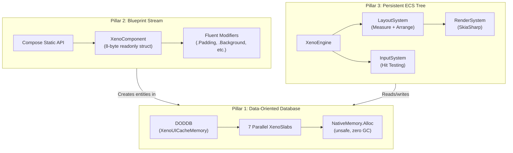
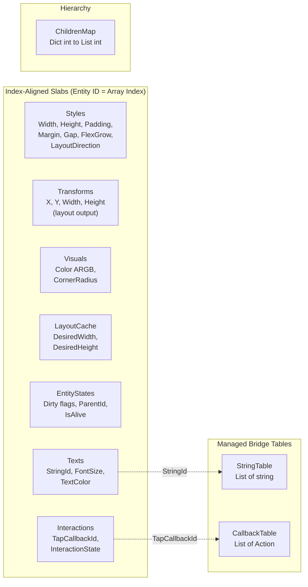
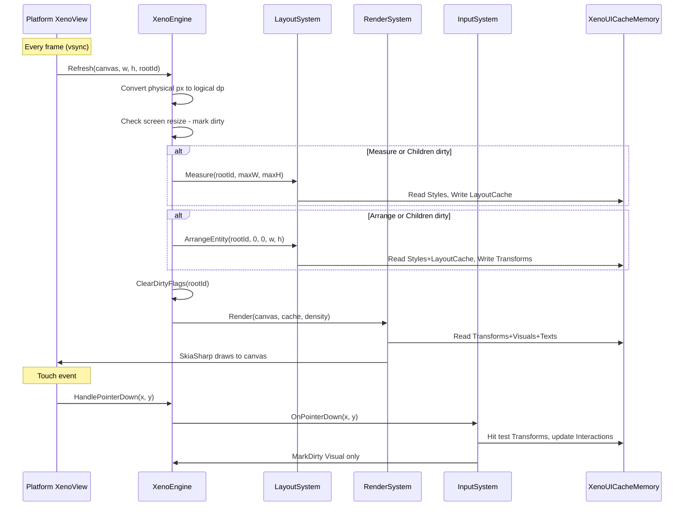
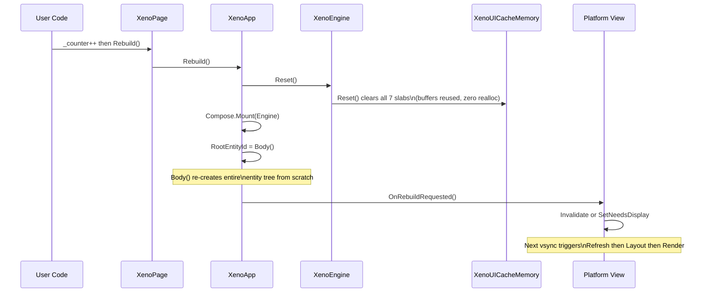

# XenoUI Architecture Deep Dive

> **Superseded document.** This document is kept for historical traceability and may describe an earlier state. The current reference is the [architecture module](architecture/index.md). In case of contradiction, the code, the tests and this new module prevail.

This document provides a comprehensive technical reference for the XenoUI rendering engine internals.

---

## The Three Pillars

XenoUI is built on three foundational pillars that work together to deliver a zero-GC, high-performance UI framework.



---

## Pillar 1: Data-Oriented Database (DODDB)

### XenoSlab — The Arena Allocator

At the heart of XenoUI is `XenoSlab<T>`, an unsafe slab allocator that stores UI component data in contiguous native memory.

```csharp
public unsafe class XenoSlab<T> : IDisposable where T : unmanaged
{
    private T* _buffer;          // Raw pointer — NativeMemory.Alloc
    private int _capacity;       // Current buffer size
    private int _count;          // Elements in use

    // Direct pointer access — zero copy, zero GC
    public ref T Get(int index) => ref _buffer[index];

    // Append — auto-resizes (2x doubling)
    public int Push(T value);

    // Arena reset — reuse buffer, zero reallocation
    public void Clear() => _count = 0;
}
```

**Why native memory?** By bypassing the .NET managed heap entirely, XenoUI eliminates GC pauses. The `ref T Get()` return allows direct in-place mutation of struct data without copying to the stack.

### XenoUICacheMemory — The Component Database

All UI state lives in 7 parallel, index-aligned slabs:



**Entity creation** pushes to ALL 7 slabs simultaneously, keeping indices aligned:

```csharp
public int CreateEntity(StyleComponent style, VisualComponent visual)
{
    int id = Styles.Push(style);      // id = index in all slabs
    Transforms.Push(default);          // zeroed — filled by layout
    LayoutCache.Push(default);         // zeroed — filled by measure
    Visuals.Push(visual);
    EntityStates.Push(new EntityState { Dirty = All, ParentId = -1, IsAlive = true });
    Texts.Push(new TextComponent { StringId = -1 });         // no text
    Interactions.Push(new InteractionComponent { TapCallbackId = -1 }); // not interactive
    return id;
}
```

### Memory Layout Visualization

```
Native Memory Block (XenoSlab<StyleComponent>):
┌────────┬────────┬────────┬────────┬─── ─ ─ ─ ─ ───┬────────┐
│ Entity │ Entity │ Entity │ Entity │                 │ (free) │
│   0    │   1    │   2    │   3    │  ... _count     │capacity│
└────────┴────────┴────────┴────────┴─── ─ ─ ─ ─ ───┴────────┘
    ▲                                       ▲              ▲
    │                                       │              │
  Get(0)                                 _count        _capacity
  returns ref                       (Clear() resets     (Resize()
  to this slot                        to 0, buffer       doubles)
                                      stays alive)
```

---

## Pillar 2: Blueprint Stream (Compositor)

### XenoComponent — The 8-Byte Handle

```csharp
public readonly struct XenoComponent   // 8 bytes, stack-allocated
{
    internal readonly int Id;           // Entity ID in ECS
    private readonly bool _valid;       // false = None (conditional skip)

    public bool IsNone => !_valid;
    public static XenoComponent None => default;   // sentinel
    public static implicit operator int(XenoComponent c) => c.Id;
}
```

Every modifier mutates slab data **in-place** via `ref` returns and returns `this` for chaining:

```csharp
// This chain creates ONE entity, mutates it 4 times — zero allocations
Box(200, 100)
    .Background(0xFF2196F3)    // mutates VisualComponent slab
    .CornerRadius(12)          // mutates VisualComponent slab
    .Padding(16)               // mutates StyleComponent slab
    .Clickable(() => count++)  // stores Action in CallbackTable
```

### How Modifiers Work (Under the Hood)

```csharp
public XenoComponent Padding(float all)
{
    if (IsNone) return this;                      // no-op on None
    ref var s = ref Compose.Engine.GetStyle(Id);  // ref into native slab
    s.PaddingLeft = s.PaddingTop = s.PaddingRight = s.PaddingBottom = all;
    Compose.Engine.MarkDirty(Id, LayoutDirtyFlags.Measure | LayoutDirtyFlags.Arrange);
    return this;  // enables chaining
}
```

**Key insight**: `ref var s = ref ...GetStyle(Id)` returns a **pointer** into the native slab. The assignment `s.PaddingLeft = all` writes directly to native memory — no struct copy, no allocation.

### Compose — The Static Factory

```csharp
public static class Compose
{
    internal static XenoEngine Engine;  // bound once at startup

    // params ReadOnlySpan<T> — C# 13, stack-allocated, zero GC
    public static XenoComponent Column(params ReadOnlySpan<XenoComponent> children);
    public static XenoComponent Row(params ReadOnlySpan<XenoComponent> children);
    public static XenoComponent Box(float width = 0, float height = 0);
    public static XenoComponent Text(string text, float fontSize = 14f);
    public static XenoComponent Spacer();  // FlexGrow(1)
}
```

`Compose` is imported as `using static` globally via `Sdk.props`, so developers write:

```csharp
public override XenoComponent Body() =>
    Column(
        Text("Hello XenoUI").FontSize(24).TextColor(0xFFFFFFFF),
        Row(
            Box(80, 80).Background(0xFFE91E63).CornerRadius(12),
            Spacer(),
            Box(80, 80).Background(0xFF2196F3).CornerRadius(12)
        ).Gap(16)
    ).Padding(24).Background(0xFF121212);
```

---

## Pillar 3: The Engine & Systems

### XenoEngine — The Orchestrator



### Two-Pass Layout Algorithm

The layout system implements a flexbox-inspired two-pass algorithm:

#### Pass 1: Measure (Bottom-Up)

```
Recursively compute desired sizes for each entity:

1. Leaf nodes:
   - Text: use SKFont.MeasureText() → (width, height)
   - Box: use explicit Width/Height from StyleComponent
   - No children? DesiredSize = explicit size or 0

2. Container nodes:
   - Main axis: sum of children's desired sizes + gaps
   - Cross axis: max of children's desired sizes
   - Apply padding to content size
   - Explicit style size takes priority over auto-content

3. Write results to LayoutCache slab:
   - LayoutCache.DesiredWidth
   - LayoutCache.DesiredHeight
```

#### Pass 2: Arrange (Top-Down)

```
Recursively assign positions and final sizes:

1. Root gets full screen bounds (0, 0, screenWidth, screenHeight)
2. Compute inner content box (subtract padding)
3. Calculate free space along main axis:
   freeSpace = available - totalContentSize - totalGaps
4. Distribute free space:
   - FlexGrow > 0: proportional distribution
   - MainAxisAlignment: Start|Center|End|SpaceBetween|SpaceAround|SpaceEvenly
5. Cross-axis placement per child:
   - AlignSelf overrides parent's CrossAxisAlignment
   - Stretch: expand to fill cross dimension
6. Write final bounds to TransformComponent slab:
   - Transform.X, Transform.Y, Transform.Width, Transform.Height
7. Recurse into children
```

### Supported Layout Properties

| Property | Type | Description |
|---|---|---|
| `LayoutDirection` | `Vertical` \| `Horizontal` | Main axis direction |
| `MainAxisAlignment` | `Start` \| `Center` \| `End` \| `SpaceBetween` \| `SpaceAround` \| `SpaceEvenly` | Distribution along main axis |
| `CrossAxisAlignment` | `Start` \| `Center` \| `End` \| `Stretch` | Placement along cross axis |
| `AlignSelf` | same as CrossAxis | Per-child override |
| `FlexGrow` | `float` | Proportional free-space distribution |
| `Gap` | `float` | Spacing between children (dp) |
| `Padding` | 4-sided `float` | Inner spacing |
| `Margin` | 4-sided `float` | Outer spacing |

### Dirty Flag System

```csharp
[Flags] public enum LayoutDirtyFlags : byte
{
    None     = 0,
    Measure  = 1,   // size changed → re-measure
    Arrange  = 2,   // position changed → re-arrange
    Visual   = 4,   // color/visual only → skip layout entirely
    Children = 8,   // child added/removed
    All      = Measure | Arrange | Children  // Visual excluded!
}
```

**Propagation rules:**
- Layout-affecting flags (`Measure`, `Arrange`, `Children`) propagate **UP** the parent chain via `MarkDirty()`
- `Visual` flags stay **LOCAL** — zero layout cost for color changes
- Engine conditionally skips Measure/Arrange passes when the subtree is clean

```
Example: Changing a button color

Button.Background(0xFFFF0000)
  → MarkDirty(buttonId, Visual)
  → Only Visual flag set — NO propagation to parent
  → Next frame: Measure skipped ✓, Arrange skipped ✓, Render runs ✓

Example: Changing padding

Button.Padding(20)
  → MarkDirty(buttonId, Measure | Arrange)
  → Propagates up to parent, grandparent, root
  → Next frame: Measure runs, Arrange runs, Render runs
```

### Input System — Hit Testing

The input system uses **reverse-iteration** (highest entity ID first = top-most Z-order) for correct hit testing:

1. **PointerDown**: Reverse-scans all entities, finds first interactive entity (`TapCallbackId >= 0`) whose `TransformComponent` bounds contain the pointer. Sets `InteractionState.Pressed`, marks `Visual` dirty.
2. **PointerUp**: Resets to `Idle`, fires tap callback if pointer still inside bounds.
3. **Press feedback**: `RenderSystem` darkens the entity color by 15% while `Pressed` — automatic with no developer code needed.

---

## Rebuild Pipeline

Every state change triggers a full declarative rebuild:



**Why no virtual DOM diffing?** It's not needed because:
1. `Slab.Clear()` just sets `_count = 0` — the native memory buffer is reused
2. Entity creation is a series of `Push()` calls into pre-allocated arrays
3. The full rebuild of ~100 entities costs microseconds

---

## Rendering Pipeline

The `RenderSystem` performs a linear scan of all entities:

```
For each entity 0..EntityCount:
  ├── Skip if !IsAlive
  ├── Read Transform × density → physical pixels
  ├── If Pressed → darken color 15%
  ├── Skip if alpha == 0 (fully transparent)
  ├── CornerRadius > 0? → DrawRoundRect : DrawRect
  ├── Has text (StringId >= 0)?
  │   └── DrawText with cached SKFont (centered vertically)
  └── Debug mode? → Draw cyan bounds + entity index
```

**Performance optimizations:**
- `SKPaint` objects cached by color (reused across frames)
- `SKFont` objects cached by font size (rounded to 0.5dp to bound cache growth)
- Fully transparent entities skipped entirely
- Press feedback uses color math only — no texture/layer operations

---

## Component Structs (ECS Data)

All component types are `unmanaged` structs stored in `XenoSlab<T>`:

```csharp
// Style — 17 fields, controls layout behavior
public struct StyleComponent
{
    public float Width, Height;
    public uint BackgroundColor;
    public float MarginLeft, MarginTop, MarginRight, MarginBottom;
    public float PaddingLeft, PaddingTop, PaddingRight, PaddingBottom;
    public float Gap, FlexGrow;
    public LayoutDirection LayoutDirection;
    public MainAxisAlignment MainAxisAlignment;
    public CrossAxisAlignment CrossAxisAlignment, AlignSelf;
}

// Transform — output of layout, input to render
public struct TransformComponent { public float X, Y, Width, Height; }

// Visual — rendering properties
public struct VisualComponent { public uint Color; public float CornerRadius; }

// EntityState — lifecycle metadata
public struct EntityState
{
    public LayoutDirtyFlags Dirty;
    public int ParentId;   // -1 = root
    public bool IsAlive;
}

// Text — references StringTable by ID
public struct TextComponent
{
    public int StringId;   // -1 = no text
    public float FontSize;
    public uint TextColor;
}

// Interaction — references CallbackTable by ID
public struct InteractionComponent
{
    public int TapCallbackId;  // -1 = not interactive
    public InteractionState State;  // Idle, Pressed, Hovered
}
```
