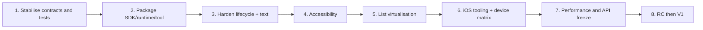

# Decisions, stability and the V1 trajectory

[Architecture](index.md) · [Runtime](runtime.md) · [Text and NativeTunnel](text-input-and-native.md) · [Tooling and platforms](tooling-and-platforms.md)

This document turns the repository audit into explicit decisions. It does not replace a backlog: it sets the invariants, the risks and the logical order of the work needed for a credible V1.

## 1. Structuring decisions

### ADR-001 — Rendering controlled by XenoUI

**Decision.** Visual components are composed, laid out and drawn by XenoUI/Skia rather than delegated to a tree of native widgets.

**Reason.** Cross-platform consistency, full customisation and a data-oriented representation.

**Consequences.** XenoUI must provide layout, rendering, hit-testing, semantics and accessibility. It cannot inherit every native widget convention for free.

### ADR-002 — Hidden native IME, custom text rendering

**Decision.** `EditText`/`UITextView` stay invisible and serve as IME clients; XenoUI paints the text, caret and selection.

**Reason.** Native input protocols are complex and already proven, while the product requires strong customisation.

**Consequences.** Snapshot/version/geometry must stay atomic. Accessibility and multilingual tests become priorities.

### ADR-003 — Typed NativeTunnel

**Decision.** Every OS capability goes through an `INativeCapability` interface with no platform types in Core.

**Reason.** Preserve boundaries, testability and independent evolution of the hosts.

**Consequences.** Each contract must document support, thread, lifetime, permissions, errors and cancellation.

### ADR-004 — Correctness-first total rebuild

**Current decision.** Structural changes replace the whole ECS tree under a lock. Reactive text updates can be fine-grained.

**Reason.** A simple, deterministic model, already protected against exposing a partial tree.

**Consequences.** No automatic keyed identity, cost proportional to the tree and a risk if a transient entity leaks. Any future incremental recomposition must first preserve the existing atomicity.

### ADR-005 — Internal layout today, Yoga evaluated through an adapter

**Decision.** The current runtime stays the source of truth; Yoga is not announced as a capability. Any adoption goes through an interchangeable backend and a conformance suite.

**Reason.** Yoga may reduce the cost of maintaining flex, but a direct migration would put text measurement, scrolling and the ECS representation at risk.

### ADR-006 — The CLI as the source of truth for devices in XenoUI extensions

**Decision.** VS Code delegates discovery/launch to `xeno`. Visual Studio still uses its standard pipeline for lack of a dedicated extension.

**Reason.** Avoid duplicating ADB, ABI and build in each IDE.

## 2. Current guarantees and non-guarantees

### Guarantees backed by code/tests

- the replaced tree is published atomically under the engine lock;
- old reactive subscriptions are invalidated by version;
- registered pages are reused and their fields persist;
- scrolling is bounded and stops without overflow;
- the text controller validates selection/composition and keeps undo/redo;
- Android picks a RID from the ABI before build/install;
- a target that is not online is not launched;
- `Xeno.SDK` and the runtimes are consumed from nuget.org, without relative imports or source references;
- generated manifests stay under `obj` and custom files are preserved.

### Pre-V1 non-guarantees

- source/binary compatibility between commits;
- total absence of allocation/GC per frame;
- absence of churn/allocation when materialising new items (common items are now kept by key/index);
- complete accessibility;
- simultaneous multi-window/multi-engine;
- iOS CLI support;
- a complete IDE/macOS matrix and the Visual Studio extension published on the Marketplace;
- identical behaviour across all IMEs, languages and hardware keyboards;
- stability of NativeTunnel APIs beyond the current contracts.

## 3. Technical debt and risks

| Priority | Debt/risk | Impact | Closing criterion |
|---|---|---|---|
| P0 | macOS/IDE validation of Xeno.SDK | preview published on nuget.org, but the IDE/macOS matrix is not validated | `{{ xeno_version }}` published on nuget.org; a fresh application compiled to an Android APK from nuget.org alone (13 October 2026); finalise the matrix and publish the Visual Studio extension |
| P0 | no CI/validated iOS runtime | fragile cross-platform promise | iOS build + tests + smoke on macOS |
| P0 | no semantic accessibility | application not inclusive/not publishable | semantic tree tested with TalkBack/VoiceOver |
| P0 | native APIs/resources and late callbacks | navigation or teardown crash/UAF | generation, dispose and back stress tests |
| P1 | lazy materialisation with new texts still allocates | A15: about 80 B/frame progressive; GL stress with 2,700 jumps: 5,040.11 B/frame and 3 Gen0 GCs in ~30 s; constant label at 0 B/GC on GL alternating jumps but 0.73 B/random CPU jump unexplained | attributed profiling of misses/complex trees + GC pause and presentation traces |
| P1 | global static composition | multi-engine not safe | explicit context or an enforceable constraint |
| P1 | total rebuild | cost and churn on large screens | metrics + a safe keyed/subtree strategy |
| P1 | limited TextInput styling | inflexible API | documented style/theme object |
| P1 | Android-only CLI | iOS not integrated | iOS provider and a common devices contract |
| P1 | fine-grained incrementality of SDK manifests | XML task re-evaluated on each build | richer inputs/outputs and diagnostics; generation under `obj` and no source modification already covered |
| P2 | home-grown layout engine without documented conformance | complex flex cases | conformance suite + Yoga decision |
| P2 | prototype VS Code extension | fragile DX | Extension Host tests, publishing/versioning |
| P2 | no dedicated Visual Studio extension | XenoUI tooling not unified | product decision + prototype if needed |
| P2 | PC and A15 CPU/GL thread baselines available; presentation/sustained memory open | presented FPS and memory stability in prolonged use not proven | GPU/presentation/memory traces + other physical devices |

The [A15 reference of 5 October 2026](../runtime-benchmark-a15.md) keeps the baseline and the post-fix series: reduced allocations, zero bytes in the prepared GL diagnostic, no GC in the new short windows, but no global guarantee. The [PC baseline](../runtime-benchmark.md) remains comparative. These measurements close neither the gate for really presented FPS, nor the one for sustained native memory, nor the global "zero-GC" guarantee. The associated Release regression suite passes 100/100 tests.

## 4. Recommended V1 plan

### Phase 1 — Verifiable baseline

- classify public vs internal API;
- turn historical bugs into regression tests;
- add navigation/rebuild/dispose and scroll stress tests;
- define the .NET/Android/iOS matrix;
- make Windows + macOS CI mandatory.

### Phase 2 — Distribution

- produce consistent Core, StandardLibrary, Android, iOS, SDK, Tooling and template packages;
- remove absolute repo/Debug paths;
- create a fixture consumer project outside the solution;
- version the CLI JSON schema;
- document install/update/uninstall.

### Phase 3 — Runtime robustness

- audit resource owners and generation callbacks;
- remove the implicit dependency on the static engine or enforce single-engine;
- test rotate/resume/background/teardown;
- complete the IME and hardware keyboard matrix;
- make text/field styles public without breaking the native tunnel.

### Phase 4 — Accessibility

- design semantic IDs that are stable across rebuilds;
- map roles/actions/bounds;
- integrate TalkBack/VoiceOver and automatable manual tests;
- define keyboard focus and switch navigation.

### Phase 5 — Truly lazy lists

- mandatory or optional keyed identity;
- visible window + overscan;
- scroll-triggered rewindow without an empty tree;
- variable measurement and estimate correction;
- safe recycling without keeping stale IDs;
- tests for jumps, prepend/delete, empty content, resize and high velocity.

### Phase 6 — Platform/tooling parity

- iOS simulator/device provider;
- launch/debug/logs;
- VS Code/CLI consistency;
- a clearly supported Visual Studio workflow or a dedicated extension;
- sample validation on real devices.

### Phase 7 — Freeze and release candidate

- benchmarks of frame time, rebuild, memory, first input and large lists;
- API review of names/nullability/exceptions/threading;
- changelog and migration guide;
- semver/support policy;
- audit of permissions, secret logging and package supply chain.

## 5. Future recomposition: design constraints

Studying Compose/SwiftUI does not mean reproducing their surface. The real need is to reduce cost without losing the guarantees.

An acceptable proposal must define:

- node identity (position, type, explicit key);
- ownership of subscriptions/controllers/resources;
- measure/render invalidation;
- transactions that publish a consistent tree;
- navigation and persistent pages;
- interaction with reallocatable slabs;
- behaviour when composition throws;
- tooling/debugging of identity and recompositions.

Recommended approach: measure the total rebuild first, introduce keys for lists, then experiment with subtree replacement behind an internal API. Do not expose a positional hooks system until multi-rebuild identity is formally tested.

## 6. Allowed extension points

- composed widget in `XenoUI.StandardLibrary` without a new engine primitive;
- Core primitive only if layout/render/input need new data;
- `INativeCapability` for an OS service;
- paragraph/layout backend behind an interface;
- device provider in Tooling;
- IDE adapter consuming the CLI/MSBuild contracts.

Avoid:

- conditional platform calls in pages;
- callbacks storing a `XenoComponent`;
- an additional global service locator;
- an IDE JSON format distinct from the CLI's;
- an undocumented magic MSBuild property;
- a cache without version/owner/dispose.

## 7. Definition of Done for a framework feature

- contract and supported platforms made explicit;
- unit/regression tests and at least one boundary test;
- lifetime, threading, permissions and errors documented;
- no platform type in Core;
- dispose/late callback handled;
- sample updated if the feature is visible;
- developer guide and architecture kept in sync;
- build commands actually run;
- remaining limitations recorded here.

## 8. Compatibility and governance

Before V1, announce every breaking change. From the first packed preview:

- apply SemVer to the aligned packages;
- define a stability level (`experimental`, `preview`, `stable`) per namespace/API;
- deprecate before removing whenever possible;
- maintain a changelog and migration guides;
- publish the .NET SDK/workload/OS matrix;
- keep ADRs in this module or a dedicated folder, linked to the PRs.

V1 must not mean "every feature", but an honest core that is installable, accessible, testable and compatible with the published matrix.
