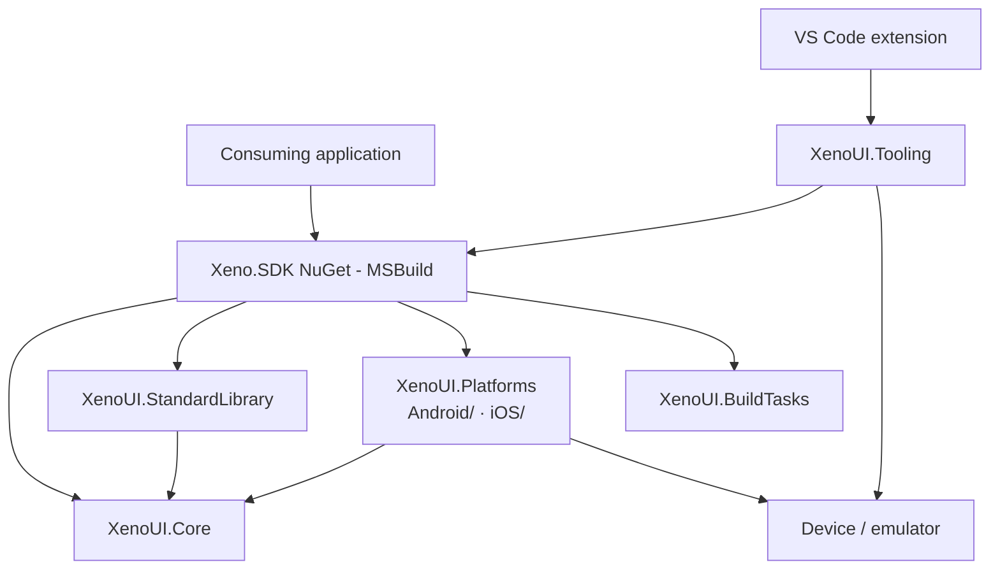
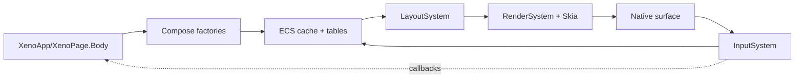
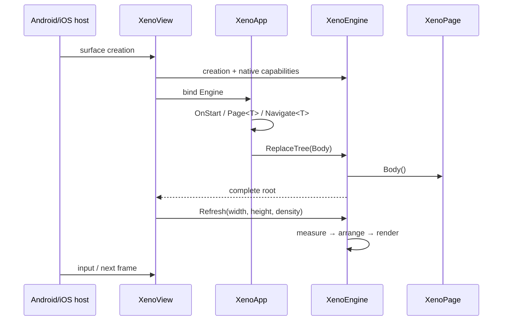

# XenoUI architecture

[Docs index](../index.md) · [Developer guide](../developer-guide.md) · [V1 decisions](decisions-v1.md)

This module is the framework's architecture reference. It describes the boundaries actually present in the repository, the invariants contributions must preserve and the gaps to close before V1.

## Module map

- [Runtime, composition, layout and rendering](runtime.md)
- [Navigation, ECS scenes and the frame path](navigation-and-scenes.md)
- [Paragraphs, TextInput, IME and NativeTunnel](text-input-and-native.md)
- [SDK, Android/iOS, CLI, Visual Studio and VS Code](tooling-and-platforms.md)
- [Decisions, stability, debt and the V1 trajectory](decisions-v1.md)

## Architecture goals

1. A compact, customisable declarative C# API.
2. Consistent rendering controlled by XenoUI, independent of native visual widgets.
3. Native system services kept behind typed contracts.
4. A predictable frame path: composition, measure, arrange, render, input.
5. Data-oriented memory for hot components, without prematurely promising zero allocation everywhere.
6. Strict separation between runtime, platform integration, SDK build, device tooling and IDE extensions.

## Project map

| Project/area | Responsibility | Must not contain |
|---|---|---|
| `XenoUI.Core` | composition, ECS/cache, layout, rendering, abstract input, text, native contracts | Android/UIKit types, CLI/IDE orchestration |
| `XenoUI.StandardLibrary` | reusable composed widgets and icons | host lifecycle or direct OS calls |
| `XenoUI.Platforms/Android` (`net10.0-android`) | Skia surface, Activity/View lifecycle, Android IME/clipboard, native back | cross-platform application policy |
| `XenoUI.Platforms/iOS` (`net10.0-ios`) | UIKit/Skia surface, UIView lifecycle, iOS IME/clipboard | cross-platform application policy |
| `XenoUI.BuildTasks` | deterministic MSBuild generation | device detection or UI runtime |
| `Xeno.SDK` | MSBuild project experience, NuGet references, entry points, assets | runtime logic |
| `XenoUI.Tooling` | out-of-process devices and launching | rendering or application state |
| VS Code extension | `[Preview]` previews, templates, device selection and launching | duplicating the ADB/build logic |

## Runtime overview

The runtime does not build a durable tree of widget objects. Factories create integer entities and fill parallel slabs. Parent/child relations and managed data stay in side tables. After a rebuild, previous IDs and `XenoComponent`s are invalid.

## Application lifecycle

Pages are created once and reused. Page fields carry durable state. The host detaches the application and releases the engine when it is destroyed.

## Application / framework boundary

Main public contract:

- `XenoApp.OnStart`, `Page<T>`, `Navigate<T>`, `GoBack`, `TryGoBack`, `Body`, `Native`;
- `XenoPage.Body`, `Rebuild`, `Navigate<T>`, `GoBack`;
- `Compose` factories and `XenoComponent` modifiers;
- `State<T>`, `ScrollState`, `LazyListState`, `TextEditController`, created by the `UseState`, `UseStates`, `UseScroll`, `UseLazyList`, `UseTextEdit` hooks;
- option factories `InputOptions`, `Selection`, `Caret`, `Glyph`: the DSL does not require `new`;
- `NativeTunnel` contracts meant for controlled extensions.

Internal contracts not to expose as stable API: entity IDs, slabs, cache tables, paragraph nodes, tree generation, platform view implementations and scrolling heuristics.

## Cross-cutting contribution rules

- An entity ID is only valid for the tree version that created it.
- A native/asynchronous callback must be cancellable or carry a generation/version.
- Measure, arrange, paragraph shape and selection must come from a consistent snapshot.
- A native resource has an explicit owner and release point.
- The UI thread drives the platforms; the engine protects the tree, but that lock does not turn every API into a concurrent API.
- An OS capability goes through `NativeTunnel`; it does not leak into Core.
- Tooling drives build and devices out of process; it must not be loaded into the application.
- Any new compatibility or performance promise must get a test/benchmark and documentation.

## Read next

The critical flow and the memory invariants are detailed in [runtime.md](runtime.md). The part most sensitive to races and platform differences is described in [text-input-and-native.md](text-input-and-native.md). Build/IDE/device responsibilities are in [tooling-and-platforms.md](tooling-and-platforms.md).
