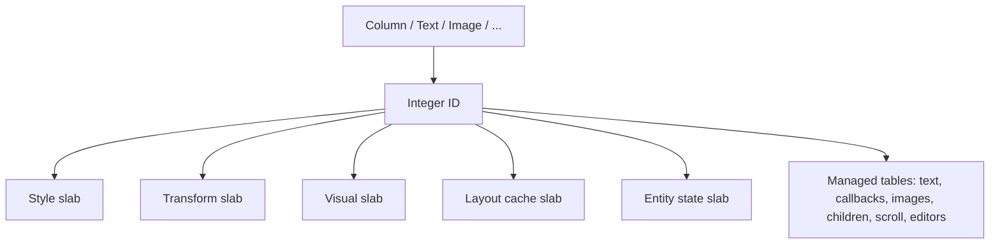
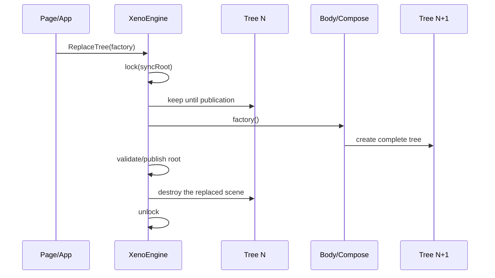
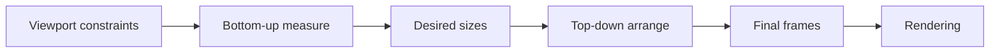
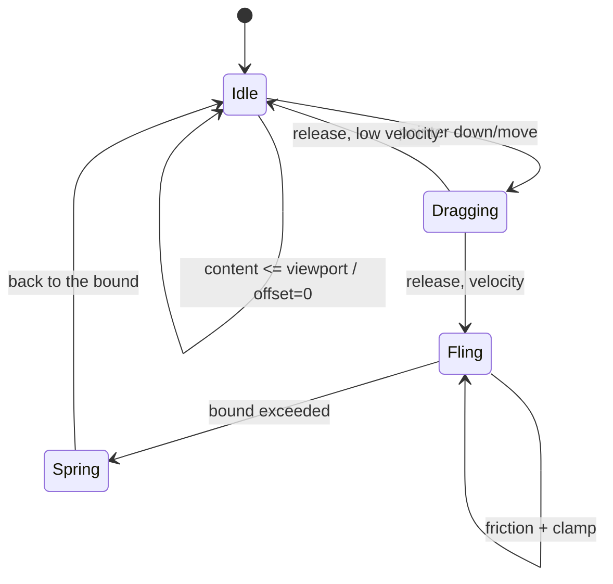
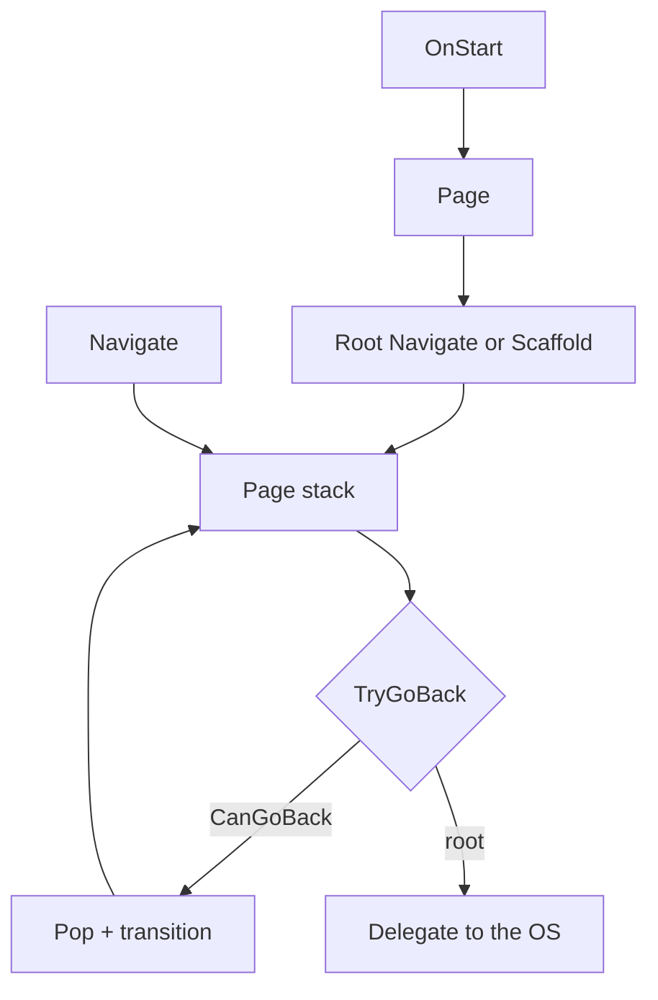

# Runtime, composition, layout and rendering

[Architecture](index.md) · [Text and NativeTunnel](text-input-and-native.md) · [Tooling and platforms](tooling-and-platforms.md) · [V1 decisions](decisions-v1.md)

## 1. The engine

`XenoEngine` aggregates:

- `XenoUICacheMemory`, storage of the current tree;
- `LayoutSystem`, measure and arrange;
- `RenderSystem`, Skia drawing;
- `InputSystem`, hit-testing, gestures, clicks and scrolling;
- the paragraph engine and text editing coordination;
- the consistency lock, current root, tree version and subscriptions.

The engine receives a physical size and a density from the host. Layout works in logical units; rendering converts to the surface.

## 2. Composition and data-oriented representation

`Compose.Mount(engine)` temporarily binds the static factories to the engine. Each factory:

1. allocates an ID;
2. writes the base components;
3. registers any managed data;
4. attaches the children;
5. returns a lightweight `XenoComponent` containing the ID.

Modifiers rewrite the components associated with that ID before the composition ends.

`XenoSlab<T>` slabs use a contiguous native region, double their capacity when needed and reuse memory after `Clear`. A borrowed reference becomes invalid after `Push`, `Clear` or `Dispose`; it must never be cached in a long-lived object.

The historical "zero-GC" wording must be understood as a goal of reduced GC pressure on hot data. Managed tables, delegates, strings, pages, controllers and composition operations may allocate. The measurements published below only cover specific scenarios, not every execution path.

### A15 mobile baseline before the allocation fix — 5 October 2026

Samsung SM-A155F, Android 16/API 36, .NET 10.0.12, Release without AOT/trimming. On the 1080 × 2340 OpenGL surface (density 2.8125), 120 warm-up frames then 300 measurements per scenario:

| Scenario | Mean CPU `Refresh` | p95 | Managed bytes/Refresh |
|---|---:|---:|---:|
| Stable, 100 texts | 1.174 ms | 2.177 ms | 0 |
| Navigation, two scenes of 100 texts | 6.484 ms | 8.351 ms | 0 |
| Lazy 10,000 items, still | 0.447 ms | 0.829 ms | 0 |
| Progressive lazy, 16 dp/frame | 0.636 ms | 1.369 ms | 146.67 |

The same CPU scenarios as on PC were re-run on the A15: Lazy jumps allocate 11,365.94 B/op and caused three Gen0 GCs. The mean cadence of GL callbacks is close to 11.1 ms under the observed 90 Hz display mode, but presentation timestamps and GPU cost are not measured. The run ended with Android thermal status 2; this condition is part of the baseline, not a universal guarantee. [A15 report, startup and methodology](../runtime-benchmark-a15.md).

After reusing the materialisation log and the measurement font: GL scroll with new texts **80 B/frame**, p95 **0.920 ms**; CPU jumps **4,880.30 B/op**. The diagnostic with an already rendered constant label allocates **0 B** in GL scroll and alternating jumps, but random CPU jumps keep **0.73 B/op unexplained**. No GC in the new short windows. The phone reached thermal status 3; do not attribute every timing variation to the code. The Core suite passes 100/100 tests. New texts, complex builders, cache misses and native allocations remain outside any global zero-GC guarantee. See the [corrected series and its limits](../runtime-benchmark-a15.md#6-allocation-fix--new-a15-series).

### Comparative PC baseline — 5 October 2026

Release, .NET 10.0.12, Windows x64, CPU Skia, 360 × 800 at density 1. Three series of 500 operations after 200 warm-up operations per series, tiered compilation disabled.

| Scenario | Mean | p95 | Managed bytes/operation |
|---|---:|---:|---:|
| Stable frame, 100 texts | 0.096 ms | 0.214 ms | 0 |
| Two navigation scenes, 100 texts each | 0.967 ms | 2.051 ms | 0 |
| Lazy 10,000 items, stable window | 0.057 ms | 0.086 ms | 0 |
| Lazy, progressive 16 dp move | 0.047 ms | 0.119 ms | 144 |
| Lazy, jump to a disjoint window | 0.169 ms | 0.325 ms | 11,325.93 |
| 1,000 evaluations of a compiled transition | 0.071 ms | 0.089 ms | 0 |

No scene/item construction was observed while measuring stable frames; progressive scrolling built 500 items over 1,500 operations. The cold/hot path separation therefore does not remove the GC pressure of materialisation during a scroll. No GC collection was observed in these short windows, but that does not guarantee the absence of GC in prolonged use.

Simulating one second of scrolling shows a 0.001953125 dp gap between 60 and 120 Hz steps. This numeric check is not a physical 120 Hz smoothness test.

Allocations are those of the measured thread, excluding Skia native memory. Timings include CPU rendering, not mobile presentation/GPU. No before/after gain or FPS commitment is derived from this baseline. [Full report and reproduction](../runtime-benchmark.md).

## 3. Atomic rebuild

The first build calls `XenoEngine.ReplaceTree`. A rebuild then only replaces the active scene with `ReplaceActiveTree`. An animated navigation publishes an incoming scene while temporarily retaining the outgoing scene.

Measure, render, refresh and coordinated updates use the same lock. A frame must therefore see the complete old tree or the new one, never a partially rebuilt tree.

### Invariants

- `_treeVersion` changes on reset; subscriptions capture their version and ignore stale callbacks.
- The root is only published after a successful composition.
- Durable objects stay out of the transient cache: page, `State`, `ScrollState`, `TextEditController`.
- A `XenoComponent` must not outlive `Body()`; only its logical description can be rebuilt.

### Current limit

There is no keyed diff or subtree recomposition in the style of Compose/SwiftUI. A structural change replaces the whole tree. `Text(State<T>)` bindings are a separate fine-grained optimisation: they update the text and dirty flags without `Body()`.

Since `Compose.Engine` is a static mount, several engines composing simultaneously in the same process is a risk area. The V1 target must introduce an explicit context or guarantee/enforce the single-engine model.

## 4. Dirty flags and fine-grained updates

Three categories drive the work:

- `Measure`: desired size potentially changed;
- `Arrange`: final position/size to recompute;
- `Visual`: redraw without a geometric change.

A text change may need all three. A selection/caret only changes the visual. Geometric flags propagate to ancestors; a purely visual change stays local as far as possible.

The mechanism is incremental within one tree version, but an explicit rebuild stays total.

## 5. Layout pipeline

The layout engine is an internal flex-like implementation. It is not Yoga today.

Supported concepts:

- `Column`, `Row`, `ZStack` directions, vertical/horizontal scroll;
- explicit or content-derived size;
- padding, margin, gap;
- `FlexGrow` to distribute the remaining space;
- main/cross axes and `AlignSelf`;
- text and images at natural size;
- a finite viewport for scrollable containers.

For a flex child without an explicit size on the main axis, the basis is zero. This prevents, for example, a `LazyColumn().FlexGrow(1)` from claiming its whole content extent as its viewport.

### Why Yoga is still being considered

A native Yoga port could reduce algorithmic risk, align flex measurements with a proven engine and avoid a long rewrite. But it does not replace:

- paragraph/image integration;
- density conversions and host constraints;
- scroll/viewport;
- the ECS representation;
- atomic snapshots and rendering.

Any adoption must go through an adapter and a conformance suite comparing the old/new engine, not through a silent mix of the two.

## 6. Rendering and resources

`RenderSystem` walks the arranged tree and draws on a Skia canvas: backgrounds, corners, shadows, text, images, selections and carets. Scrollable containers add clipping and translation. Input applies the inverse transform so that hit-testing and rendering stay aligned.

Transient data is cleared on every tree replacement. Image and font caches survive rebuilds for the engine's lifetime. `Dispose` releases images, typefaces, paragraphs and native memory.

### Resource ownership

| Resource | Owner | Lifetime |
|---|---|---|
| ECS slabs | `XenoUICacheMemory` | engine |
| entities/components | current tree | until the next reset |
| decoded images/fonts | resource tables | engine/host app |
| text input paragraphs | node/engine | relevant version/layout |
| surface/canvas | platform host | view/native surface lifecycle |

Additions must stay idempotent on destruction: timer/frame callbacks must no longer touch a disposed engine.

## 7. Input and hit-testing

The host converts native events into logical coordinates, then delegates to `InputSystem`. It:

- hit-tests from the visual top down;
- respects clipping, scroll translation and arranged bounds;
- drives press/release and `Clickable`;
- recognises drag/fling for `ScrollState`;
- routes tap/long press/drag to the active text editor.

An interaction that requests a new frame marks the host for invalidation. The host must not assume that a single frame finishes an animation.

## 8. Scrolling

`ScrollState` is a persistent model bound to a scrollable entity on each composition. It holds offset, velocity, extent, viewport, direction, overscroll and item range.

Correctness invariants:

- `maxOffset = max(0, contentExtent - viewportExtent)`;
- without overflow, offset and velocity fall back to zero;
- after a content/viewport change, the offset is clamped;
- `NeedsAnimationFrame` becomes false when the motion is over;
- rendering and input share exactly the same translation.

`LazyColumn<T>`/`LazyRow<T>` only materialise the viewport and an overscan of about one viewport. `LazyListState` maintains a prefix index (Fenwick trees): unknown sizes use the learned average, then each layout replaces the estimate with the real measurement. Offset correction keeps the visible item as the anchor during this learning. The first live child is always placed at its estimated global coordinate, even if its index is not zero.

When a window leaves the overscan, the engine builds the next detached window, then swaps it in under the tree lock. The old window's entities, strings, callbacks and subscriptions are released and their slots reused. The viewport's `ScrollState` stays intact during the swap. A stable key remembers the size per logical identity when the source is replaced or reordered. The old indexed overloads with an estimate remain a non-virtualised compatibility path.

Without an explicit state, the engine binds the `LazyListState` to the call site (`file`, member and line, with a local ordinal). This identity survives rebuilds of the same screen without mixing up the lists of different pages. A change of orientation on an explicit state resets the offset to zero.

## 9. State and lifetime

### Pages

`Page<T>()` instantiates a page and registers it. `Navigate<T>()` pushes the same instance onto the stack. The state of its fields persists, including while another page is on top.

### `State<T>`

The setter compares the values, then raises `OnChanged`. The engine registers a versioned subscription for each reactive text. Reset releases the old subscriptions.

### Persistent models

`ScrollState` and `TextEditController` keep a stable identity across trees. The current entity attaches to them during `Body()`. This is the central rule for not losing offset, input or selection.

## 10. Navigation

Android connects this contract to the native mechanism matching the OS version. iOS does not yet have an integrated navigation controller/interactive pop: the logical stack works, but the full native gesture remains a debt item.

`NavigationScaffold` keeps one stack per destination. Switching BottomBar/Rail/Drawer does not recreate these stacks. Multi-scene technical details and the cold/hot path boundary are in [Navigation, ECS scenes and the frame path](navigation-and-scenes.md).

## 11. Threading, snapshots and concurrency

The expected model is: platform events and drawing coordinated by the UI thread, with the engine lock as a consistency guard — not as permission to call the UI arbitrarily from background threads.

Rules:

- marshal to the UI thread before a mutation with a visual effect;
- never hold the engine lock during a long external call;
- capture immutable values/snapshots before rendering;
- associate async/native callbacks with the session generation and tree version;
- release the caret timer and the IME session on focus loss/detach.

Text has an extra invariant: the controller snapshot and the shaped paragraph must be captured together. See [text-input-and-native.md](text-input-and-native.md).

## 12. Expected tests

The Core suite notably covers: slabs, composition, layout, bounded scroll, lists, state, rebuild, navigation, logical text/IME, Unicode, selection, batch, undo/redo and snapshots.

For each runtime bug:

1. add a minimal deterministic test;
2. test at the limits (zero, empty, last position, smaller content);
3. test after `ReplaceTree`;
4. test `Dispose` or a late callback where relevant;
5. complement with a device test when Skia/IME/the OS lifecycle is involved.
