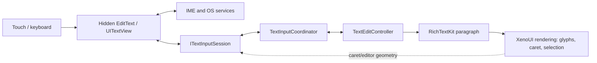
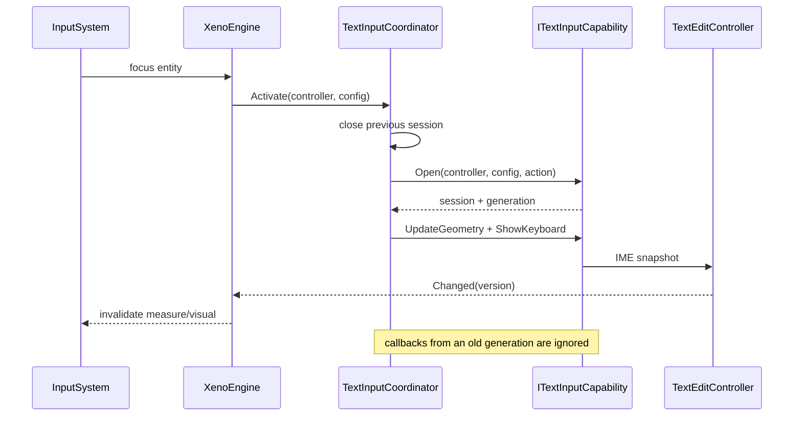
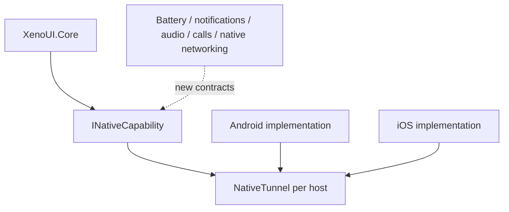

# Paragraphs, TextInput, IME and NativeTunnel

[Architecture](index.md) · [Runtime](runtime.md) · [Tooling and platforms](tooling-and-platforms.md) · [V1 decisions](decisions-v1.md)

## 1. Decision: custom rendering, native input service

XenoUI does not render a visible `EditText`/`UITextView` as the final widget. It adopts a hybrid architecture:

- XenoUI owns the style, layout, paragraph, painted text, caret, selection and handles;
- the hidden native control owns the IME connection, language, composition, autocorrection, suggestions, emoji, dictation, autofill and OS conventions;
- a `TextEditingValue` snapshot synchronises the two worlds.

This choice preserves customisation (show/hide button, decoration, effects, exact control of rendering) without reimplementing complex input protocols.

## 2. Editing model

`TextEditingValue` is the editor's atomic value:

- text;
- `TextSelection` with base/extent;
- nullable composing range.

Offsets follow UTF-16, the contract shared by .NET strings and the platforms. They do not always match runes, graphemes or glyphs. The controller validates bounds and refuses inconsistent states.

`TextEditController` is a field's stable identity. It contains:

- value/version and the `Changed` event;
- undo/redo stacks;
- atomic batch edits;
- external update policies;
- selection, composition, commit and deletion operations;
- helpers for text before/after/selected.

A rebuild recreates the entity and the `EditableTextNode`, but reattaches the same controller and its `TextViewportState`.

## 3. Paragraph engine

`ITextParagraphEngine` abstracts shaping, wrapping, metrics and hit-testing. The `RichTextKitParagraphEngine` implementation relies on RichTextKit/Skia/HarfBuzz.

The paragraph provides the runtime with:

- measured width/height;
- caret positions;
- selection rectangles;
- visual position ↔ UTF-16 offset conversion;
- lines and wrapping for multi-line.

### Layout/viewport snapshot

A classic risk is painting the paragraph of version N with the selection of N+1. `EditableTextNode.CaptureLayoutViewport` atomically associates:

1. the controller snapshot/version;
2. the paragraph shaped from that text;
3. the internal viewport/scroll;
4. the caret/selection geometry derived from that paragraph.

Any optimisation must preserve this relation. Caching the paragraph independently of the text version is incorrect.

## 4. Focus and session coordination

`TextInputCoordinator` owns at most one active native session.

The coordinator guards against late events: each activation carries a generation. Losing focus/detaching closes the session and the keyboard. Geometry is updated after layout.

## 5. Android

The adapter creates a nearly transparent, tiny native `EditText` (non-zero `Alpha`) attached to the view hierarchy. It stays detectable by the IME while leaving visible rendering to Skia.

Responsibilities:

- `InputConnection` and batch edits;
- commit/composition, selection, UTF-16/code point deletions;
- mapping `NativeKeyboardType`, IME action, autocorrect, secure and autofill;
- synchronising the complete snapshot;
- geometry and keyboard show/hide;
- Android clipboard;
- `AdjustResize` for the keyboard.

The native control must not become the source of XenoUI style or layout. Conversely, the runtime must not simulate the private details of an Android keyboard.

## 6. iOS

The adapter uses a hidden `UITextView`. UIKit keeps ownership of `markedText`, the keyboard, languages, dictation and editing services. XenoUI provides caret/first rect rectangles consistent with the canvas and keeps visible hit-testing.

Responsibilities:

- text/selection/marked range synchronisation;
- mapping keyboard type, return key, secure/autocorrect/content type;
- editor and caret geometry;
- UIKit clipboard;
- first responder session and keyboard.

iOS validation must be done on macOS with real keyboards/the simulator; compiling alone checks neither composition nor geometry.

## 7. Selection, caret and toolbar

The runtime draws:

- blinking caret and automatic reveal;
- selection highlight;
- composition underline/range;
- selection handles;
- the Cut/Copy/Paste/Select All bar.

A long press requests a word selection. Dragging the handles converts coordinates through the paragraph. Page scrolling and the internal scrolling of a `TextArea` must be arbitrated so that moving the caret does not scroll the wrong viewport.

Secure fields:

- keep `Secure=true` on the native side;
- can toggle `obscureText` on the rendering side;
- forbid Cut/Copy;
- must not log their content.

## 8. Undo, redo and external updates

A logical transaction must produce one undo entry. Nested batch edits stay atomic and Undo is rejected while a batch is open. Composition keeps a base in order to avoid one entry per intermediate character.

An external update must state its origin/policy to avoid the loop: controller → native control → controller. `Version` and `TextEditOrigin` serve diagnostics and anti-echo.

Cases to test systematically:

- reversed selection and replacement;
- caret at the start/end;
- surrogate pair and ZWJ emoji;
- composed/decomposed accent;
- CJK composition;
- RTL and mixed text;
- undo after composition;
- rebuild with the keyboard open;
- switching field A → B with a late callback from A.

## 9. NativeTunnel

`NativeTunnel` is a per-host/application registry. It is neither a stringly-typed message bus nor the device CLI.

API:

- `Register<T>(capability)`: a single typed implementation;
- `Get<T>()`: optional capability;
- `Require<T>()`: explicit failure if missing.

Existing contracts: `ITextInputCapability`, `ITextInputSession`, `IClipboardCapability`.

### Adding a capability

1. Define in Core a minimal interface inheriting `INativeCapability` and DTOs without platform types.
2. Decide whether absence is supported (`Get`) or fatal (`Require`).
3. Implement Android and iOS, or document the support matrix precisely.
4. Register before `InitialBuild`.
5. Define threading, lifetime, cancellation, permissions and error handling.
6. Add a fake/contract test in Core and a host integration test.

For notifications or calls, a permission/user interaction and an asynchronous result are needed. The contract must accept a `CancellationToken` and return typed results rather than fire opaque commands.

## 10. Accessibility and semantics

The hidden native text control provides part of the input services and a label, but XenoUI does not yet have a complete semantic tree linking each custom-painted component to the TalkBack/VoiceOver APIs.

Before V1, plan for:

- semantic nodes independent of transient entities;
- role, label, value, state, actions and bounds;
- Android AccessibilityNodeProvider and iOS UIAccessibility mapping;
- focus order, scrollable content and live regions;
- a secure mode that does not reveal the text;
- TalkBack/VoiceOver tests.

## 11. Limits and planned extensions

- `TextField`/`TextArea` visual parameters still insufficient;
- no public spans/editable rich text;
- no global semantic tree;
- incomplete hardware keyboard/dictation/language matrix;
- no desktop/web provider;
- NativeTunnel does not yet have a general convention for permissions, async streams and activity/scene lifecycle.

Future extensions must preserve the fundamental decision: XenoUI controls rendering, the OS controls the input protocols and system services it runs better.
