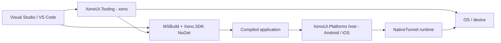
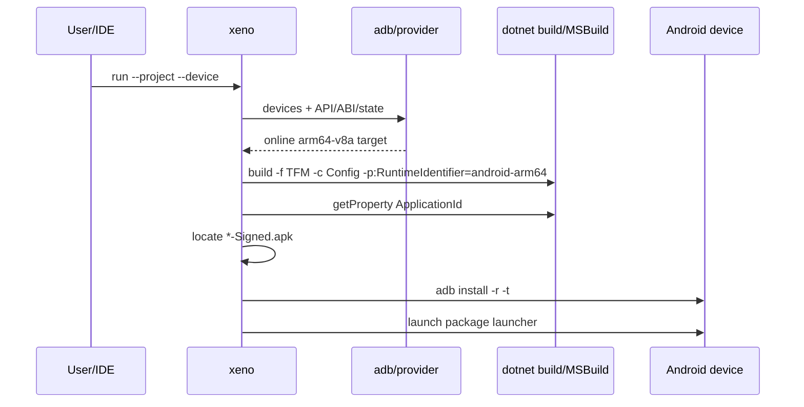

# SDK, platforms, devices and IDEs

[Architecture](index.md) · [Runtime](runtime.md) · [Text and NativeTunnel](text-input-and-native.md) · [V1 decisions](decisions-v1.md)

## 1. Three layers, three responsibilities



- **SDK/MSBuild** turns the source project into a platform application.
- **Tooling/IDE** discovers a target, picks a configuration, triggers the build and deploys.
- **NativeTunnel** lives in the application's process to call OS capabilities.

The CLI must not be referenced by the app. NativeTunnel must not run `adb`. The IDE extension must not reimplement ABI detection or the APK search.

## 2. Current MSBuild evaluation

The consumer uses `<Project Sdk="Xeno.SDK/{{ xeno_version }}">`, or a version centralised in `global.json`. The package imports the standard .NET SDK without depending on the checkout:

1. `Sdk/Sdk.props` before the consumer's properties;
2. the application's properties and TFM;
3. `Sdk/Sdk.targets` after the properties, selecting the host matching the TFM.

### `Sdk.props`

- enables nullable and implicit usings;
- marks `XenoUIProject` and the `XenoUI` IDE capability;
- sets `OutputType=Exe` by default;
- sets the default identifier, name and OS minimums;

### `Sdk.targets`

- sets `ApplicationId` and the OS minimums late;
- references the versioned Core, StandardLibrary and platform host packages;
- injects the global usings/factories and collects `Assets/**/*` as `XenoAsset`;
- marks Android as an application;
- injects `MainActivity.cs` or `Main.cs`;
- provides an iOS `Info.plist` if missing;
- turns `XenoAsset` into `EmbeddedResource` under `XenoAsset/`;
- merges Android/iOS permissions into derived files under `obj`, without modifying the sources;
- loads the build task from the package's `tools/netstandard2.0`, never from `bin/Debug`.

### Distribution and validation

- SDK, runtimes, templates and tool are published on [nuget.org](https://www.nuget.org/packages?q=XenoUI) with a single version (`{{ xeno_version }}`); a published version is immutable.
- Each release is checked before publishing: version, licence, icon, README, Source Link commit and XenoUI dependencies aligned on the same version.
- Validated on 13 October 2026: an application created by `dotnet new xenoui`, restored only from nuget.org with an empty NuGet cache, compiles a signed Android APK without warnings.
- The old local imports from before `Xeno.SDK` are no longer a supported path for new applications.

See [Xeno.SDK](../xeno-sdk.md) for bootstrapping, properties and extension points. IDE/macOS validation and publishing the Visual Studio extension remain separate steps.

## 3. Android host

The SDK links the default `MainActivity`. The host:

- creates the surface and the `XenoEngine`;
- registers the IME/clipboard capabilities;
- instantiates the consuming `App`;
- converts size/density and touch events;
- invalidates frames as long as scrolling/caret need an animation;
- configures `AdjustResize`;
- wires native back to `TryGoBack`.

Back:

- Android 7–12: `OnBackPressed`;
- Android 13+: `OnBackInvokedDispatcher`, callback active only if `CanGoBack`;
- root: delegates to the OS behaviour.

Debug keeps the workload's standard fast deployment mechanism. Do not force `EmbedAssembliesIntoApk=true` without a Release packaging reason.

## 4. iOS host

The SDK links the iOS entry point and the host initialises the surface, engine and UIKit capabilities. Input relies on a hidden `UITextView`.

Constraints:

- compilation/runtime on macOS with Xcode;
- Apple signing/provisioning for devices;
- `Info.plist` generated under `obj` by the SDK if missing; a custom plist still takes precedence;
- no iOS `xeno devices/run` provider;
- no navigation controller/interactive back integration equivalent to Android yet.

The architecture must stay ready for SceneDelegate/multi-window, but the static `Compose.Engine` is currently an obstacle to simultaneous multi-engine.

## 5. The `xeno` CLI

`XenoUI.Tooling` is a .NET tool ([nuget.org](https://www.nuget.org/packages/XenoUI.Tooling), `ToolCommandName=xeno`). Commands:

```text
xeno devices [--json] [--watch]
xeno run --project <path> --device <id>
         [--framework net10.0-android]
         [--configuration Debug]
         [--no-build]
```

### Android discovery

`AndroidDeviceProvider` locates `adb`, reads the targets and enriches each entry: ID, name, emulator/physical, state, API and ABIs. Modelled states: online, offline, unauthorized, bootloader, recovery, unknown.

`--watch` polls every second and only emits if the logical JSON changes. `--json` is the machine contract used by the extension; any change must be versioned or backward compatible.

### Android run



Explicit failures: target missing/not online, unknown ABI, non-zero build, empty `ApplicationId`, signed APK missing or ADB install/launch failed.

### Needed extensions

- a shared, testable `IDeviceProvider` abstraction;
- an iOS provider (simulators and devices through Apple tools);
- structured cancellation/process timeouts;
- separate logs/deploy/debug;
- discovery of multi-target projects/configurations;
- a versioned JSON contract;
- global/local tool package and automatic version resolution.

## 6. Visual Studio

Visual Studio relies first on MSBuild and the standard workloads. XenoUI exposes:

- `ProjectCapability Include="XenoUI"`;
- a recognised Android target and `AndroidApplication=true`.

The **XenoUI Preview** extension (VisualStudio.Extensibility, out of process, coming soon to the Visual Studio Marketplace) adds the **XenoUI Preview** window. It delegates all computation to `XenoUI.PreviewServer`, a dedicated .NET 10 process it starts, watches and restarts: in-memory Roslyn compilation of the project sources, collectible `AssemblyLoadContext`, headless rendering by `XenoUI.Core.Preview.PreviewRenderer`, one-line-per-message JSON protocol over stdin/stdout. The server does not evaluate MSBuild, does not build the project and only runs `[Preview]` members. See [Visual Studio](../visual-studio.md).

The `XenoUI.Templates` templates (`xenoui`, `xenoui-page`, `xenoui-component`) are `dotnet new` templates; Visual Studio shows them through `ide.host.json`.

The device list shown by Visual Studio comes from Visual Studio's Android/.NET tools, not directly from `XenoUI.Tooling`.

Consequence: a device visible to `xeno devices` validates ADB, but not automatically the state of the Visual Studio picker. Diagnosis must compare Android SDK, workload, active TFM, startup project and MSBuild evaluation.

## 7. VS Code

A dedicated VS Code extension is a prototype and is not published. Today, VS Code with C# Dev Kit builds the project and `xeno run` launches the application from the integrated terminal.

Target contract for the extension: activation only in a XenoUI Android workspace, target in the status bar, selection through a Quick Pick and launching delegated to the `xeno` CLI (resolved via `xenoui.cliPath` or the `PATH`), without duplicating the ADB/build logic. It must treat the JSON of `xeno devices --json` as untrusted data (parsing error, incompatible version, interrupted process → actionable message) and use `xeno devices --watch` with a single long-lived process, stopped on deactivation, rather than concurrent polling.

## 8. Assets and manifests

MSBuild embeds each `XenoAsset` with a stable logical name. The runtime loads from the assemblies, then caches images/fonts.

The packed pipeline ensures generation under `obj`, preservation of the sources and merging of permissions. Integration tests check these contracts. Still to strengthen before V1:

- declared MSBuild inputs/outputs for incrementality;
- diagnostics naming the responsible file/property;
- package tests on Windows/macOS.

## 9. Test responsibility matrix

| Layer | Automated tests | Integration validation |
|---|---|---|
| Core | regression executable | sample frame/input |
| Android host | compilation + contract tests | arm64 phone + x64 emulator |
| iOS host | macOS compilation | simulator + device as available |
| BuildTasks/SDK | fixture projects, properties/outputs | packed external project |
| Tooling | parsing/command tests | real ADB, offline/unauthorized states |
| VS Code | TypeScript tests/command mocking | Extension Host + device |
| Visual Studio | solution/project evaluation | target picker + F5/deploy |

## 10. Security and reliability

- Never concatenate a shell command with project/device values; use `ArgumentList`.
- Validate that the resolved project and APK belong to the requested project/configuration.
- Do not log signing secrets, secure field content or ADB/Apple tokens.
- Set timeouts and propagate cancellation to child processes.
- Do not launch automatically on an `unauthorized/offline` device.
- Make any destructive operation explicit; `adb install -r` must preserve data as far as the package/signature allows.

## 11. Targeted V1 contract

A coherent installable experience should become:

```text
dotnet new install XenoUI.Templates::<version>
dotnet tool install --global XenoUI.Tooling --version <version>
dotnet new xenoui -n MyApp
xeno devices
xeno run --project MyApp/MyApp.csproj --device <id>
```

These commands work as of the `{{ xeno_version }}` preview published on nuget.org (see [Installation](../installation.md)). An explicit compatibility matrix and the iOS provider are still to come.
