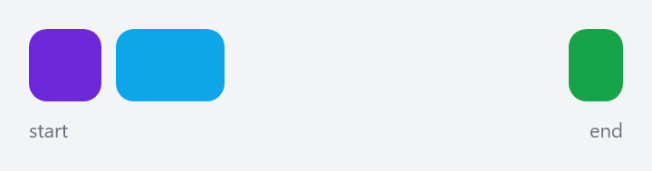
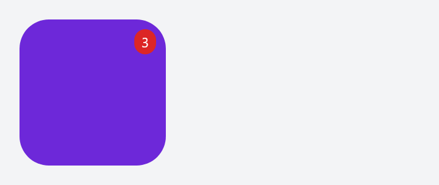
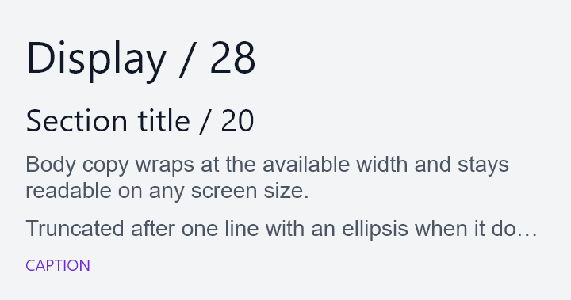
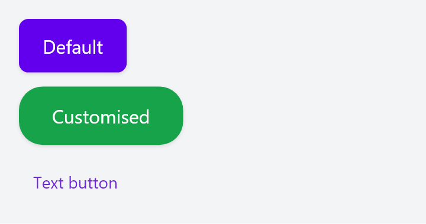
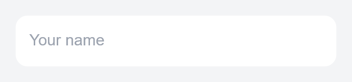
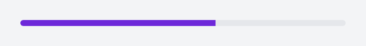
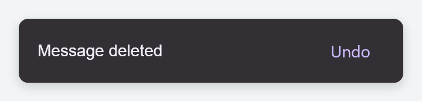
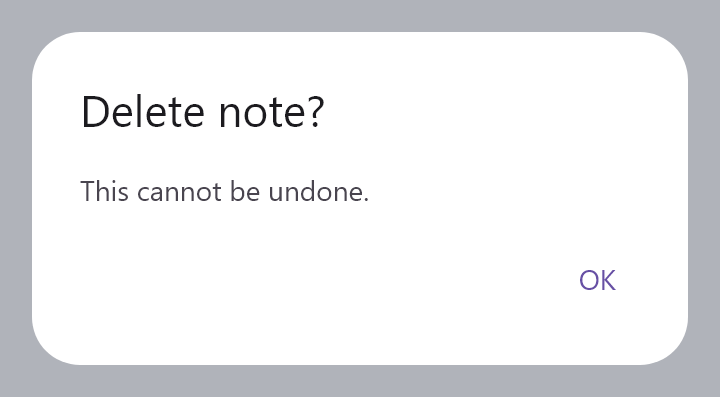

# Component catalogue

[Documentation](index.md) · [Creating a component](components.md) · [Customising](customization.md) · [Layouts](layouts.md) · [API reference](reference/index.md)

Every component XenoUI provides, with what it is for, its main parameters and defaults, the modifiers that matter, and a
screenshot. Each entry links to the generated [API reference](reference/index.md) for the full signatures. The
screenshots are rendered by the headless previewer (see
[`tools/DocSnippets`](https://github.com/Eel2000/XenoUI.Docs/tree/main/tools/DocSnippets)).

All of these are **functions** returning a `XenoComponent`: chain [modifiers](customization.md#16-modifier-quick-reference)
on the result. Sizes are in dp, colours are `0xAARRGGBB`.

## Contents

1. [Layout containers](#layout-containers)
2. [Content](#content)
3. [Actions](#actions)
4. [Text input](#text-input)
5. [Lists and pagers](#lists-and-pagers)
6. [Feedback](#feedback)
7. [Overlays](#overlays)
8. [Navigation and app bars](#navigation-and-app-bars)
9. [Media](#media)
10. [Not provided yet](#not-provided-yet)

---

## Layout containers

### `Column(children…)` and `Row(children…)`

Stack children vertically (`Column`) or horizontally (`Row`; right to left in RTL). Transparent by default.

| Typical modifiers | Effect |
|---|---|
| `.Gap(8)` | Space between children |
| `.MainAxis(MainAxisAlignment.SpaceBetween)` | Distribute along the flow |
| `.CrossAxis(CrossAxisAlignment.Center)` | Align across the flow (`Start`, `Center`, `End`, `Stretch`) |
| `.Padding(…)`, `.Background(…)` | Inner margin, fill |



```csharp
Row(Box(40, 40).Background(0xFF6D28D9).CornerRadius(10),
    Box(60, 40).Background(0xFF0EA5E9).CornerRadius(10),
    Spacer(),
    Box(30, 40).Background(0xFF16A34A).CornerRadius(10)).Gap(8)
```

### `ZStack(children…)`

Overlaps its children; the **last** one is on top. Horizontal position comes from the stack's `MainAxis`, vertical position
from each child's `AlignSelf`. See [Layouts §6](layouts.md#6-overlapping-zstack).



```csharp
ZStack(
    Box(120, 120).Background(0xFF6D28D9).CornerRadius(24),
    Row(Spacer(), Text("3", 11).TextColor(0xFFFFFFFF).Background(0xFFDC2626).CornerRadius(9).Padding(6, 3))
        .AlignSelf(CrossAxisAlignment.Stretch).Padding(8)
).Size(120, 120)
```

### `Box(width = 0, height = 0)` and `Box(width, height, children…)`

A rectangle of a given size (`0` = automatic). With children it is a container. Use it for coloured blocks, dividers
(`Box(0, 1).Background(…)`) and fixed-size wrappers.

### `Spacer()`

A flexible gap: `FlexGrow(1)`. Pushes siblings apart.

## Content

### `Text(string | State<T> | $"…{state}", fontSize = 14)`

Draws text. Static, bound to a `State`, or an interpolated string that tracks embedded states.

| Modifier | Effect |
|---|---|
| `.TextColor(uint | State<uint>)` | Colour (default black) |
| `.FontSize(float)`, `.FontFamily("Name")` | Size, font from `Assets/Fonts` |
| `.TextAlign(Start/Center/End)` | Alignment inside its box |
| `.MaxLines(n, ellipsis)`, `.TextWrap(bool)`, `.AutoSize(min)` | Truncation and fitting |



### `Image(assetName)`

An embedded image from `Assets/Images/` by short name. Natural size by default; `.Size(w, h)` and
`.ScaleMode(Cover | Fit | Fill | None)` adjust it. `.CornerRadius(r)` rounds it (a circle is `Size(d, d).CornerRadius(d / 2)`).

### `ImageFile(State<string?>)`

A local image file chosen at run time; `null` hides it. Decoded once and cached by path.

### `Icon(IconDef icon, size = 24)` / `Icon(glyph, fontName, size)`

A font glyph. `Glyph("", "Font Awesome 5 Free-Solid-900")` pairs a glyph with its font. Colour it with `.TextColor(…)`.

## Actions

### `Button(label, onTap, fontSize = 16, textColor = 0xFFFFFFFF)`

A filled button: purple background, 8 dp corners, 2 dp elevation, 20/12 padding, centred text, automatic press tint. The
label colour and size are **parameters**; everything else is a modifier.

### `TextButton(label, onTap, color = 0xFF6750A4, fontSize = 14)`

A flat button for dialog and snackbar actions. Transparent until customised.



```csharp
Button("Default", () => { }),
Button("Customised", () => { }, 16).Background(0xFF16A34A).CornerRadius(20).Padding(28, 14),
TextButton("Text button", () => { }, 0xFF6D28D9)
```

### `.Clickable(Action)`

Makes **any** element tappable. A tappable element with a non-transparent background darkens by 15 % while pressed.

## Text input

### `TextField(controller, placeholder = "", configuration = null, obscureText = null, onAction = null)`

A single-line field drawn by XenoUI, driven by a persistent `TextEditController` (`UseTextEdit("")` in a field). The native
keyboard and IME are used.

### `TextArea(controller, placeholder = "", configuration = null, onAction = null)`

The multi-line version.



Configure the keyboard with `InputOptions(NativeKeyboardType.Email, NativeInputAction.Next, autofill: …)`. Details:
[Developer guide §11](developer-guide.md#11-text-input-and-ime).

## Lists and pagers

| Component | Use |
|---|---|
| `LazyColumn(items, itemContent, key, state)` | Virtualised vertical list; sizes are measured |
| `LazyRow(items, itemContent, key, state)` | Virtualised horizontal list |
| `VerticalPager(items, pageContent, key, state)` | Full-screen pages that snap (feeds); `PageChanged`, `ScrollToPage` |

Always pass `key`, give the list a bounded size, and keep per-item state in a page field
([Layouts §8](layouts.md#8-virtualised-lists)).

## Feedback

### `LinearProgress(State<float> progress, height = 2, trackColor = 0x40FFFFFF, fillColor = 0xFFFFFFFF)`

A horizontal bar bound to a 0..1 state. Updating the state resizes the fill without a rebuild.



## Overlays

Shown above the page and the navigation bar. See [Overlays](https://github.com/Eel2000/XenoUI/blob/master/docs/overlays.md)
(French) for behaviour, and [Animations §8](animations.md#8-animating-an-overlay-overlayanimation) for motion.

| Widget | Modal | Use |
|---|---|---|
| `Snackbar.Show(app, message, options)` | No | Short message, optional action; replaces the previous one |
| `Alert.Show(app, title, message, …)` | Yes | One to three buttons |
| `Dialog` | Yes | Any content on a card |
| `Popup` | No | Menu or card anchored to the tapped element |
| `BottomSheet.Show(app, content, options)` | Yes | Sheet from the bottom, drag down to dismiss |
| `app.Overlays.Show(content, OverlayOptions)` | Configurable | Fully custom overlay |





Every overlay has an options object with defaults (`SnackbarOptions`, `AlertOptions`, `DialogOptions`, `PopupOptions`,
`BottomSheetOptions`) and exposes its visual alone (`Snackbar.Body`, `Alert.Content`, `Dialog.Surface`…) for previews.

## Navigation and app bars

| Component | Use |
|---|---|
| `NavigationScaffoldState` | Adaptive shell: bottom bar, rail or drawer, one stack per destination |
| `NavigationDestination.For<TPage>(label, icon, badge)` | A tab |
| `ITopBarPage` + `TopBarOptions` | A fixed application bar on a page |
| `NavigationFab.Standard` / `Extended` | Floating action button of the scaffold |
| `NavigationBars.Docked(context, style, action)` | Bar with a raised centre button |

See [Navigation and NavigationScaffold](navigation-scaffold.md).

## Media

`MediaView.Video(controller, height = 210)` shows a native video output; `Native.CreatePlayer(MediaKind.Video)` creates the
controller. See [Media controller](media-controller.md).

## Not provided yet

These are **not** built-in; compose them from the primitives (see the [recipes](components.md#15-complete-recipes)):

| Missing | Build it from |
|---|---|
| `Switch`, `Checkbox`, `RadioButton` | `Row` + `Box` + `Clickable` ([controlled switch](components.md#152-controlled-switch)) |
| `Slider` | Not available; use `LinearProgress` plus your own gesture handling |
| `Chip`, `Card`, `Badge` | `Text`/`Column` + `Background` + `CornerRadius` ([options pattern](components.md#11-a-component-with-options-the-options-pattern)) |
| Spinner / circular progress | Not available; animate a `State` ([Animations §5](animations.md#5-animating-yourself-step-by-step)) |
| Date / time pickers, dropdown field | Compose with `Popup` or `BottomSheet` |
| Tab bar inside a page | `Row` of clickable `Text` ([segmented bar](components.md#154-segmented-bar)) |
| Skeleton / shimmer, pull to refresh | Not available |
