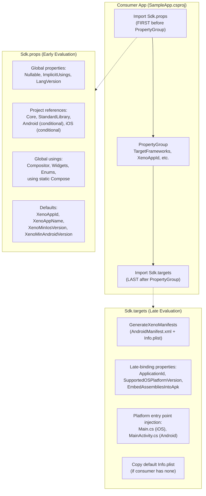
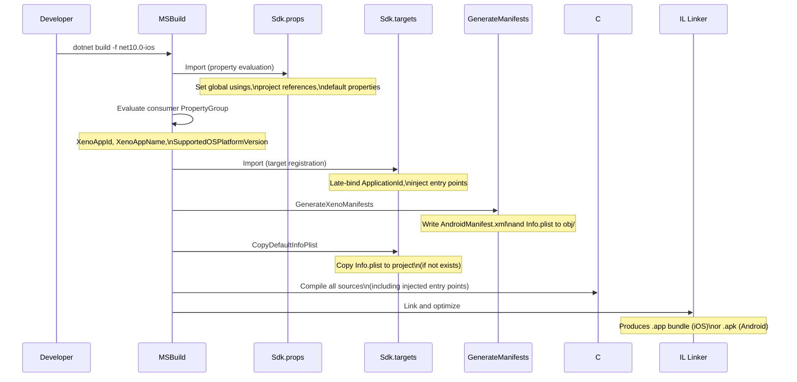

# SDK System & Project Setup

> **Historical: SDK through local imports.** The current path uses `<Project Sdk="Xeno.SDK">`: see [Xeno.SDK](xeno-sdk.md) and the [developer guide](developer-guide.md). The import paths and examples below describe the old SDK and must not be copied into a new application.

This document explains how XenoUI's SDK system works — the build pipeline that allows consumer apps to build cross-platform with zero boilerplate.

---

## How It Works

XenoUI uses a two-file SDK pattern inspired by .NET SDK-style projects:



---

## Minimal Consumer App

A complete XenoUI app requires just 3 files:

### 1. Project File (`MyApp.csproj`)

```xml
<Project Sdk="Microsoft.NET.Sdk">
  <Import Project="path/to/Sdk.props" />

  <PropertyGroup>
    <TargetFrameworks>net10.0-android;net10.0-ios</TargetFrameworks>
    <OutputType>Exe</OutputType>
    <XenoAppId>com.mycompany.myapp</XenoAppId>
    <XenoAppName>My App</XenoAppName>
    <SupportedOSPlatformVersion>13.0</SupportedOSPlatformVersion>
  </PropertyGroup>

  <Import Project="path/to/Sdk.targets" />
</Project>
```

### 2. App Class (`App.cs`)

```csharp
public class App : XenoApp
{
    public override void OnStart()
    {
        Page<HomePage>();
        Navigate<HomePage>();
    }
}
```

### 3. Page (`Pages/HomePage.cs`)

```csharp
public class HomePage : XenoPage
{
    public override XenoComponent Body() =>
        Column(
            Text("Hello, XenoUI!").FontSize(32).TextColor(0xFFFFFFFF),
            Box(200, 100).Background(0xFF2196F3).CornerRadius(16)
        ).Padding(24).Background(0xFF121212);
}
```

That's it. No `MainActivity`, no `Main.cs`, no `Info.plist`, no `using` statements. The SDK injects everything.

---

## What Sdk.props Provides

| What | How |
|---|---|
| **Project References** | Automatically adds Core, StandardLibrary, and platform-specific libraries |
| **Global Usings** | `XenoUI.Core.Compositor`, `.Widgets`, `.Enums`, `using static Compose` |
| **Defaults** | `XenoAppId`, `XenoAppName`, `XenoMinIosVersion=13.0`, `XenoMinAndroidVersion=24` |
| **Build Settings** | `Nullable=enable`, `ImplicitUsings=enable`, `LangVersion=latest` |

### Full Sdk.props Breakdown

```xml
<!-- Sdk.props — imported FIRST by consumer -->
<Project>
  <PropertyGroup>
    <Nullable>enable</Nullable>
    <ImplicitUsings>enable</ImplicitUsings>
    <LangVersion>latest</LangVersion>
    <XenoUIProject>true</XenoUIProject>

    <!-- Consumer-overridable defaults -->
    <XenoAppId Condition="'$(XenoAppId)' == ''">com.xenoui.unnamed</XenoAppId>
    <XenoAppName Condition="'$(XenoAppName)' == ''">$(MSBuildProjectName)</XenoAppName>
    <XenoMinIosVersion Condition="'$(XenoMinIosVersion)' == ''">13.0</XenoMinIosVersion>
    <XenoMinAndroidVersion Condition="'$(XenoMinAndroidVersion)' == ''">24</XenoMinAndroidVersion>
  </PropertyGroup>

  <!-- Automatic project references -->
  <ItemGroup>
    <ProjectReference Include="$(XenoSdkRoot)/XenoUI.Core/XenoUI.Core.csproj" />
    <ProjectReference Include="$(XenoSdkRoot)/XenoUI.StandardLibrary/..." />
    <ProjectReference Include="$(XenoSdkRoot)/XenoUI.Android/..."
                      Condition="$(TargetFramework.Contains('android'))" />
    <ProjectReference Include="$(XenoSdkRoot)/XenoUI.Ios/..."
                      Condition="$(TargetFramework.Contains('ios'))" />
  </ItemGroup>

  <!-- Global usings — this is why Column(), Row(), Text() work without imports -->
  <ItemGroup>
    <Using Include="XenoUI.Core.Compositor" />
    <Using Include="XenoUI.Core.Compositor.Widgets" />
    <Using Include="XenoUI.Core.Components.Enums" />
    <Using Include="XenoUI.Core.Compositor.Compose" Static="True" />
  </ItemGroup>
</Project>
```

---

## What Sdk.targets Provides

| What | How |
|---|---|
| **Android manifest** | Uses the consumer manifest or the SDK default directly during design-time evaluation |
| **Entry Points** | Injects `MainActivity.cs` (Android) and `Main.cs` (iOS) as linked files |
| **Info.plist** | Copies default plist template if consumer doesn't provide one |
| **Late Properties** | Sets `ApplicationId` from `XenoAppId`, `SupportedOSPlatformVersion` per-platform |

### Platform Entry Point Injection

The SDK compiles platform-specific entry points into the consumer app as **linked files** — the source lives in `platforms/` but appears in the consumer's build:

**iOS Entry Point** (`platforms/ios/Main.cs`):
```csharp
UIApplication.Main(args, null, typeof(AppDelegate));
```

**Android Entry Point** (`platforms/android/MainActivity.cs`):
```csharp
[Activity(Theme = "@android:style/Theme.NoTitleBar", MainLauncher = true)]
public class MainActivity : Activity
{
    protected override void OnCreate(Bundle? savedInstanceState)
    {
        base.OnCreate(savedInstanceState);
        SetContentView(new XenoView(this));
    }
}
```

Both entry points create a `XenoView` which handles:
1. Creating the `XenoEngine`
2. Setting screen density
3. Discovering the `XenoApp` subclass via assembly reflection
4. Calling `InitialBuild()` to render the first frame

---

## Device discovery and IDE integration

XenoUI keeps device discovery in development tooling rather than in the app
runtime or `NativeTunnel`:

```text
xeno devices
xeno devices --json
xeno devices --watch
xeno run --project MyApp.csproj --device <device-id>
```

On Android, the tooling discovers physical devices and emulators through ADB and
preserves the device identifier used by the official .NET Android `Device`
property. Visual Studio continues to use its standard Android project capability
and device selector. The XenoUI VS Code extension consumes the JSON form of the
same command and exposes a status-bar picker.

`Sdk.props` supplies `OutputType=Exe` when the consumer did not specify an output
type and exposes the `XenoUI` project capability. The Android workload then adds
its official `Mobile`, `Android`, and `AndroidApplication` capabilities.

The SDK default Android manifest is referenced directly during project
evaluation. It is not copied into the consumer source tree during a build.

---

## Configurable Properties

| Property | Default | Where to Set | Description |
|---|---|---|---|
| `XenoAppId` | `com.xenoui.unnamed` | Consumer csproj | Bundle identifier (iOS) / Application ID (Android) |
| `XenoAppName` | Project name | Consumer csproj | Display name on home screen |
| `XenoMinIosVersion` | `13.0` | Consumer csproj | Minimum iOS deployment target |
| `XenoMinAndroidVersion` | `24` | Consumer csproj | Minimum Android API level |
| `SupportedOSPlatformVersion` | From min version | Consumer csproj | **Direct override** — must be set unconditionally |
| `XenoPermission` | (none) | Consumer csproj | MSBuild items for Android permissions |

> **⚠️ Important**: `SupportedOSPlatformVersion` must be set directly in the consumer's `<PropertyGroup>` — NOT in platform-conditional blocks. The .NET SDK evaluates `TargetPlatformIdentifier` late in its import chain, so conditional blocks in `Sdk.targets` fire before the identifier is available, leaving the property empty for the SDK's default (the TFM version, e.g. 26.2) to fill in.

---

## Build Pipeline Flow



---

## Running the App

### From CLI

```bash
# iOS Simulator
dotnet build samples/SampleApp/SampleApp.csproj -t:Run -f net10.0-ios

# Android Emulator  
dotnet build samples/SampleApp/SampleApp.csproj -t:Run -f net10.0-android

# Build only (no deploy)
dotnet build samples/SampleApp/SampleApp.csproj -f net10.0-ios
dotnet build samples/SampleApp/SampleApp.csproj -f net10.0-android
```

### From IDE (Rider / Visual Studio)

1. Open `XenoUI.slnx`
2. Set **SampleApp** as startup project
3. Select target framework: `net10.0-ios` or `net10.0-android`
4. Select device/simulator from the dropdown
5. Press Run (▶️)

> **Note**: The IDE must see `Sdk.props` imported **before** the `<PropertyGroup>` for the target picker to show iOS/Android device options.

---

## MSBuild Evaluation Order (Why It Matters)

Understanding MSBuild evaluation order is critical for the SDK to work:

```
1. Sdk.props    ← Our early imports (properties, references, usings)
2. <PropertyGroup> ← Consumer's properties (XenoAppId, SupportedOSPlatformVersion)
3. Sdk.targets  ← Our late imports (targets, entry point injection)
4. .NET SDK implicit imports ← Sets TargetPlatformIdentifier, defaults
5. iOS/Android SDK targets ← CompileAppManifest reads SupportedOSPlatformVersion
```

The key constraint: `TargetPlatformIdentifier` (e.g. "iOS", "Android") is only available at step 4. Any condition in `Sdk.targets` (step 3) that checks `$(TargetPlatformIdentifier)` will see an empty string and fail silently. This is why `SupportedOSPlatformVersion` must be set unconditionally in the consumer's `PropertyGroup`.

---

## GenerateManifests MSBuild Task

The `XenoUI.BuildTasks` project contains a custom MSBuild task that generates platform manifests:

```csharp
public class GenerateManifests : Task
{
    [Required] public string AppId { get; set; }
    [Required] public string AppName { get; set; }
    [Required] public string IntermediatePath { get; set; }
    public ITaskItem[] Permissions { get; set; }

    public override bool Execute()
    {
        // Generates AndroidManifest.xml with AppId, AppName, and permissions
        // Generates Info.plist with bundle identifier and display name
        // Both written to IntermediatePath (obj/ folder)
    }
}
```

Consumer apps can add Android permissions via MSBuild items:

```xml
<ItemGroup>
    <XenoPermission Include="android.permission.CAMERA" />
    <XenoPermission Include="android.permission.INTERNET" />
</ItemGroup>
```
