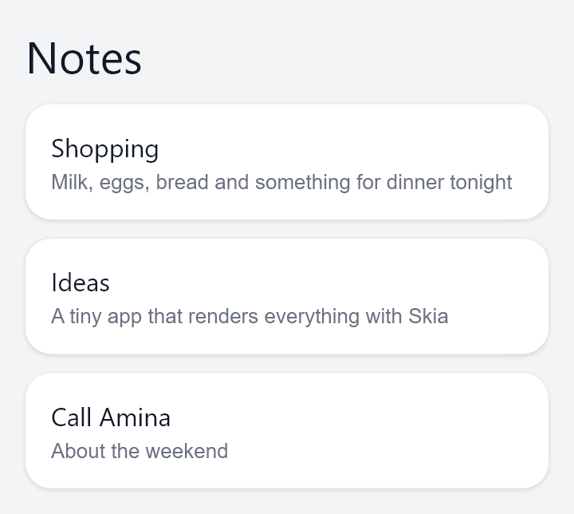
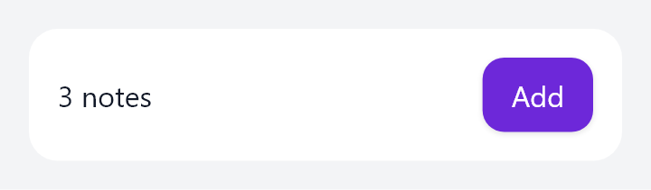
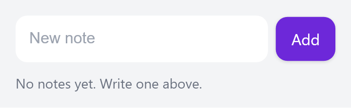
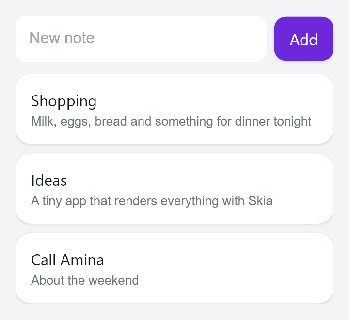

# Tutorial: your first XenoUI app

[Documentation](index.md) · [Why XenoUI?](why-xenoui.md) · [Installation](installation.md) · [Glossary](glossary.md) · [FAQ](faq.md)

In about 30 minutes you will build a small **Notes** app: a screen, a reusable card, state, a text field, a list and
a second page. Each step shows the code and what it looks like. Every snippet on this page is compiled against the
real XenoUI sources (see [`tools/DocSnippets`](https://github.com/Eel2000/XenoUI.Docs/tree/main/tools/DocSnippets)),
and the screenshots are rendered by the same lightweight previewer you will use in your IDE.

**You need:** the .NET 11 SDK, the Android workload and an emulator or phone ([Installation](installation.md)).
Never written a declarative UI? Read [Thinking in XenoUI](thinking-in-xenoui.md) afterwards, not before: this
tutorial is meant to be done first.

## Contents

1. [Create the project](#step-0-create-the-project)
2. [Step 1: a first screen](#step-1-a-first-screen)
3. [Step 2: layout and your own component](#step-2-layout-and-your-own-component)
4. [Step 3: state](#step-3-state)
5. [Step 4: a text field and a list](#step-4-a-text-field-and-a-list)
6. [Step 5: a second page](#step-5-a-second-page)
7. [Step 6: run it, preview it, test it](#step-6-run-it-preview-it-test-it)
8. [Where to go next](#where-to-go-next)

---

## Step 0: create the project

```powershell
dotnet new install XenoUI.Templates
dotnet new xenoui -n NotesApp
cd NotesApp
dotnet build -f net11.0-android
```

The template gives you `App.cs`, `Pages/HomePage.cs` and `Components/Counter.cs`. You will replace the page's
`Body()`; everything else is already wired. If a command fails, see [Installation](installation.md) and
[Troubleshooting](troubleshooting.md).

## Step 1: a first screen

A page is a class that inherits `XenoPage` and returns its interface from `Body()`. The interface is **built by
calling functions**: `Column`, `Text`… Each returns a `XenoComponent`, and *modifiers* such as `.Padding(24)` refine it.

```csharp
public sealed class HomePage : XenoPage
{
    public override XenoComponent Body() =>
        Column(
            Text("Notes", 28).TextColor(0xFF111827),
            Text("My first XenoUI screen", 14).TextColor(0xFF6B7280)
        ).Gap(6).Padding(24);
}
```


What you just used:

- `Column(a, b)` stacks its children vertically; `Row` does so horizontally.
- `Text("…", 28)` draws text at 28 dp. Sizes are **logical units** (dp), colours are `0xAARRGGBB`.
- `.Gap(6)` is the space between children, `.Padding(24)` the inner margin. Modifiers chain.

> **Tip:** put `[Preview]` on the page and you see this screen in Visual Studio or VS Code **without a device**
> ([Visual Studio](visual-studio.md), [VS Code](vscode.md)).

## Step 2: layout and your own component

A **component** is just a function that returns a `XenoComponent`. Extract the note card:

```csharp
public static class NoteCard
{
    public static XenoComponent View(string title, string body) =>
        Column(
            Text(title, 16).TextColor(0xFF111827),
            Text(body, 13).TextColor(0xFF6B7280).MaxLines(2, ellipsis: true)
        ).Gap(4).Padding(16)
         .Background(0xFFFFFFFF).CornerRadius(16).Elevation(2);
}
```

Use it three times:

```csharp
public override XenoComponent Body() =>
    Column(
        Text("Notes", 28).TextColor(0xFF111827),
        NoteCard.View("Shopping", "Milk, eggs, bread and something for dinner tonight"),
        NoteCard.View("Ideas", "A tiny app that renders everything with Skia"),
        NoteCard.View("Call Amina", "About the weekend")
    ).Gap(12).Padding(16).CrossAxis(CrossAxisAlignment.Stretch).Background(0xFFF3F4F6);
```



New ideas:

- `.Background`, `.CornerRadius` and `.Elevation` style an element; `.MaxLines(2, ellipsis: true)` truncates long text.
- `CrossAxis(Stretch)` makes the cards as wide as the screen. The *cross axis* of a `Column` is horizontal.
- A component is **reusable and testable**: change `NoteCard` once and every card changes. More in
  [Creating a component](components.md).

## Step 3: state

Static screens are not very useful. **State** is a value the interface depends on and that can change. XenoUI's
state object is `State<T>`.

```csharp
public sealed class CounterPage : XenoPage
{
    private readonly State<int> _count = UseState(3);          // a field, never in Body()

    public override XenoComponent Body() =>
        Column(Counter(_count, () => _count.Value++))
            .Padding(16).Background(0xFFF3F4F6).CrossAxis(CrossAxisAlignment.Stretch);
}

public static XenoComponent Counter(State<int> count, Action add) =>
    Row(
        Text($"{count} notes", 16).TextColor(0xFF111827).FlexGrow(1),
        Button("Add", add).Background(0xFF6D28D9).CornerRadius(12).Padding(16, 10)
    ).Gap(12).CrossAxis(CrossAxisAlignment.Center)
     .Padding(16).Background(0xFFFFFFFF).CornerRadius(16);
```



Tap **Add** and the number changes **without rebuilding the page**: `Text($"{count} notes")` is *bound* to the state.

Three rules to remember (they are the most common beginner mistakes):

1. **Create state in a field**, never inside `Body()`. `UseState` returns a new object on each call, so inside
   `Body()` your state would reset on every rebuild.
2. **Pass state down, call events up.** `Counter` receives the state and an `Action`; it does not own either.
3. **Binding is explicit.** `Text(count)` or `$"{count}"` inside `Text(...)` follows changes; reading `count.Value`
   in `Body()` does not.

Read more: [State and rebuilding](state.md).

## Step 4: a text field and a list

Now let the user write notes. Text input uses a **controller** (`UseTextEdit`) that, like state, lives in a field.

```csharp
public sealed class NotesPage : XenoPage
{
    private readonly TextEditController _input = UseTextEdit();
    private readonly List<Note> _notes = new();
    private readonly LazyListState _list = UseLazyList();
    private int _nextId;

    public override XenoComponent Body() =>
        Column(
            Row(
                TextField(_input, "New note").Height(48).FlexGrow(1),
                Button("Add", Add).Background(0xFF6D28D9).CornerRadius(12).Padding(16, 12)
            ).Gap(8).CrossAxis(CrossAxisAlignment.Center),
            _notes.Count == 0
                ? Text("No notes yet. Write one above.", 14).TextColor(0xFF6B7280)
                : LazyColumn(_notes, NoteRow, key: note => note.Id, state: _list)
                    .FlexGrow(1).CrossAxis(CrossAxisAlignment.Stretch)
        ).Gap(12).Padding(16).Background(0xFFF3F4F6).CrossAxis(CrossAxisAlignment.Stretch);

    private XenoComponent NoteRow(Note note) =>
        NoteCard.View(note.Title, note.Body).Margin(Spacing.Only(bottom: 10));

    private void Add()
    {
        string text = _input.Value.Text.Trim();
        if (text.Length == 0) return;
        _notes.Insert(0, new Note(_nextId++, text, "Tap to read"));
        _input.SetText("");
        Rebuild();                                              // the list changed shape
    }
}

public sealed record Note(int Id, string Title, string Body);
```

The empty state, and the screen once it holds notes:





What is new:

- `TextField(controller, placeholder)` is a field drawn by XenoUI; the **native keyboard** is used for input.
- `LazyColumn(items, itemFunction, key: …)` is a **virtualised list**: it only builds what is visible. The `key`
  identifies each item, so always give one (an id, never the index).
- `Rebuild()` runs `Body()` again. Here the **shape** of the screen changed (a new item), so a rebuild is right.
  When only a *value* changes, bind a `State` instead (Step 3).
- The notes live in a **field** (`_notes`), so they survive the rebuild.

> **Rule of thumb:** a `State` first, `Rebuild()` only when the structure changes.

## Step 5: a second page

Pages are registered once in `App.OnStart`, and you move between them with `Navigate`. A page can receive a typed
argument.

```csharp
public sealed record NoteArgs(Note Note);

public sealed class NoteDetailPage : XenoPage<NoteArgs>, ITopBarPage
{
    private Note? _note;

    public override void OnNavigatedTo(NoteArgs arguments) { _note = arguments.Note; Rebuild(); }

    public string TopBarTitle => "Note";
    public TopBarOptions? TopBarOptions => new()
    {
        OnNavigation = GoBack,
        Background = 0xFFFFFFFF,
        Foreground = 0xFF111827,
        Elevation = 0
    };

    public override XenoComponent Body() =>
        Column(
            Text(_note?.Title ?? "", 24).TextColor(0xFF111827),
            Text(_note?.Body ?? "", 16).TextColor(0xFF374151),
            Button("Back", GoBack).Background(0xFF6D28D9).CornerRadius(12).Padding(16, 12)
        ).Gap(12).Padding(24).Background(0xFFF3F4F6).CrossAxis(CrossAxisAlignment.Start);
}

public sealed class NotesApp : XenoApp
{
    public override void OnStart()
    {
        Page<NotesPage>();
        Page<NoteDetailPage>();
        Navigate<NotesPage>();
    }
}
```

To open the detail from a note, call (inside `NotesPage`):

```csharp
Navigate<NoteDetailPage, NoteArgs>(new NoteArgs(note), NavTransitions.SlideHorizontal());
```

- `Page<T>()` creates each page **once**; its fields keep their values when you navigate away and back.
- `GoBack()` pops the page; the system Back button does the same.
- `ITopBarPage` gives the page a fixed top bar. `NavTransitions.SlideHorizontal()` animates the change.

More: [Lifecycle](lifecycle.md), [Navigation](navigation-scaffold.md).

## Step 6: run it, preview it, test it

**Run on a device or emulator**

```powershell
xeno devices
xeno run --project NotesApp.csproj --device <id> --framework net11.0-android
```

**Preview without a device.** Add `[Preview]` to a static, parameterless method that returns a component:

```csharp
[Preview("Note card")]
private static XenoComponent CardPreview() => NoteCard.View("Shopping", "Milk, eggs and bread");
```

**Test the rendering headlessly.** The same previewer works from a unit test ([Testing](testing.md)):

```csharp
var image = PreviewRenderer.Render(() => NoteCard.View("Shopping", "Milk"), scale: 1f);
Assert.True(image.Succeeded);
```

If something looks wrong: [Debugging your UI](debugging.md) and [FAQ](faq.md).

## Where to go next

You now know the whole loop: **functions build the UI, state drives it, `Rebuild()` handles structure, pages and
`Navigate` move around.** Next:

| I want to… | Read |
|---|---|
| Understand the model behind it | [Thinking in XenoUI](thinking-in-xenoui.md) |
| Load data from the network | [Side effects and async work](side-effects.md), [Application architecture](app-architecture.md) |
| Style and animate | [Customising](customization.md), [Animations](animations.md) |
| See every built-in component | [Component catalogue](component-catalog.md) |
| Look up a type or method | [API reference](reference/index.md) |
| See a full app | [Learning from the SampleApp](sample-app.md) |
| Ship it | [Publishing your app](publishing.md) |
| Coming from Jetpack Compose | [From Jetpack Compose to XenoUI](compose-comparison.md) |
