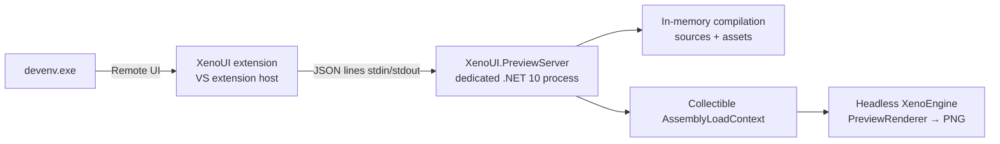

# Visual Studio — templates and XenoUI Preview

[Documentation](index.md) · [Developer guide](developer-guide.md) · [Xeno.SDK](xeno-sdk.md) · [Tooling architecture](architecture/tooling-and-platforms.md)

On macOS and Linux, see [VS Code](vscode.md).

XenoUI provides two things for Visual Studio:

- **`dotnet new` templates**, visible in *Create a new project* and *Add › New Item*: "XenoUI App", "XenoUI Page" and "XenoUI Component";
- **the XenoUI Preview extension**: a tool window that shows, as you type, the components and pages marked `[Preview]`, like Compose previews in Android Studio. It does not compile the project through MSBuild and launches neither the application nor an emulator.

> **Status: `{{ xeno_version }}`.** The templates are published on [nuget.org](https://www.nuget.org/packages/XenoUI.Templates); the XenoUI Preview extension is coming soon to the Visual Studio Marketplace. Prerequisites: Visual Studio 2022 17.14 or Visual Studio 2026, and the .NET 10 runtime (installed with the .NET 10 SDK) for the render server.

## Installing

```powershell
dotnet new install XenoUI.Templates::{{ xeno_version }}
```

The templates show up in Visual Studio on the next start. The XenoUI Preview extension will install from *Extensions › Manage Extensions* as soon as it is published on the Marketplace.

Prerequisites, update, uninstall and troubleshooting: [installation guide](installation.md#6-the-previewer-visual-studio-extension).

## Creating a project

In Visual Studio: *Create a new project* › "XenoUI" filter › **XenoUI App**. From the command line:

```powershell
dotnet new xenoui -n MyApp
```

| Option | Effect |
|---|---|
| `--ios` | Adds `net10.0-ios` (iOS workload required; building the app requires macOS and Xcode) |
| `--appId com.example.myapp` | Android/iOS identifier; defaults to `com.companyname.<name>` |
| `--sdkVersion <version>` | `Xeno.SDK` version pinned in `global.json`; defaults to the template pack's version |

The project contains `App.cs`, `Pages/HomePage.cs` and `Components/Counter.cs`, each with `[Preview]`s.

Adding an item: *right-click a folder › Add › New Item* › **XenoUI Page** or **XenoUI Component**, or:

```powershell
dotnet new xenoui-page -n ProfilePage -o Pages
dotnet new xenoui-component -n Avatar -o Components
```

The namespace follows the restored project's `RootNamespace`; a page still has to be registered in `App.OnStart` with `Page<ProfilePage>()`.

## Writing previews

`[Preview]` (namespace `XenoUI.Core.Preview`) applies to:

- a **static, parameterless** method returning `XenoComponent` — a component preview, as wide as the device and as tall as its content;
- a **`XenoPage`** with a public parameterless constructor — a full-screen preview.

```csharp
using XenoUI.Core.Preview;

public static class ProfileCard
{
    public static XenoComponent View(string name, string role) =>
        Column(Text(name, 18), Text(role, 13).TextColor(0xFF6B7280))
            .Gap(4).Padding(16).Background(0xFFF3F4F6).CornerRadius(16);

    [Preview("Card")]
    [Preview("Card (Pixel, RTL)", Device = "pixel", RightToLeft = true)]
    private static XenoComponent Preview() => View("Amina", "Designer");
}
```

| Property | Default | Role |
|---|---|---|
| `Name` | member name | Displayed title |
| `Device` | component: `android` width; page: `android` | `android`, `pixel`, `iphone`, `iphone-se`, `foldable`, `tablet`; also forces the device height |
| `Width`, `Height` | device | Logical size in dp; `Height = 0` on a component = content height |
| `RightToLeft` | `false` | Right-to-left layout |
| `Background` | `0xFFFFFFFF` | ARGB colour behind the preview |
| `Group` | — | Grouping label shown under the title |
| `App` | the assembly's single `XenoApp` | Application class of a page, when the assembly declares several |

The attribute has no effect at run time. Assets (`Assets/**`) and fonts are loaded as in the application.

### Pages and the application in a preview

**No application is launched.** For a page, the preview only constructs your `App` class object (constructor and fields), then attaches the page to it: `Application` and `((App)Application).…` casts work. Then:

| Runs | Never runs |
|---|---|
| `App` constructor, then `OnPreview()` | `OnStart`, `OnForeground`, `OnBackground` |
| page constructor, `OnCreate()`, `Body()`, then `OnDestroy()` | `OnActivated`, `OnNavigatedTo` (static preview) |
| actions posted to the UI dispatcher during `OnCreate`/`Body` (before the frame) | navigation: `Navigate`, `GoBack` and the drawer have no effect |

`Native` provides preview stand-ins: UI dispatcher, device dimensions (`IWindowMetricsCapability`), layout direction, reduced-motion preference, in-memory clipboard. **Media, video and keyboard are missing**: `Native.Get<T>()` returns `null` (handle this case as on a host that does not provide them), `Native.Require<T>()` throws.

What your pages read and `OnStart` prepares (models, services) is prepared for the preview in `OnPreview()`, without network or navigation:

```csharp
public sealed class App : XenoApp
{
    internal ArticleDetailsModel ArticleDetails { get; private set; } = null!;

    public override void OnStart() { ArticleDetails = CreateDetails(); /* pages, navigation… */ }

    protected override void OnPreview() => ArticleDetails = CreateDetails();
}
```

`Application.IsPreview` is `true` in a preview: test it to avoid a network call or a side effect in shared code. When a page fails for one of these reasons (state prepared in `OnStart`, cast to another app, missing capability), the window shows a hint under the error describing the fix.

## Using the XenoUI Preview window

*View › Other Windows › XenoUI Preview* (or *Extensions › XenoUI Preview*, shortcut **Ctrl+Alt+P**). The window docks to the right of the editor and follows the active C# file:

- it shows the `[Preview]`s **declared in that file**; unsaved text is taken into account;
- each change triggers a new render after 350 ms of inactivity;
- on a compilation error, the errors are listed at the top and the last valid render stays on screen;
- an exception in a preview is shown in its place, without affecting the others;
- `−` / `+` set the zoom (100 % = phone size in dp), `⟳` forces a new render.

Nothing is computed while the window is hidden.

## How it works and isolation



- **The extension** is *out-of-process* (VisualStudio.Extensibility): it never runs inside `devenv.exe`.
- **The render server** is a separate process owned by the extension. It reads the `.csproj` without evaluating MSBuild, compiles the project's shared sources in memory with Roslyn (excluding `bin`, `obj`, `Platforms/`) with the `Xeno.SDK` implicit usings and the framework's source generators, embeds the assets, loads the assembly into a collectible context, renders each preview with `PreviewRenderer`, then unloads everything.
- **Project runtime**: previews are compiled and rendered with the same XenoUI version as the project, never with a copy frozen in the extension:
  1. project inside the XenoUI sources (framework contributors): `XenoUI.Core`, `StandardLibrary` and `Media` are compiled in memory from those sources, then cached as long as no file changes;
  2. otherwise, the packages of the project's `Xeno.SDK` version (`Sdk="Xeno.SDK/x"` or `global.json`), read from the NuGet cache after restore;
  3. failing that (project never restored), the runtime embedded in the extension, with a warning in the window: run a build or `dotnet restore`.

  The runtime in use is shown in the status line. Like the build, compilation uses C# 14 and the reference assemblies of the dependencies (SkiaSharp, RichTextKit).
- **Lightweight**: low priority, non-concurrent workstation GC, `ConserveMemory`, 768 MB heap cap, single-core Roslyn compilation, no activity when idle (blocking read on stdin). A request identical to the previous one answers in a few tens of milliseconds without recompiling. The server stops by itself after 15 minutes of inactivity or when the extension host ends, and restarts on demand.
- **Robust**: a preview that runs longer than 10 s (infinite loop) stops the server; a crash or a missing response after 45 s is reported in the window and the server is restarted on the next change. The IDE is never affected.

Orders of magnitude measured (development machine, Release): first render ~5 s; then ~1.6 s of compilation and ~0.7 s of rendering per change; ~150 MB of working set.

## Limits

- Only the files in the project folder are compiled: `ProjectReference`s, additional `PackageReference`s and external `<Compile Include>` are not resolved yet.
- In packages mode, SkiaSharp is the extension's: a project that forces a SkiaSharp version newer than the runtime's may fail in a preview.
- `#if ANDROID` / `#if IOS` directives evaluate to false; `XENO_PREVIEW` is defined.
- Previews are static: no interactive mode (click, scroll, input) or animation yet.
- The code of constructors (`App`, pages), `OnPreview`, `OnCreate` and `Body` really runs in the render server: a network call there would go out too. Guard it with `Application.IsPreview`. If preview code keeps resources alive (timers, requests), the server recycles itself after about twenty renders.
- Content loaded in `OnActivated` or `OnNavigatedTo` does not appear: the preview shows the page's initial state.
- Only the `[Preview]`s of the active file are shown; a tab switch is detected on the first interaction in the editor (or with `⟳`).
- The server is started with the `dotnet` command on the `PATH`; without a .NET 10 runtime, the window shows the startup error.
