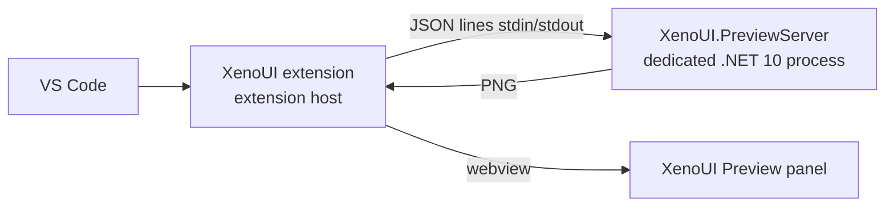

# Visual Studio Code — XenoUI Preview, projects, pages and components

[Documentation](index.md) · [Installation](installation.md) · [Visual Studio](visual-studio.md) · [Developer guide](developer-guide.md)

The **XenoUI** extension for Visual Studio Code brings to macOS, Linux and Windows what the Visual Studio extension brings to Windows:

- **XenoUI Preview**: a panel that shows, as you type, the components and pages marked `[Preview]`, with the same render server as Visual Studio;
- **creating projects, pages and components** from the `XenoUI.Templates` templates;
- Android device selection and application launching (the `xeno` tool).

> **Status: pre-release `{{ vscode_extension_version }}` published on the [VS Code Marketplace](https://marketplace.visualstudio.com/items?itemName=EliezerBwana.xenoui).** The extension has its own version number; it creates projects with `Xeno.SDK` `{{ xeno_version }}`.
>
> Prerequisites: VS Code 1.95+ and the .NET 10 SDK (previews compile against its reference assemblies; project creation uses `dotnet new`). The server, the protocol client, the templates and item creation are tested on macOS, and the Windows package on Windows; the panel on Linux still has to be validated.

## Installing

In VS Code: *Extensions* view (**Cmd/Ctrl+Shift+X**), search for **XenoUI** (publisher *EliezerBwana*), then **Install**. Only a pre-release exists for now; if VS Code offers both, choose *Install Pre-Release Version*. From the command line:

```bash
code --install-extension EliezerBwana.xenoui --pre-release
```

VS Code installs the package for your platform automatically (`win32-x64`, `win32-arm64`, `darwin-x64`, `darwin-arm64`, `linux-x64`, `linux-arm64`, `alpine-x64`). Updates come through the Marketplace. Uninstall: `code --uninstall-extension EliezerBwana.xenoui`.

## Creating a project, a page, a component

| Command (palette **Cmd/Ctrl+Shift+P**) | Effect |
|---|---|
| **XenoUI: New Project…** | Name, parent folder, platforms (Android, iOS), `Xeno.SDK` package source, then `dotnet new xenoui`; offers to open the project or add it to the workspace |
| **XenoUI: New Page…** | `dotnet new xenoui-page` in the chosen folder, then opens the file; reminds you to register the page with `Page<T>()` in `App.OnStart` |
| **XenoUI: New Component…** | `dotnet new xenoui-component` in the chosen folder, then opens the file |
| **XenoUI: Install Templates** | Reinstalls the templates shipped with the extension |

The page and component commands are also in the explorer: *right-click a folder › XenoUI*. The folder must be inside a XenoUI project. The namespace follows the project's (`RootNamespace`, else the `.csproj` name) followed by the subfolders, as in Visual Studio: a page created in `Features/Cart` of the `Shop` project is in `Shop.Features.Cart`.

The templates are installed automatically on first use when missing, from the package shipped in the extension. The `Xeno.SDK` version written to `global.json` is the extension's. At the "`Xeno.SDK` package source" step, choose **nuget.org only**: the SDK is published there and no `NuGet.config` is needed.

## Using XenoUI Preview

Open a C# file of a `Xeno.SDK` project, then **XenoUI: Open Preview** (**Cmd+Alt+P** / **Ctrl+Alt+P**, or the preview icon at the top of the editor). The panel opens beside the editor and follows the active C# file:

- it shows the `[Preview]`s **declared in that file**; unsaved text is taken into account;
- each change triggers a new render after 350 ms of inactivity;
- on a compilation error, the errors are listed (a click opens the line) and the last valid render stays on screen;
- an exception in a preview is shown in its place, with a fix hint when the failure is a typical one;
- `−` / `+` set the zoom (100 % = phone size in dp), **Refresh** forces a new render.

Nothing is computed while the panel is hidden. The `[Preview]` attribute, page previews and `OnPreview()` are described in [Visual Studio › Writing previews](visual-studio.md#writing-previews): the behaviour is the same.

| Setting | Default | Role |
|---|---|---|
| `xenoui.previewScale` | `2` | Pixels per dp of the images |
| `xenoui.previewServerPath` | empty | Path of a `XenoUI.PreviewServer.dll` to use instead of the shipped server |
| `xenoui.cliPath` | `xeno` | `xeno` tool used for the device list and launching |

## How it works



The extension talks to the **same render server** as Visual Studio, with the same protocol: in-memory compilation, the project's XenoUI runtime (packages from the NuGet cache, else the embedded runtime with a warning), collectible context, isolation and automatic restart. See [Visual Studio › How it works and isolation](visual-studio.md#how-it-works-and-isolation).

VS Code specifics:

- each `.vsix` is platform-specific (`darwin-arm64`, `darwin-x64`, `linux-x64`, `linux-arm64`, `alpine-x64`, `win32-x64`, `win32-arm64`) and contains only that platform's native SkiaSharp libraries;
- images are written to a temporary folder specific to the window (`XenoUI.Preview/vscode-<pid>`), the only folder the panel may read;
- the server stops with the VS Code window (parent process watch) or after 15 minutes of inactivity.

Measured on a sample application (macOS, Intel): first render about 10 s, then ~0.9 s of compilation and ~0.2 s of rendering per change.

## Limits

- Those of the render server: see [Visual Studio › Limits](visual-studio.md#limits).
- The server is started with the `dotnet` command on the `PATH`; without a .NET 10 runtime, the panel says so.
- The creation commands use `dotnet new`: an Android project then builds with the Android workload, an iOS project requires macOS and Xcode.
- Launching on a device (status bar, **XenoUI: Run on Selected Device**) only applies to Android projects.
