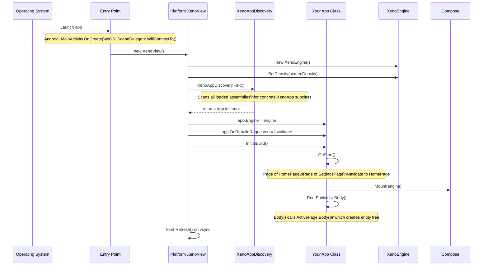
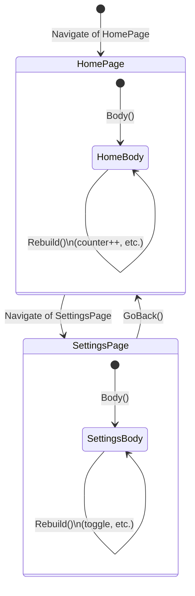
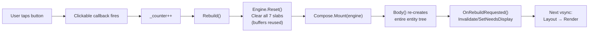
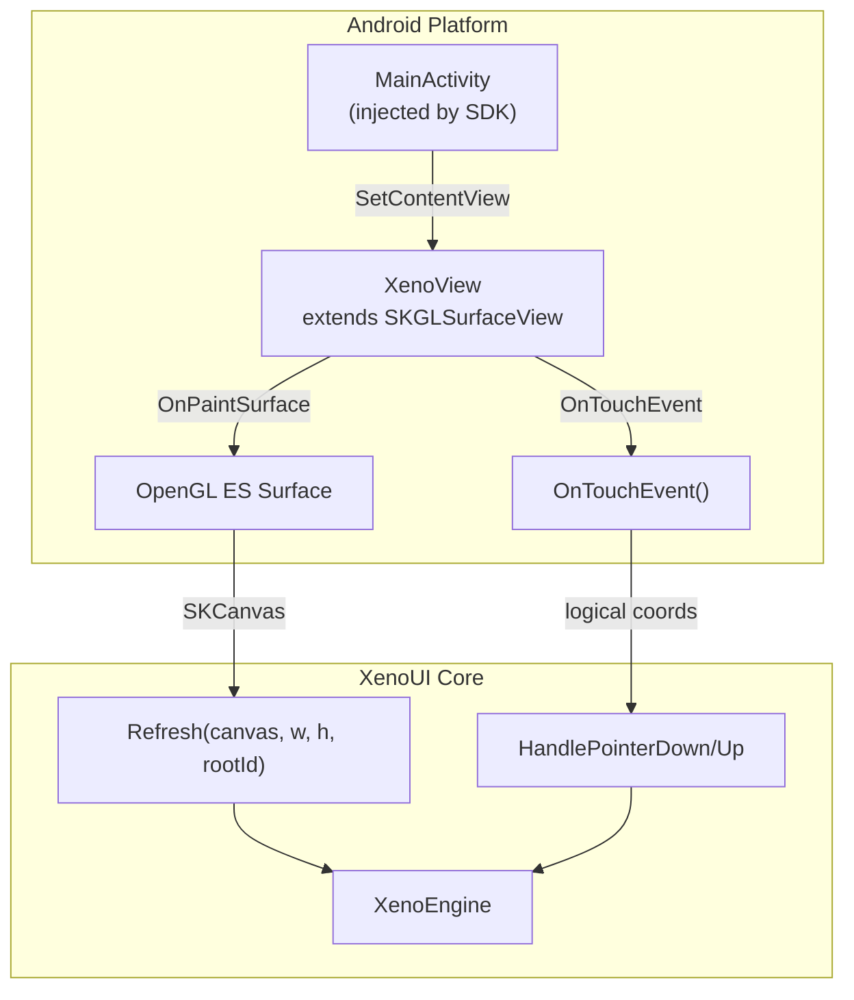
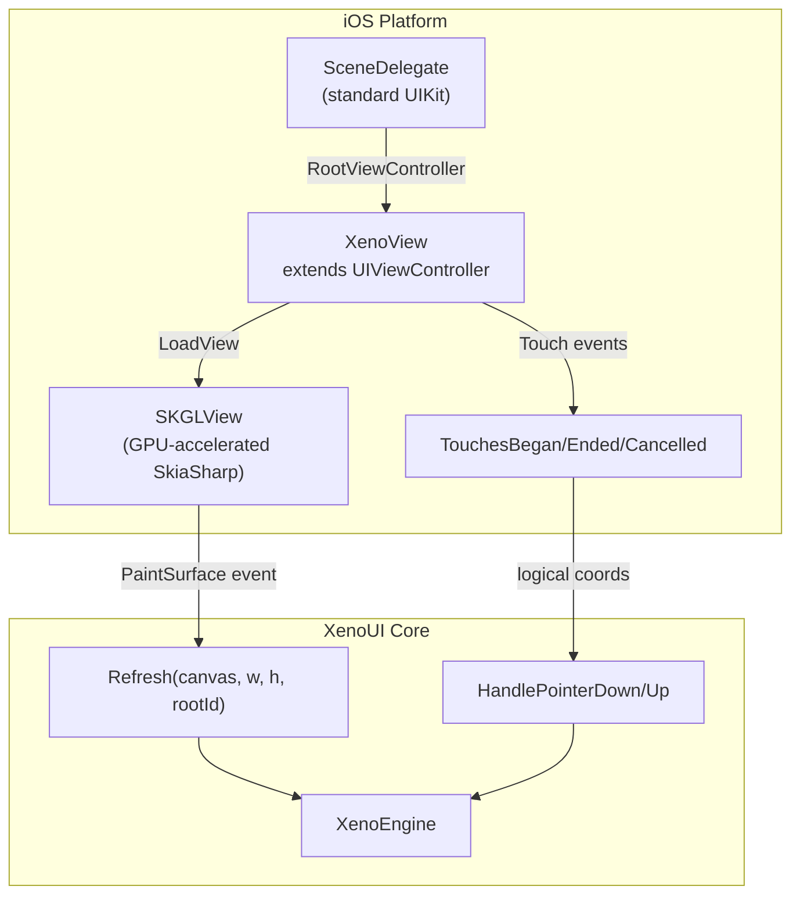
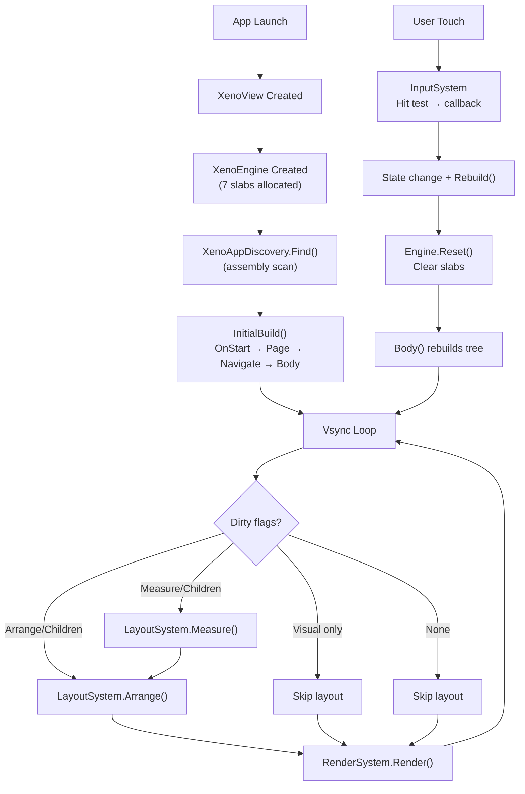

# Application Lifecycle & Navigation

> **Document historique.** Utilisez le [guide développeur](developer-guide.md#8-navigation-et-retour-natif) et la [référence runtime](architecture/runtime.md#10-navigation) pour le contrat actuel. Ce fichier peut contenir des hypothèses antérieures.

This document traces the complete lifecycle of a XenoUI application — from OS launch to pixels on screen.

---

## Boot Sequence



### Step-by-Step

1. **OS launches the app** → platform entry point runs (`MainActivity.OnCreate` on Android, `SceneDelegate` on iOS)
2. **XenoView is created** → this is a SkiaSharp surface view (`SKGLSurfaceView` on Android, `UIViewController` + `SKGLView` on iOS)
3. **XenoEngine is created** → allocates all 7 slabs in `XenoUICacheMemory` (default capacity: 1024 entities)
4. **Screen density is set** → `DisplayMetrics.Density` (Android) or `UIScreen.MainScreen.Scale` (iOS)
5. **XenoAppDiscovery.Find()** → one-time assembly reflection scan. Finds the single concrete `XenoApp` subclass. Throws if 0 or >1 found.
6. **Engine is wired to App** → `app.Engine = engine`, `app.OnRebuildRequested = Invalidate` (platform redraw callback)
7. **InitialBuild()** → calls `OnStart()` (page registration + initial navigation), then `Compose.Mount(engine)`, then `Body()` to create the entity tree
8. **First vsync** → platform calls `Refresh()` → Layout → Render → pixels on screen

---

## Page Registration & Navigation

### Registration

Pages are registered once in `OnStart()` and **reused** across navigations:

```csharp
public class App : XenoApp
{
    public override void OnStart()
    {
        // Instantiate once, store in registry
        Page<HomePage>();       // new HomePage() → _pages[typeof(HomePage)] = page
        Page<SettingsPage>();   // new SettingsPage() → _pages[typeof(SettingsPage)] = page

        // Push initial page and build
        Navigate<HomePage>();   // _navStack.Add(page) → Rebuild()
    }
}
```

### Navigation Stack



**Key behaviors:**
- `Navigate<T>()` pushes page onto `_navStack`, triggers `Rebuild()`
- `GoBack()` pops the stack, triggers `Rebuild()`
- Page instances are **reused** — state (counters, toggles, etc.) survives across navigations
- `ActivePage` is always the last item in `_navStack`

### Navigation Internals

```csharp
// Inside XenoApp:
public void Navigate<TPage>() where TPage : XenoPage
{
    if (!_pages.TryGetValue(typeof(TPage), out var page))
        throw new InvalidOperationException($"Page {typeof(TPage).Name} not registered.");

    _navStack.Add(page);   // push
    Rebuild();              // full ECS reset + re-render
}

public void GoBack()
{
    if (_navStack.Count > 1)
    {
        _navStack.RemoveAt(_navStack.Count - 1);  // pop
        Rebuild();
    }
}
```

---

## State Management (Current)

State is currently stored as fields on `XenoPage` subclasses:

```csharp
public class HomePage : XenoPage
{
    private int _counter = 0;      // ← state lives here
    private bool _darkMode = false; // ← survives across navigations

    public override XenoComponent Body() =>
        Column(
            Text($"Count: {_counter}").FontSize(28),
            Box(120, 50)
                .Background(0xFF4CAF50)
                .CornerRadius(8)
                .Clickable(() => { _counter++; Rebuild(); })
        ).Padding(20);
}
```

### State Change Flow



**Pattern**: Mutate state → call `Rebuild()` → entire entity tree reconstructed → platform redraws.

**Why this works**: `Slab.Clear()` just resets `_count = 0` without freeing memory. Rebuilding ~100 entities costs microseconds because it's just a series of `Push()` calls into pre-allocated native arrays.

---

## Platform Integration

### Android



| Aspect | Implementation |
|---|---|
| **View** | `SKGLSurfaceView` (GPU-accelerated SkiaSharp) |
| **Density** | `context.Resources.DisplayMetrics.Density` |
| **Invalidation** | `Invalidate()` triggers next `OnPaintSurface` |
| **Render Loop** | `OnPaintSurface` calls `Invalidate()` at end (continuous vsync) |
| **Touch** | `OnTouchEvent` → convert to logical coords (÷density) → `HandlePointerDown/Up` |

### iOS



| Aspect | Implementation |
|---|---|
| **View** | `UIViewController` with `SKGLView` child (Metal-backed) |
| **Density** | `UIScreen.MainScreen.Scale` |
| **Invalidation** | `_skglView.SetNeedsDisplay()` triggers next paint |
| **Scene** | Standard `UIWindowSceneSessionRoleApplication` configuration |
| **Touch** | `TouchesBegan/Ended/Cancelled` → logical coords → `HandlePointerDown/Up` |
| **App Delegate** | Standard `UIApplicationDelegate` with scene configuration |

### Platform Abstraction

The core engine (`XenoEngine`, `LayoutSystem`) never references SkiaSharp or any platform API. The abstraction boundary:

```
                    Core (platform-agnostic)
                    ┌──────────────────────────┐
                    │ LayoutSystem              │
                    │   TextMeasurer = callback │  ← injected
                    │ RenderSystem              │
                    │   uses SKCanvas           │  ← SkiaSharp (cross-platform)
                    │ InputSystem               │
                    │   logical coordinates     │  ← platform converts
                    └──────────────────────────┘
                              ▲
                    ┌─────────┴─────────┐
             ┌─────┴─────┐       ┌─────┴─────┐
             │  Android   │       │    iOS     │
             │ XenoView   │       │ XenoView   │
             │ (density,  │       │ (density,  │
             │  touch,    │       │  touch,    │
             │  vsync)    │       │  vsync)    │
             └───────────┘       └───────────┘
```

---

## Reusable Components

Components are **plain classes** with a `Body()` method — no base class required:

```csharp
public class HeaderBar
{
    private readonly string _title;

    public HeaderBar(string title) => _title = title;

    public XenoComponent Body() =>
        Row(
            Text(_title).FontSize(20).TextColor(0xFFFFFFFF)
        ).Padding(16, 12).Background(0xFF1976D2);
}
```

Used inside pages:

```csharp
public override XenoComponent Body() =>
    Column(
        new HeaderBar("Home").Body(),    // ← reusable component
        Text($"Count: {_counter}"),
        // ...
    );
```

---

## File Organization (Swift-Inspired)

```
MyApp/
├── MyApp.csproj          ← imports Sdk.props + Sdk.targets
├── App.cs                ← XenoApp subclass (one per app)
├── Pages/
│   ├── HomePage.cs       ← one file per page
│   ├── SettingsPage.cs
│   └── ProfilePage.cs
└── Components/
    ├── HeaderBar.cs      ← reusable UI components
    ├── TabBar.cs
    └── Card.cs
```

Each page is self-contained with its own state and `Body()`. Components are composable building blocks. This pattern follows the Swift/SwiftUI convention of one file per screen.

---

## Lifecycle Summary


