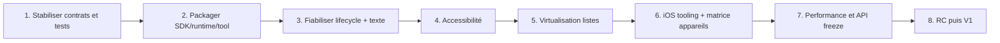

# Décisions, stabilité et trajectoire V1

[Architecture](index.md) · [Runtime](runtime.md) · [Texte et NativeTunnel](text-input-and-native.md) · [Tooling et plateformes](tooling-and-platforms.md)

Ce document transforme l’audit du dépôt en décisions explicites. Il ne remplace pas un backlog : il fixe les invariants, les risques et l’ordre logique des travaux nécessaires à une V1 crédible.

## 1. Décisions structurantes

### ADR-001 — Rendu contrôlé par XenoUI

**Décision.** Les composants visuels sont composés, layoutés et dessinés par XenoUI/Skia plutôt que délégués à un arbre de widgets natifs.

**Raison.** Cohérence interplateforme, customisation complète et représentation data-oriented.

**Conséquences.** XenoUI doit fournir layout, rendu, hit-testing, sémantique et accessibilité. Il ne peut pas hériter gratuitement de toutes les conventions des widgets natifs.

### ADR-002 — IME natif caché, rendu texte custom

**Décision.** `EditText`/`UITextView` restent invisibles et servent de clients IME ; XenoUI peint texte, caret et sélection.

**Raison.** Les protocoles de saisie natifs sont complexes et déjà éprouvés, tandis que le produit exige une forte customisation.

**Conséquences.** Snapshot/version/géométrie doivent rester atomiques. Accessibilité et tests multilingues deviennent prioritaires.

### ADR-003 — NativeTunnel typé

**Décision.** Toute capacité OS traverse une interface `INativeCapability` sans types plateforme dans Core.

**Raison.** Préserver les frontières, la testabilité et l’évolution indépendante des hôtes.

**Conséquences.** Chaque contrat doit documenter support, thread, durée de vie, permissions, erreurs et annulation.

### ADR-004 — Reconstruction totale correctness-first

**Décision actuelle.** Les changements structurels remplacent l’arbre ECS complet sous verrou. Les mises à jour textuelles réactives peuvent être fines.

**Raison.** Modèle simple, déterministe et déjà protégé contre l’exposition d’un arbre partiel.

**Conséquences.** Pas d’identité keyed automatique, coût proportionnel à l’arbre et risque si une entité transitoire fuit. Toute recomposition incrémentale future doit d’abord préserver l’atomicité existante.

### ADR-005 — Layout interne aujourd’hui, Yoga évalué par adaptateur

**Décision.** Le runtime courant reste la source de vérité ; Yoga n’est pas annoncé comme capacité. Une adoption éventuelle passe par un backend interchangeable et une suite de conformité.

**Raison.** Yoga peut réduire le coût de maintenance flex, mais une migration directe risquerait mesures texte, scroll et représentation ECS.

### ADR-006 — CLI comme source de vérité appareils pour les extensions XenoUI

**Décision.** VS Code délègue découverte/lancement à `xeno`. Visual Studio utilise encore son pipeline standard faute d’extension dédiée.

**Raison.** Éviter la duplication ADB, ABI et build dans chaque IDE.

## 2. Garanties actuelles et non-garanties

### Garanties défendues par le code/tests

- l’arbre remplacé est publié atomiquement sous le verrou engine ;
- les anciens abonnements réactifs sont invalidés par version ;
- les pages enregistrées sont réutilisées et leurs champs persistent ;
- le scroll est borné et s’arrête sans overflow ;
- le contrôleur texte valide sélection/composition et conserve undo/redo ;
- Android choisit un RID selon ABI avant build/install ;
- une cible non online n’est pas lancée.
- `Xeno.SDK` se consomme hors dépôt via un feed NuGet local, sans imports relatifs ni références source ;
- les manifests générés restent sous `obj` et les fichiers personnalisés sont préservés.

### Non-garanties pré-V1

- compatibilité source/binaire entre commits ;
- absence totale d’allocation/GC par frame ;
- absence de churn/allocation lors de la matérialisation des nouveaux items (les items communs sont désormais conservés par clé/index) ;
- accessibilité complète ;
- multi-window/multi-engine simultané ;
- support CLI iOS ;
- SDK publié sur nuget.org et matrice IDE/macOS complète ;
- comportement identique sur tous IME, langues et claviers matériels ;
- stabilité des API NativeTunnel au-delà des contrats actuels.

## 3. Dette technique et risques

| Priorité | Dette/risque | Impact | Critère de fermeture |
|---|---|---|---|
| P0 | publication et validation macOS/IDE de Xeno.SDK | distribution publique pas encore disponible | preview locale packagée et consommateur Android hors dépôt validés ; finaliser la matrice et publier des versions immuables |
| P0 | absence CI/runtime iOS validé | promesse multiplateforme fragile | build + tests + smoke iOS macOS |
| P0 | accessibilité sémantique absente | application non inclusive/non publiable | arbre sémantique TalkBack/VoiceOver testé |
| P0 | APIs/ressources natives et callbacks tardifs | crash/UAF navigation ou teardown | tests génération, dispose et stress back |
| P1 | matérialisation lazy avec nouveaux textes encore allouante | A15 : environ 80 B/frame progressif ; stress GL 2 700 sauts : 5 040,11 B/frame et 3 GC Gen0 en ~30 s ; libellé constant à 0 B/GC sur sauts alternés GL mais 0,73 B/saut aléatoire CPU inexpliqué | profiling attribué des misses/arbres complexes + traces de pauses GC et présentation |
| P1 | composition statique globale | multi-engine non sûr | contexte explicite ou contrainte enforceable |
| P1 | reconstruction totale | coût et churn grands écrans | métriques + stratégie keyed/subtree sûre |
| P1 | style TextInput limité | API peu flexible | objet de style/thème documenté |
| P1 | CLI Android uniquement | iOS non intégré | provider iOS et contrat devices commun |
| P1 | incrémentalité fine des manifests SDK | tâche XML réévaluée à chaque build | inputs/outputs et diagnostics enrichis ; génération sous `obj` et absence de modification source déjà couvertes |
| P2 | moteur layout maison non conforme documenté | cas flex complexes | suite conformité + décision Yoga |
| P2 | extension VS Code prototype | DX fragile | tests Extension Host, publication/versioning |
| P2 | pas d’extension Visual Studio dédiée | tooling XenoUI non unifié | décision produit + prototype si nécessaire |
| P2 | baselines PC et CPU/thread GL A15 disponibles ; présentation/mémoire soutenue ouvertes | FPS présentés et stabilité mémoire en usage prolongé non prouvés | traces GPU/présentation/mémoire + autres appareils physiques |

La [référence A15 du 5 octobre 2026](../runtime-benchmark-a15.md) conserve la baseline et la série après correction : allocations réduites, zéro octet dans le diagnostic GL préparé, aucun GC dans les nouvelles fenêtres courtes, mais pas de garantie globale. La [baseline PC](../runtime-benchmark.md) reste comparative. Ces mesures ne ferment ni le gate des FPS réellement présentés, ni celui de mémoire native soutenue, ni la garantie globale « zero-GC ». La suite de régression Release associée passe 100/100 tests.

## 4. Plan V1 recommandé

### Phase 1 — Baseline vérifiable

- classifier API publique vs interne ;
- convertir les bugs historiques en tests de régression ;
- ajouter stress tests navigation/rebuild/dispose et scroll ;
- définir matrice .NET/Android/iOS ;
- rendre la CI Windows + macOS obligatoire.

### Phase 2 — Distribution

- produire packages Core, StandardLibrary, Android, iOS, SDK, Tooling et templates cohérents ;
- supprimer les chemins repo absolus/Debug ;
- créer projet consommateur fixture hors solution ;
- versionner schéma JSON du CLI ;
- documenter install/update/uninstall.

### Phase 3 — Solidité runtime

- auditer propriétaires de ressources et callbacks de génération ;
- supprimer la dépendance implicite au moteur statique ou imposer single-engine ;
- tester rotate/resume/background/teardown ;
- compléter matrice IME et clavier matériel ;
- rendre les styles texte/field publics sans casser le tunnel natif.

### Phase 4 — Accessibilité

- concevoir IDs sémantiques stables à travers rebuild ;
- mapper rôles/actions/bounds ;
- intégrer TalkBack/VoiceOver et tests manuels automatisables ;
- définir focus clavier et navigation switch.

### Phase 5 — Listes réellement lazy

- identité keyed obligatoire ou optionnelle ;
- fenêtre visible + overscan ;
- rewindow déclenché par scroll sans arbre vide ;
- mesure variable et correction d’estimation ;
- recyclage sûr sans conserver d’ID périmé ;
- tests saut, prepend/delete, contenu vide, resize et vitesse élevée.

### Phase 6 — Parité plateforme/tooling

- provider iOS simulator/device ;
- launch/debug/logs ;
- cohérence VS Code/CLI ;
- workflow Visual Studio clairement supporté ou extension dédiée ;
- validation sample sur appareils réels.

### Phase 7 — Freeze et release candidate

- benchmarks temps frame, rebuild, mémoire, première saisie et grande liste ;
- revue noms/nullabilité/exceptions/threading de l’API ;
- changelog et migration guide ;
- politique semver/support ;
- audit permissions, logs secrets et supply chain packages.

## 5. Recomposition future : contraintes de design

Étudier Compose/SwiftUI ne signifie pas reproduire leur surface. Le besoin réel est de réduire le coût sans perdre les garanties.

Une proposition acceptable doit définir :

- identité des nœuds (position, type, key explicite) ;
- ownership des subscriptions/controllers/ressources ;
- invalidation mesure/rendu ;
- transactions qui publient un arbre cohérent ;
- navigation et pages persistantes ;
- interaction avec slabs réallouables ;
- comportement quand la composition lance une exception ;
- tooling/debug de l’identité et des recompositions.

Approche recommandée : mesurer d’abord la reconstruction totale, introduire des keys pour les listes, puis expérimenter le remplacement de sous-arbres derrière une API interne. Ne pas exposer un système de hooks positionnels tant que l’identité multi-rebuild n’est pas formellement testée.

## 6. Points d’extension autorisés

- widget composé dans `XenoUI.StandardLibrary` sans nouveau primitive engine ;
- primitive Core seulement si layout/render/input nécessitent une donnée nouvelle ;
- `INativeCapability` pour service OS ;
- backend de paragraph/layout derrière une interface ;
- provider appareil dans Tooling ;
- adaptateur IDE qui consomme les contrats CLI/MSBuild.

Éviter :

- appels plateforme conditionnels dans les pages ;
- callbacks stockant un `XenoComponent` ;
- service locator global supplémentaire ;
- format JSON IDE distinct du CLI ;
- propriété MSBuild magique non documentée ;
- cache sans version/owner/dispose.

## 7. Definition of Done d’une fonctionnalité framework

- contrat et plateformes supportées explicités ;
- tests unitaires/régression et au moins un test limite ;
- durée de vie, threading, permissions et erreurs documentés ;
- aucun type plateforme dans Core ;
- dispose/callback tardive traités ;
- sample mis à jour si fonctionnalité visible ;
- guide développeur et architecture synchronisés ;
- commandes de build réellement exécutées ;
- limitations restantes inscrites ici.

## 8. Compatibilité et gouvernance

Avant V1, annoncer chaque rupture. À partir d’une première preview packagée :

- appliquer SemVer aux packages alignés ;
- définir un niveau de stabilité (`experimental`, `preview`, `stable`) par namespace/API ;
- déprécier avant suppression dès que possible ;
- maintenir un changelog et des guides de migration ;
- publier la matrice .NET SDK/workload/OS ;
- conserver les ADR dans ce module ou un dossier dédié, reliés aux PRs.

La V1 ne doit pas signifier « toutes les fonctionnalités », mais un noyau honnête, installable, accessible, testable et compatible avec la matrice publiée.
