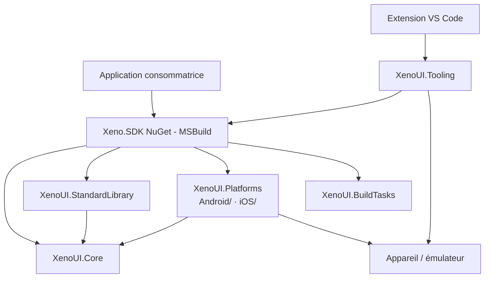
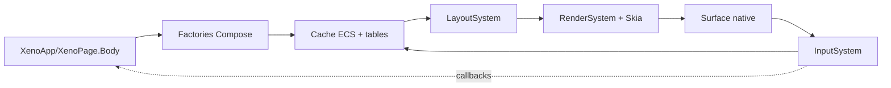
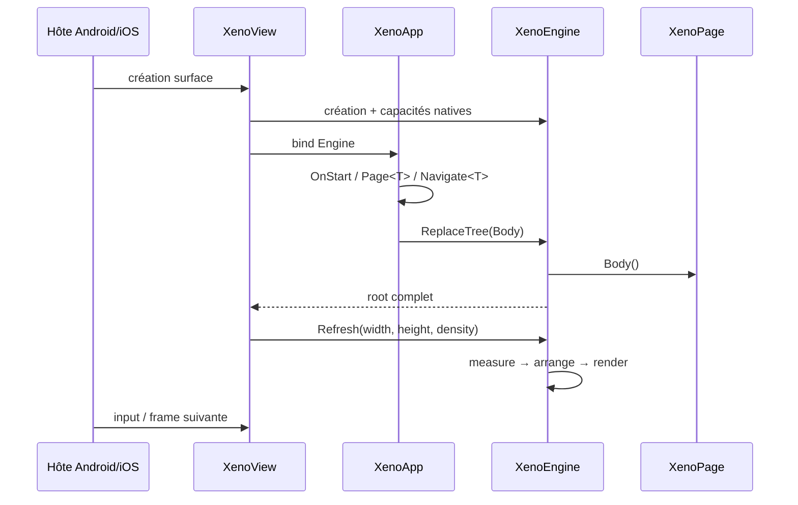

# Architecture XenoUI

[Index docs](../index.md) · [Guide développeur](../developer-guide.md) · [Décisions V1](decisions-v1.md)

Ce module est la référence d’architecture du framework. Il décrit les frontières réellement présentes dans le dépôt, les invariants que les contributions doivent préserver et les écarts à fermer avant V1.

## Carte du module

- [Runtime, composition, layout et rendu](runtime.md)
- [Navigation, scènes ECS et chemin de frame](navigation-and-scenes.md)
- [Paragraphes, TextInput, IME et NativeTunnel](text-input-and-native.md)
- [SDK, Android/iOS, CLI, Visual Studio et VS Code](tooling-and-platforms.md)
- [Décisions, stabilité, dette et trajectoire V1](decisions-v1.md)

## Objectifs d’architecture

1. Une API déclarative C# compacte et personnalisable.
2. Un rendu cohérent contrôlé par XenoUI, indépendant des widgets visuels natifs.
3. Des services système natifs conservés derrière des contrats typés.
4. Un chemin de frame prévisible : composition, mesure, arrangement, rendu, input.
5. Une mémoire orientée données pour les composants chauds, sans promettre prématurément zéro allocation partout.
6. Une séparation stricte entre runtime, intégration plateforme, build SDK, tooling appareil et extensions IDE.

## Cartographie des projets

| Projet/zone | Responsabilité | Ne doit pas contenir |
|---|---|---|
| `XenoUI.Core` | composition, ECS/cache, layout, rendu, input abstrait, texte, contrats natifs | types Android/UIKit, orchestration CLI/IDE |
| `XenoUI.StandardLibrary` | widgets composés réutilisables et icônes | cycle de vie hôte ou appels OS directs |
| `XenoUI.Platforms/Android` (`net10.0-android`) | surface Skia, cycle Activity/View, IME/clipboard Android, back natif | politique applicative multiplateforme |
| `XenoUI.Platforms/iOS` (`net10.0-ios`) | surface UIKit/Skia, cycle UIView, IME/clipboard iOS | politique applicative multiplateforme |
| `XenoUI.BuildTasks` | génération MSBuild déterministe | détection d’appareils ou runtime UI |
| `Xeno.SDK` | expérience projet MSBuild, références NuGet, points d’entrée, assets | logique runtime |
| `XenoUI.Tooling` | appareils et lancement hors processus | rendu ou état d’application |
| Extension VS Code (prototype) | UX VS Code, sélection et commandes | duplication de la logique ADB/build |

## Vue d’ensemble du runtime

Le runtime ne construit pas un arbre d’objets widgets durable. Les factories créent des entités entières et remplissent des slabs parallèles. Les relations parent/enfants et les données managées restent dans des tables latérales. Après une reconstruction, les IDs et `XenoComponent` précédents sont invalides.

## Cycle de vie d’une application

Les pages sont créées une fois et réutilisées. Les champs de page portent l’état durable. L’hôte détache l’application et libère l’engine à sa destruction.

## Frontière application / framework

Contrat public principal :

- `XenoApp.OnStart`, `Page<T>`, `Navigate<T>`, `GoBack`, `TryGoBack`, `Body`, `Native` ;
- `XenoPage.Body`, `Rebuild`, `Navigate<T>`, `GoBack` ;
- factories `Compose` et modificateurs `XenoComponent` ;
- `State<T>`, `ScrollState`, `LazyListState`, `TextEditController`, créés par les hooks `UseState`, `UseStates`, `UseScroll`, `UseLazyList`, `UseTextEdit` ;
- fabriques d’options `InputOptions`, `Selection`, `Caret`, `Glyph` : le DSL n’exige pas `new` ;
- contrats `NativeTunnel` destinés aux extensions contrôlées.

Contrats internes à ne pas exposer comme API stable : IDs d’entités, slabs, tables cache, nœuds paragraphes, génération d’arbre, implémentations platform view et heuristiques de scrolling.

## Règles de contribution transversales

- Un ID d’entité est valide uniquement pour la version d’arbre qui l’a créé.
- Une callback native/asynchrone doit être annulable ou porter une génération/version.
- Mesure, arrangement, paragraph shape et sélection doivent provenir d’un snapshot cohérent.
- Une ressource native possède un propriétaire et un point de libération explicites.
- Le thread UI pilote les plateformes ; l’engine protège l’arbre, mais ce verrou ne transforme pas toutes les API en API concurrentes.
- Une capacité OS traverse `NativeTunnel`; elle ne fuit pas dans Core.
- Le tooling pilote build et appareils hors processus ; il ne doit pas être chargé dans l’application.
- Toute nouvelle promesse de compatibilité ou performance doit recevoir un test/benchmark et une documentation.

## Lire ensuite

Le flux critique et les invariants mémoire sont détaillés dans [runtime.md](runtime.md). La partie la plus sensible aux courses et aux différences de plateforme est décrite dans [text-input-and-native.md](text-input-and-native.md). Les responsabilités build/IDE/appareils sont dans [tooling-and-platforms.md](tooling-and-platforms.md).
