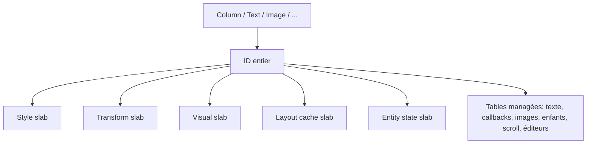
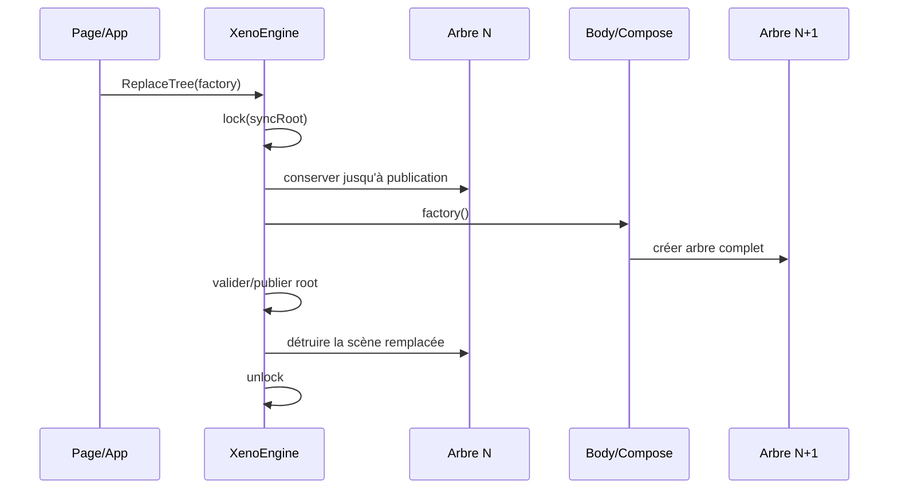
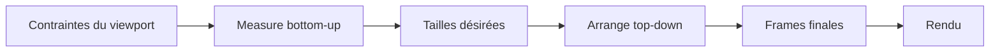
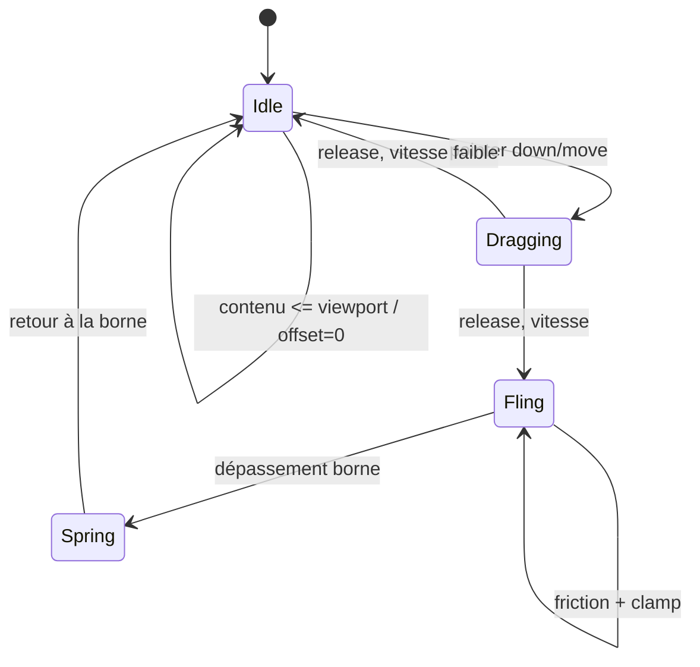
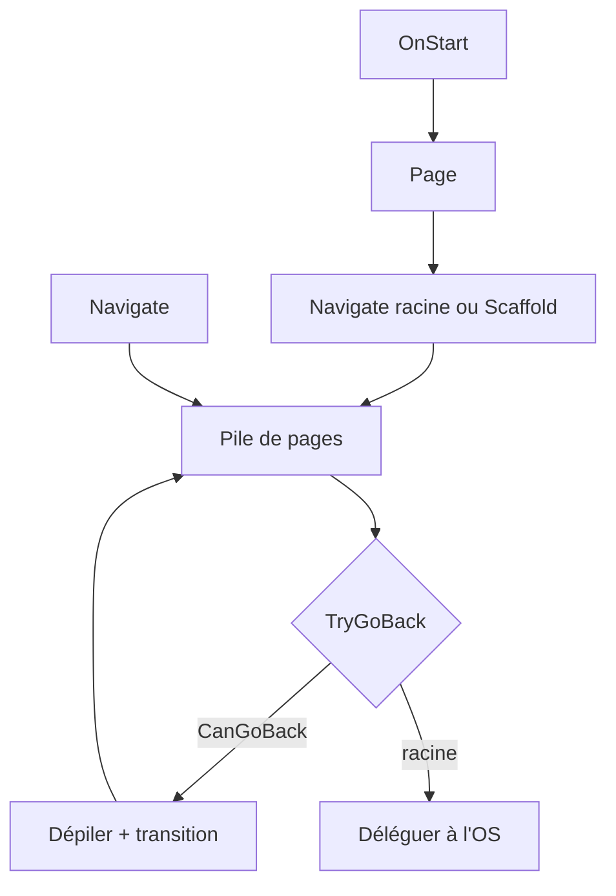

# Runtime, composition, layout et rendu

[Architecture](index.md) · [Texte et NativeTunnel](text-input-and-native.md) · [Tooling et plateformes](tooling-and-platforms.md) · [Décisions V1](decisions-v1.md)

## 1. Le moteur

`XenoEngine` agrège :

- `XenoUICacheMemory`, stockage de l’arbre courant ;
- `LayoutSystem`, mesure et arrangement ;
- `RenderSystem`, dessin Skia ;
- `InputSystem`, hit-testing, gestes, clics et scrolling ;
- moteur de paragraphes et coordination de l’édition texte ;
- verrou de cohérence, root courant, version d’arbre et abonnements.

Le moteur reçoit de l’hôte une taille physique et une densité. Le layout travaille en unités logiques ; le rendu convertit vers la surface.

## 2. Composition et représentation orientée données

`Compose.Mount(engine)` associe temporairement les factories statiques au moteur. Chaque factory :

1. alloue un ID ;
2. écrit les composants de base ;
3. enregistre les données managées éventuelles ;
4. rattache les enfants ;
5. retourne un `XenoComponent` léger contenant l’ID.

Les modificateurs réécrivent les composants associés à cet ID avant la fin de la composition.

Les slabs `XenoSlab<T>` utilisent une zone native contiguë, doublent leur capacité lorsque nécessaire et réutilisent la mémoire après `Clear`. Une référence empruntée devient invalide après `Push`, `Clear` ou `Dispose`; elle ne doit jamais être mise en cache dans un objet long-lived.

La formulation historique « zero-GC » doit être comprise comme un objectif de pression GC réduite sur les données chaudes. Les tables managées, delegates, strings, pages, contrôleurs et opérations de composition peuvent allouer. Les mesures publiées ci-dessous ne couvrent que des scénarios précis, pas tout chemin d’exécution.

### Baseline mobile A15 avant correction des allocations — 5 octobre 2026

Samsung SM-A155F, Android 16/API 36, .NET 10.0.12, Release sans AOT/trimming. Sur la surface OpenGL 1080 × 2340 (densité 2,8125), 120 frames de warm-up puis 300 mesures par scénario :

| Scénario | Moyenne CPU `Refresh` | p95 | Octets managés/Refresh |
|---|---:|---:|---:|
| Stable, 100 textes | 1,174 ms | 2,177 ms | 0 |
| Navigation, deux scènes de 100 textes | 6,484 ms | 8,351 ms | 0 |
| Lazy 10 000 items, immobile | 0,447 ms | 0,829 ms | 0 |
| Lazy progressif, 16 dp/frame | 0,636 ms | 1,369 ms | 146,67 |

Les mêmes scénarios CPU que sur PC ont été réexécutés sur l’A15 : les sauts Lazy allouent 11 365,94 B/op et ont provoqué trois GC Gen0. La cadence moyenne des callbacks GL est proche de 11,1 ms sous le mode écran 90 Hz observé, mais les timestamps de présentation et le coût GPU ne sont pas mesurés. Le run s’est terminé avec un état thermique Android 2 ; cette condition fait partie de la baseline, pas d’une garantie universelle. [Rapport A15, startup et méthodologie](../runtime-benchmark-a15.md).

Après réutilisation du journal de matérialisation et de la police de mesure : scroll GL à nouveaux textes **80 B/frame**, p95 **0,920 ms** ; sauts CPU **4 880,30 B/op**. Le diagnostic à libellé constant déjà rendu alloue **0 B** en scroll et sauts alternés GL, mais les sauts aléatoires CPU gardent **0,73 B/op inexpliqué**. Aucun GC dans les nouvelles fenêtres courtes. Le téléphone a atteint l'état thermique 3 ; ne pas attribuer toutes les variations de temps au code. La suite Core passe 100/100 tests. Les nouveaux textes, builders complexes, caches manqués et allocations natives restent hors d'une garantie zéro-GC globale. Voir la [série corrigée et ses limites](../runtime-benchmark-a15.md#6-correction-des-allocations--nouvelle-série-a15).

### Baseline PC comparative — 5 octobre 2026

Release, .NET 10.0.12, Windows x64, Skia CPU, 360 × 800 à densité 1. Trois séries de 500 opérations après 200 opérations de warm-up par série, compilation tiered désactivée.

| Scénario | Moyenne | p95 | Octets managés/opération |
|---|---:|---:|---:|
| Frame stable, 100 textes | 0,096 ms | 0,214 ms | 0 |
| Deux scènes de navigation, 100 textes chacune | 0,967 ms | 2,051 ms | 0 |
| Lazy 10 000 items, fenêtre stable | 0,057 ms | 0,086 ms | 0 |
| Lazy, déplacement progressif de 16 dp | 0,047 ms | 0,119 ms | 144 |
| Lazy, saut vers une fenêtre disjointe | 0,169 ms | 0,325 ms | 11 325,93 |
| 1 000 évaluations de transition compilée | 0,071 ms | 0,089 ms | 0 |

Aucune construction de scène/item n’a été observée pendant les mesures des frames stables ; le scroll progressif a construit 500 items sur 1 500 opérations. La séparation cold/hot path ne supprime donc pas la pression GC de la matérialisation pendant un scroll. Aucune collection GC n’a été observée dans ces fenêtres courtes, mais cela ne garantit pas l’absence de GC en usage prolongé.

La simulation d’une seconde de scroll présente un écart de 0,001953125 dp entre les pas à 60 et 120 Hz. Ce contrôle numérique n’est pas un test physique de fluidité à 120 Hz.

Les allocations sont celles du thread mesuré, hors mémoire native Skia. Les temps incluent le rendu CPU, pas la présentation/GPU mobile. Aucun gain avant/après ni engagement FPS n’est déduit de cette baseline. [Rapport complet et reproduction](../runtime-benchmark.md).

## 3. Reconstruction atomique

Le premier build appelle `XenoEngine.ReplaceTree`. Une reconstruction remplace ensuite uniquement la scène active avec `ReplaceActiveTree`. Une navigation animée publie une scène entrante tout en retenant temporairement la scène sortante.

Mesure, rendu, refresh et mises à jour coordonnées utilisent le même verrou. Une frame doit donc voir l’ancien arbre complet ou le nouveau, jamais un arbre partiellement reconstruit.

### Invariants

- `_treeVersion` change lors du reset ; les abonnements capturent leur version et ignorent les callbacks périmées.
- Le root n’est publié qu’après composition réussie.
- Les objets durables restent hors du cache transitoire : page, `State`, `ScrollState`, `TextEditController`.
- Un `XenoComponent` ne doit pas survivre à `Body()` ; seule sa description logique peut être reconstruite.

### Limite actuelle

Il n’existe pas de diff keyed ni de recomposition de sous-arbre à la Compose/SwiftUI. Une modification structurelle remplace l’arbre complet. Les liaisons `Text(State<T>)` constituent une optimisation fine séparée : elles mettent à jour le texte et les dirty flags sans `Body()`.

`Compose.Engine` étant un montage statique, plusieurs engines composant simultanément dans le même processus sont une zone de risque. La cible V1 doit introduire un contexte explicite ou garantir/faire respecter le modèle single-engine.

## 4. Dirty flags et mises à jour fines

Trois catégories pilotent le travail :

- `Measure` : taille désirée potentiellement modifiée ;
- `Arrange` : position/taille finale à recalculer ;
- `Visual` : redraw sans changement géométrique.

Une modification de texte peut nécessiter les trois. Une sélection/caret change seulement le visuel. Les flags géométriques remontent aux ancêtres ; un changement purement visuel reste local autant que possible.

Le mécanisme est incrémental à l’intérieur d’une version d’arbre, mais une reconstruction explicite reste totale.

## 5. Pipeline de layout

Le moteur de layout est une implémentation interne flex-like. Il ne s’agit pas de Yoga aujourd’hui.

Concepts pris en charge :

- directions `Column`, `Row`, `ZStack`, scroll vertical/horizontal ;
- taille explicite ou issue du contenu ;
- padding, margin, gap ;
- `FlexGrow` pour distribuer l’espace restant ;
- axes principal/transverse et `AlignSelf` ;
- texte et images à taille naturelle ;
- viewport fini pour les conteneurs scrollables.

Pour un enfant flex sans taille explicite sur l’axe principal, la base est zéro. Cela empêche par exemple une `LazyColumn().FlexGrow(1)` de réclamer comme viewport toute son étendue de contenu.

### Pourquoi Yoga est encore envisagé

Un port Yoga natif pourrait réduire le risque algorithmique, aligner les mesures flex sur un moteur éprouvé et éviter une réécriture longue. Mais il ne remplace pas :

- l’intégration paragraphes/images ;
- les conversions densité et contraintes hôte ;
- le scroll/viewport ;
- la représentation ECS ;
- les snapshots atomiques et le rendu.

Toute adoption doit passer par un adaptateur et une suite de conformité comparant l’ancien/nouveau moteur, pas par un mélange silencieux des deux.

## 6. Rendu et ressources

`RenderSystem` parcourt l’arbre arrangé et dessine sur un canvas Skia : backgrounds, coins, ombres, texte, images, sélections et curseurs. Les conteneurs scrollables ajoutent clipping et translation. L’input applique la transformation réciproque pour que hit-testing et rendu restent alignés.

Les données transitoires sont nettoyées à chaque remplacement d’arbre. Les caches d’images et de polices survivent aux reconstructions pour la durée de l’engine. `Dispose` libère images, typefaces, paragraphes et mémoire native.

### Propriété des ressources

| Ressource | Propriétaire | Durée de vie |
|---|---|---|
| slabs ECS | `XenoUICacheMemory` | engine |
| entités/composants | arbre courant | jusqu’au prochain reset |
| images/polices décodées | tables de ressources | engine/app hôte |
| paragraphes text input | nœud/engine | version/layout concerné |
| surface/canvas | hôte plateforme | cycle de la vue/native surface |

Les ajouts doivent rester idempotents à la destruction : les callbacks de timer/frame ne doivent plus toucher un engine disposé.

## 7. Input et hit-testing

L’hôte transforme les événements natifs en coordonnées logiques puis délègue à `InputSystem`. Celui-ci :

- hit-test du haut visuel vers le bas ;
- respecte clipping, translation de scroll et bounds arrangées ;
- pilote press/release et `Clickable` ;
- reconnaît drag/fling pour `ScrollState` ;
- route tap/long press/drag vers l’éditeur texte actif.

Une interaction qui demande une nouvelle frame marque l’hôte pour invalidation. L’hôte ne doit pas supposer qu’une frame unique termine une animation.

## 8. Scrolling

`ScrollState` est un modèle persistant lié à une entité scrollable à chaque composition. Il contient offset, vitesse, étendue, viewport, direction, overscroll et plage d’items.

Invariants de correction :

- `maxOffset = max(0, contentExtent - viewportExtent)` ;
- sans overflow, offset et vitesse retombent à zéro ;
- après changement de contenu/viewport, offset est clampé ;
- `NeedsAnimationFrame` devient faux lorsque le mouvement est terminé ;
- rendu et input partagent exactement la même translation.

`LazyColumn<T>`/`LazyRow<T>` matérialisent seulement le viewport et un overscan d’environ un viewport. `LazyListState` maintient un index de préfixes (arbres de Fenwick) : les tailles inconnues utilisent la moyenne apprise, puis chaque layout remplace l’estimation par la mesure réelle. La correction d’offset conserve l’item visible comme ancre pendant cet apprentissage. Le premier enfant vivant est toujours placé à sa coordonnée globale estimée, même si son index n’est pas zéro.

Lorsqu’une fenêtre sort de l’overscan, l’engine construit la prochaine fenêtre détachée, puis l’échange sous le verrou de l’arbre. Les entités, chaînes, callbacks et abonnements de l’ancienne fenêtre sont libérés et leurs slots réutilisés. Le `ScrollState` du viewport reste intact pendant l’échange. Une clé stable mémorise la taille par identité logique lors d’un remplacement ou réordonnancement de la source. Les anciennes surcharges indexées avec estimation restent un chemin de compatibilité non virtualisé.

Sans état explicite, l’engine associe le `LazyListState` au point d’appel (`fichier`, membre et ligne, avec un ordinal local). Cette identité survit aux reconstructions du même écran sans confondre les listes de pages différentes. Un changement d’orientation sur un état explicite remet l’offset à zéro.

## 9. État et durée de vie

### Pages

`Page<T>()` instancie une page et l’enregistre. `Navigate<T>()` pousse la même instance dans la pile. L’état de ses champs persiste, y compris quand une autre page est au-dessus.

### `State<T>`

Le setter compare les valeurs puis déclenche `OnChanged`. L’engine enregistre un abonnement versionné pour chaque texte réactif. Reset libère les anciens abonnements.

### Modèles persistants

`ScrollState` et `TextEditController` conservent une identité stable entre les arbres. L’entité courante se rattache à eux lors de `Body()`. C’est la règle centrale pour ne pas perdre offset, saisie ou sélection.

## 10. Navigation

Android raccorde ce contrat au mécanisme natif correspondant à la version OS. iOS n’a pas encore de navigation controller/interactive pop intégré : la pile logique fonctionne, mais le geste natif complet reste une dette.

`NavigationScaffold` conserve une pile par destination. Le changement BottomBar/Rail/Drawer ne recrée pas ces piles. Les détails techniques multi-scènes et la frontière cold/hot path sont dans [Navigation, scènes ECS et chemin de frame](navigation-and-scenes.md).

## 11. Threading, snapshots et concurrence

Le modèle attendu est : événements plateforme et dessin coordonnés par le thread UI, avec verrou engine comme garde de cohérence — pas comme autorisation d’appeler arbitrairement l’UI depuis des threads background.

Règles :

- marshaler vers le thread UI avant mutation ayant un effet visuel ;
- ne jamais tenir le verrou engine pendant un appel externe long ;
- capturer des valeurs immuables/snapshots avant rendu ;
- associer callback async/native à la génération de session et version d’arbre ;
- libérer timer caret et session IME à la perte de focus/détachement.

Le texte possède un invariant supplémentaire : snapshot du contrôleur et paragraphe mis en forme doivent être capturés ensemble. Voir [text-input-and-native.md](text-input-and-native.md).

## 12. Tests attendus

La suite Core couvre notamment : slabs, composition, layout, scroll borné, listes, état, reconstruction, navigation, texte/IME logique, Unicode, sélection, batch, undo/redo et snapshots.

Pour chaque bug runtime :

1. ajouter un test minimal déterministe ;
2. tester aux limites (zéro, vide, dernière position, contenu plus petit) ;
3. tester après `ReplaceTree` ;
4. tester `Dispose` ou callback tardive si pertinent ;
5. compléter par un test appareil quand Skia/IME/cycle OS est impliqué.
