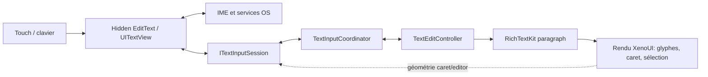
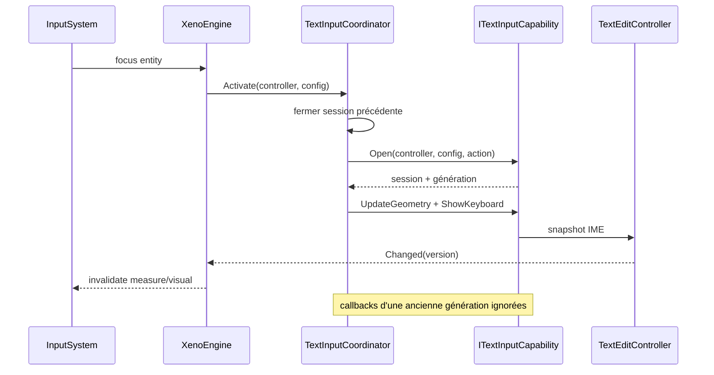
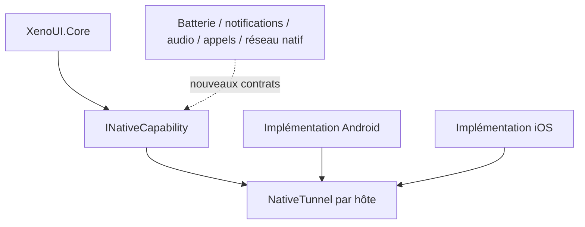

# Paragraphes, TextInput, IME et NativeTunnel

[Architecture](index.md) · [Runtime](runtime.md) · [Tooling et plateformes](tooling-and-platforms.md) · [Décisions V1](decisions-v1.md)

## 1. Décision : rendu custom, service d’entrée natif

XenoUI ne rend pas un `EditText`/`UITextView` visible comme widget final. Il adopte une architecture hybride :

- XenoUI possède le style, le layout, le paragraphe, le texte peint, le curseur, la sélection et les poignées ;
- le contrôle natif caché possède la connexion IME, la langue, la composition, l’autocorrection, les suggestions, emoji, dictée, autofill et les conventions OS ;
- un snapshot `TextEditingValue` synchronise les deux mondes.

Ce choix préserve la customisation (bouton afficher/masquer, décoration, effets, contrôle exact du rendu) sans réimplémenter les protocoles de saisie complexes.

## 2. Modèle d’édition

`TextEditingValue` est la valeur atomique de l’éditeur :

- texte ;
- `TextSelection` avec base/extent ;
- plage de composition nullable.

Les offsets suivent UTF-16, contrat commun à .NET strings et aux plateformes. Ils ne correspondent pas toujours aux runes, graphèmes ou glyphes. Le contrôleur valide les bornes et refuse les états incohérents.

`TextEditController` est l’identité stable d’un champ. Il contient :

- valeur/version et événement `Changed` ;
- piles undo/redo ;
- batch edits atomiques ;
- politiques de mise à jour externe ;
- opérations de sélection, composition, commit et suppression ;
- helpers de texte avant/après/sélectionné.

Un rebuild recrée l’entité et `EditableTextNode`, mais rattache le même contrôleur et son `TextViewportState`.

## 3. Paragraph engine

`ITextParagraphEngine` abstrait shaping, wrapping, métriques et hit-testing. L’implémentation `RichTextKitParagraphEngine` s’appuie sur RichTextKit/Skia/HarfBuzz.

Le paragraphe fournit au runtime :

- largeur/hauteur mesurées ;
- positions caret ;
- rectangles de sélection ;
- conversion position visuelle ↔ offset UTF-16 ;
- lignes et wrapping pour multi-ligne.

### Snapshot layout/viewport

Un risque classique est de peindre le paragraphe de la version N avec la sélection de N+1. `EditableTextNode.CaptureLayoutViewport` associe atomiquement :

1. snapshot/version du contrôleur ;
2. paragraphe formé depuis ce texte ;
3. viewport/scroll interne ;
4. géométrie caret/sélection issue de ce paragraphe.

Toute optimisation doit préserver cette relation. Mettre en cache le paragraphe indépendamment de la version texte est incorrect.

## 4. Focus et coordination de session

`TextInputCoordinator` possède au plus une session native active.

Le coordinateur protège contre les événements tardifs : chaque activation porte une génération. La perte de focus/détachement ferme la session et le clavier. La géométrie est mise à jour après layout.

## 5. Android

L’adaptateur crée un `EditText` natif presque transparent et minuscule (`Alpha` non nul) rattaché à la hiérarchie de vue. Il reste détectable par l’IME tout en laissant le rendu visible à Skia.

Responsabilités :

- `InputConnection` et batch edits ;
- commit/composition, sélection, suppressions UTF-16/code points ;
- mapping `NativeKeyboardType`, action IME, autocorrect, secure et autofill ;
- synchronisation du snapshot complet ;
- géométrie et keyboard show/hide ;
- presse-papiers Android ;
- `AdjustResize` pour le clavier.

Le contrôle natif ne doit pas devenir la source du style ou du layout XenoUI. Inversement, le runtime ne doit pas simuler les détails privés d’un clavier Android.

## 6. iOS

L’adaptateur utilise un `UITextView` caché. UIKit garde la propriété de `markedText`, du clavier, des langues, de la dictée et des services d’édition. XenoUI fournit les rectangles caret/first rect cohérents avec le canvas et conserve le hit-testing visible.

Responsabilités :

- synchronisation texte/sélection/marked range ;
- mapping keyboard type, return key, secure/autocorrect/content type ;
- géométrie de l’éditeur et caret ;
- presse-papiers UIKit ;
- session first responder et clavier.

La validation iOS doit être faite sur macOS avec claviers réels/simulateur ; une compilation seule ne vérifie ni la composition ni la géométrie.

## 7. Sélection, curseur et toolbar

Le runtime dessine :

- caret clignotant et reveal automatique ;
- highlight de sélection ;
- soulignement/plage de composition ;
- poignées de sélection ;
- barre Cut/Copy/Paste/Select All.

Le long press demande une sélection de mot. Le drag des poignées convertit les coordonnées via le paragraphe. Le scroll de page et le scroll interne de `TextArea` doivent être arbitrés pour éviter que déplacer le caret fasse défiler le mauvais viewport.

Les champs sécurisés :

- conservent `Secure=true` côté natif ;
- peuvent basculer `obscureText` côté rendu ;
- interdisent Couper/Copier ;
- ne doivent pas journaliser leur contenu.

## 8. Undo, redo et mises à jour externes

Une transaction logique doit produire une entrée undo. Les batch edits imbriqués restent atomiques et Undo est rejeté pendant un batch ouvert. La composition garde une base afin d’éviter une entrée par caractère intermédiaire.

Une mise à jour externe doit annoncer son origine/politique pour éviter la boucle : contrôleur → contrôle natif → contrôleur. `Version` et `TextEditOrigin` servent au diagnostic et à l’anti-écho.

Cas à tester systématiquement :

- sélection inversée et remplacement ;
- caret au début/fin ;
- paire de substitution et emoji ZWJ ;
- accent composé/décomposé ;
- composition CJK ;
- RTL et texte mixte ;
- undo après composition ;
- rebuild avec clavier ouvert ;
- passage champ A → B avec callback tardive de A.

## 9. NativeTunnel

`NativeTunnel` est un registre par hôte/application. Il ne s’agit ni d’un bus de messages stringly-typed ni du CLI appareil.

API :

- `Register<T>(capability)` : une seule implémentation typée ;
- `Get<T>()` : capacité optionnelle ;
- `Require<T>()` : échec explicite si absente.

Contrats présents : `ITextInputCapability`, `ITextInputSession`, `IClipboardCapability`.

### Ajouter une capacité

1. Définir dans Core une interface minimale héritant `INativeCapability` et des DTO sans types plateforme.
2. Décider si l’absence est supportée (`Get`) ou fatale (`Require`).
3. Implémenter Android et iOS, ou documenter précisément la matrice de support.
4. Enregistrer avant `InitialBuild`.
5. Définir threading, durée de vie, annulation, permissions et gestion d’erreur.
6. Ajouter fake/test contractuel dans Core et test d’intégration hôte.

Pour notifications ou appels, une permission/interaction utilisateur et un résultat asynchrone sont nécessaires. Le contrat doit accepter `CancellationToken` et retourner des résultats typés plutôt que lancer des commandes opaques.

## 10. Accessibilité et sémantique

Le contrôle texte natif caché fournit une partie des services d’entrée et un label, mais XenoUI n’a pas encore d’arbre sémantique complet reliant chaque composant custom-painted aux API TalkBack/VoiceOver.

Avant V1, prévoir :

- nœuds sémantiques indépendants des entités transitoires ;
- rôle, label, valeur, état, actions et bounds ;
- mapping Android AccessibilityNodeProvider et iOS UIAccessibility ;
- ordre de focus, contenu scrollable et live regions ;
- mode sécurisé qui ne révèle pas le texte ;
- tests TalkBack/VoiceOver.

## 11. Limites et extensions prévues

- paramètres visuels `TextField`/`TextArea` encore insuffisants ;
- pas de spans/rich text éditable public ;
- pas de semantic tree global ;
- matrice clavier matériel/dictée/langues incomplète ;
- pas de provider desktop/web ;
- NativeTunnel n’a pas encore de convention généralisée pour permissions, async streams et activité/scene lifecycle.

Les prochaines extensions doivent préserver la décision fondamentale : XenoUI contrôle le rendu, l’OS contrôle les protocoles d’entrée et services système qu’il sait mieux exécuter.
