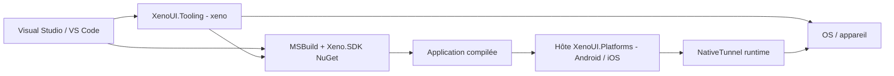
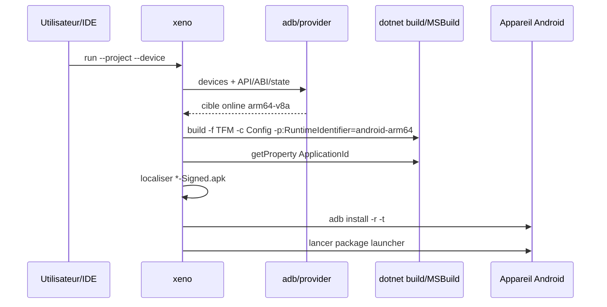

# SDK, plateformes, appareils et IDE

[Architecture](index.md) · [Runtime](runtime.md) · [Texte et NativeTunnel](text-input-and-native.md) · [Décisions V1](decisions-v1.md)

## 1. Trois couches, trois responsabilités



- **SDK/MSBuild** transforme le projet source en application plateforme.
- **Tooling/IDE** découvre une cible, choisit une configuration, déclenche le build et déploie.
- **NativeTunnel** existe dans le processus de l’application pour appeler des capacités OS.

Le CLI ne doit pas être référencé par l’app. NativeTunnel ne doit pas exécuter `adb`. L’extension IDE ne doit pas réimplémenter la détection d’ABI ou la recherche d’APK.

## 2. Évaluation MSBuild actuelle

Le consommateur utilise `<Project Sdk="Xeno.SDK/{{ xeno_version }}">`, ou une version centralisée dans `global.json`. Le package importe le SDK .NET standard sans dépendre du checkout :

1. `Sdk/Sdk.props` avant les propriétés du consommateur ;
2. propriétés et TFM de l’application ;
3. `Sdk/Sdk.targets` après les propriétés, avec sélection de l'hôte correspondant au TFM.

### `Sdk.props`

- active nullable et implicit usings ;
- marque `XenoUIProject` et la capacité IDE `XenoUI` ;
- définit `OutputType=Exe` par défaut, avant l’import de `Microsoft.NET.Sdk` (jusqu’à `{{ xeno_version }}`, la valeur était posée après et ne s’appliquait pas : voir [dépannage](../troubleshooting.md#le-build-ios-échoue-avec-cs8805)) ;
- définit identifiant, nom et minimums OS par défaut ;

### `Sdk.targets`

- fixe tardivement `ApplicationId` et les minimums OS ;
- référence les packages versionnés Core, StandardLibrary et l'hôte de la plateforme ;
- injecte les using globaux/factories et collecte `Assets/**/*` comme `XenoAsset` ;
- marque Android comme application ;
- injecte `MainActivity.cs` ou `Main.cs` ;
- fournit `Info.plist` iOS si absent ;
- transforme `XenoAsset` en `EmbeddedResource` sous `XenoAsset/` ;
- fusionne les permissions Android/iOS dans des dérivés sous `obj`, sans modifier les sources ;
- charge la tâche de build depuis `tools/netstandard2.0` du package, jamais depuis `bin/Debug`.

### Distribution et validation

- SDK, runtimes, templates et outil sont publiés sur [nuget.org](https://www.nuget.org/packages?q=XenoUI) avec une version unique (`{{ xeno_version }}`) ; une version publiée est immuable.
- Chaque release est vérifiée avant publication : version, licence, icône, README, commit Source Link et dépendances XenoUI alignées sur la même version.
- Validé le 13 octobre 2026 : une application créée par `dotnet new xenoui`, restaurée uniquement depuis nuget.org avec un cache NuGet vide, compile un APK Android signé sans avertissement.
- Les anciens imports locaux d’avant `Xeno.SDK` ne sont plus un parcours supporté pour les nouvelles applications.

Voir [Xeno.SDK](../xeno-sdk.md) pour le bootstrap, les propriétés et les points d'extension. La validation IDE/macOS et la publication de l’extension Visual Studio restent des étapes distinctes.

## 3. Hôte Android

Le SDK lie le `MainActivity` par défaut. L’hôte :

- crée la surface et `XenoEngine` ;
- enregistre les capacités IME/clipboard ;
- instancie l’`App` consommatrice ;
- convertit taille/densité et événements tactiles ;
- invalide les frames tant que scrolling/caret nécessitent une animation ;
- configure `AdjustResize` ;
- raccorde le retour natif à `TryGoBack`.

Retour :

- Android 7–12 : `OnBackPressed` ;
- Android 13+ : `OnBackInvokedDispatcher`, callback actif uniquement si `CanGoBack` ;
- racine : délégation au comportement OS.

Le Debug conserve le mécanisme de fast deployment standard du workload. Ne forcez pas `EmbedAssembliesIntoApk=true` sans raison de packaging Release.

## 4. Hôte iOS

Le SDK lie le point d’entrée iOS et l’hôte initialise surface, engine et capacités UIKit. La saisie repose sur un `UITextView` caché.

Contraintes :

- compilation/runtime sur macOS avec Xcode ;
- signature/provisioning Apple pour appareils ;
- `Info.plist` généré sous `obj` par le SDK si absent ; un plist personnalisé demeure prioritaire ;
- pas de provider `xeno devices/run` iOS ;
- pas encore d’intégration navigation controller/interactive back équivalente à Android.

L’architecture doit rester prête pour SceneDelegate/multi-window, mais `Compose.Engine` statique constitue aujourd’hui un obstacle au multi-engine simultané.

## 5. CLI `xeno`

`XenoUI.Tooling` est un .NET tool ([nuget.org](https://www.nuget.org/packages/XenoUI.Tooling), `ToolCommandName=xeno`). Commandes :

```text
xeno devices [--json] [--watch]
xeno run --project <path> --device <id>
         [--framework net10.0-android]
         [--configuration Debug]
         [--no-build]
```

### Discovery Android

`AndroidDeviceProvider` localise `adb`, lit les cibles et enrichit chaque entrée : ID, nom, émulateur/physique, état, API et ABIs. États modélisés : online, offline, unauthorized, bootloader, recovery, unknown.

`--watch` sonde chaque seconde et n’émet que si le JSON logique change. `--json` est le contrat machine utilisé par l’extension ; toute évolution doit être versionnée ou rétrocompatible.

### Run Android



Échecs explicites : cible absente/non online, ABI inconnue, build non nul, `ApplicationId` vide, APK signé absent ou install/launch ADB échoué.

### Extensions nécessaires

- abstraction `IDeviceProvider` partagée et testable ;
- provider iOS (simulateurs et appareils via outils Apple) ;
- annulation/process timeout structurés ;
- logs/deploy/debug distincts ;
- découverte de projets/configurations multi-target ;
- contrat JSON versionné ;
- package global/local tool et auto-resolution de version.

## 6. Visual Studio

Visual Studio s’appuie d’abord sur MSBuild et les workloads standard. XenoUI expose :

- `ProjectCapability Include="XenoUI"` ;
- cible Android reconnue et `AndroidApplication=true`.

L’extension **XenoUI Preview** (VisualStudio.Extensibility, hors processus, bientôt sur le Visual Studio Marketplace) ajoute la fenêtre **XenoUI Preview**. Elle délègue tout calcul à `XenoUI.PreviewServer`, un processus .NET 10 dédié qu’elle démarre, surveille et relance : compilation Roslyn en mémoire des sources du projet, `AssemblyLoadContext` collectible, rendu headless par `XenoUI.Core.Preview.PreviewRenderer`, protocole JSON une ligne par message sur stdin/stdout. Le serveur n’évalue pas MSBuild, ne construit pas le projet et n’exécute que les membres `[Preview]`. Voir [Visual Studio](../visual-studio.md).

Les templates `XenoUI.Templates` (`xenoui`, `xenoui-page`, `xenoui-component`) sont des templates `dotnet new` ; Visual Studio les affiche via `ide.host.json`.

La liste d’appareils affichée par Visual Studio provient des outils Android/.NET de Visual Studio, pas directement de `XenoUI.Tooling`.

Conséquence : un appareil visible par `xeno devices` valide ADB, mais pas automatiquement l’état du sélecteur Visual Studio. Le diagnostic doit comparer SDK Android, workload, TFM actif, projet de démarrage et évaluation MSBuild.

## 7. VS Code

L’extension **XenoUI** pour VS Code (pré-version `{{ vscode_extension_version }}` sur le Marketplace VS Code, éditeur `EliezerBwana`) couvre trois usages ; le guide utilisateur est [VS Code](../vscode.md).

- **Appareils et lancement** : cible dans la barre de statut, sélection par Quick Pick et lancement délégués au CLI `xeno` (résolu via `xenoui.cliPath` ou le `PATH`), sans dupliquer la logique ADB/build. Le JSON de `xeno devices --json` est traité comme une donnée non fiable (erreur de parsing, version incompatible, processus interrompu → message actionnable).
- **XenoUI Preview** : une webview pilote le même `XenoUI.PreviewServer` que Visual Studio, avec le même protocole JSON lignes. Une requête à la fois, délai de 45 s, redémarrage après crash ou blocage ; anti-rebond de 350 ms et aucun travail quand le panneau est masqué ; CSP stricte, seul le dossier d’images de la fenêtre est lisible.
- **Création** : `New Project/Page/Component` exécutent les templates `dotnet new` ; le namespace des éléments est réécrit depuis `RootNamespace` et les sous-dossiers, car `dotnet new` ne le lie qu’une fois le projet restauré.

Chaque `.vsix` est propre à une plateforme et ne contient que les bibliothèques natives SkiaSharp/HarfBuzz de celle-ci, plus le package `XenoUI.Templates`.

## 8. Assets et manifests

MSBuild embarque chaque `XenoAsset` avec un nom logique stable. Le runtime charge depuis les assemblies, puis met images/polices en cache.

Le pipeline packagé assure la génération sous `obj`, la préservation des sources et la fusion des permissions. Les tests d'intégration vérifient ces contrats. Restent à renforcer avant V1 :

- inputs/outputs MSBuild déclarés pour incrémentalité ;
- diagnostics avec fichier/propriété responsable ;
- tests de package sur Windows/macOS.

## 9. Matrice de responsabilités de test

| Couche | Tests automatiques | Validation intégration |
|---|---|---|
| Core | exécutable de régression | sample frame/input |
| Android host | compilation + tests contractuels | téléphone arm64 + émulateur x64 |
| iOS host | compilation macOS | simulateur + appareil selon capacité |
| BuildTasks/SDK | projets fixture, propriétés/outputs | projet externe packagé |
| Tooling | parsing/command tests | ADB réel, états offline/unauthorized |
| VS Code | tests TypeScript/command mocking | Extension Host + appareil |
| Visual Studio | évaluation solution/projet | sélecteur cible + F5/deploy |

## 10. Sécurité et fiabilité

- Ne jamais concaténer une commande shell avec les valeurs projet/appareil ; utiliser `ArgumentList`.
- Valider que le projet et l’APK résolus appartiennent au projet/configuration demandés.
- Ne pas journaliser secrets de signature, contenu de champs sécurisés ou tokens ADB/Apple.
- Fixer des timeouts et propager l’annulation aux processus enfants.
- Ne pas lancer automatiquement sur un appareil `unauthorized/offline`.
- Rendre toute opération destructive explicite ; `adb install -r` doit préserver les données tant que le package/signature le permet.

## 11. Contrat V1 visé

Une expérience installable cohérente devrait devenir :

```text
dotnet new install XenoUI.Templates::<version>
dotnet tool install --global XenoUI.Tooling --version <version>
dotnet new xenoui -n MyApp
xeno devices
xeno run --project MyApp/MyApp.csproj --device <id>
```

Ces commandes fonctionnent dès la preview `{{ xeno_version }}` publiée sur nuget.org (voir [Installation](../installation.md)). Il reste à publier une matrice de compatibilité explicite et à ajouter le provider iOS.
