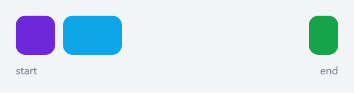
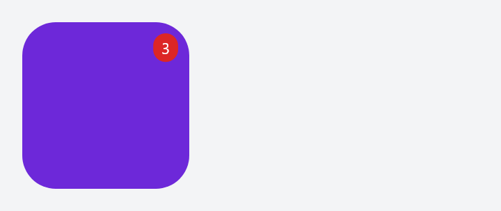
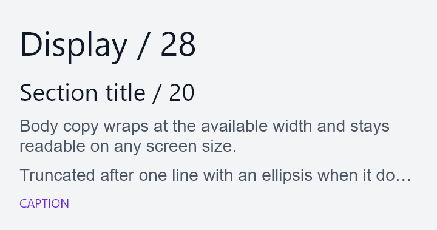
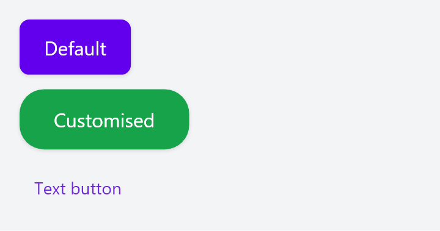
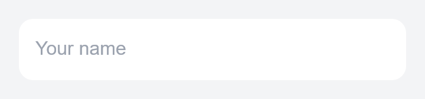
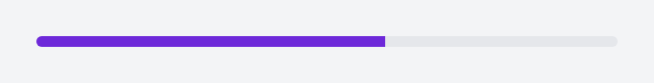
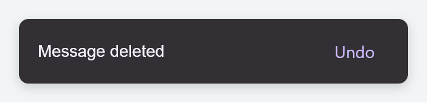
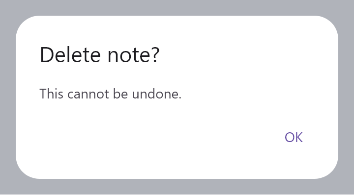

# Catalogue des composants

[Documentation](index.md) · [Créer un composant](components.md) · [Personnaliser](customization.md) · [Mises en page](layouts.md) · [Référence d’API](reference/index.md)

Tous les composants fournis par XenoUI : à quoi ils servent, leurs paramètres principaux et valeurs par défaut, les
modificateurs utiles, et une capture. Chaque entrée renvoie à la [référence d’API](reference/index.md) générée pour les
signatures complètes (en anglais). Les captures sont produites par l’aperçu headless (voir
[`tools/DocSnippets`](https://github.com/Eel2000/XenoUI.Docs/tree/main/tools/DocSnippets)).

Ce sont tous des **fonctions** qui retournent un `XenoComponent` : enchaînez des
[modificateurs](customization.md) sur le résultat. Tailles en dp, couleurs en `0xAARRGGBB`.

## Conteneurs de mise en page

### `Column(enfants…)` et `Row(enfants…)`

Empilent les enfants verticalement (`Column`) ou horizontalement (`Row`, de droite à gauche en RTL). Transparents par défaut.

| Modificateurs usuels | Effet |
|---|---|
| `.Gap(8)` | Espace entre enfants |
| `.MainAxis(MainAxisAlignment.SpaceBetween)` | Répartition le long du flux |
| `.CrossAxis(CrossAxisAlignment.Center)` | Alignement en travers (`Start`, `Center`, `End`, `Stretch`) |
| `.Padding(…)`, `.Background(…)` | Marge intérieure, fond |

### `ZStack(enfants…)`

Superpose ses enfants ; le **dernier** est au-dessus. La position horizontale vient du `MainAxis` de la pile, la verticale de
l’`AlignSelf` de chaque enfant. Voir [Mises en page](layouts.md).

### `Box(width = 0, height = 0)` et `Box(width, height, enfants…)`

Un rectangle de taille donnée (`0` = automatique). Avec des enfants, c’est un conteneur. Pour des blocs colorés, des séparateurs
(`Box(0, 1).Background(…)`) et des enveloppes de taille fixe.

### `Spacer()`

Un espace flexible : `FlexGrow(1)`. Écarte ses voisins.

## Contenu

### `Text(string | State<T> | $"…{state}", fontSize = 14)`

Dessine du texte. Statique, lié à un `State`, ou chaîne interpolée qui suit les états incorporés.

| Modificateur | Effet |
|---|---|
| `.TextColor(…)` | Couleur (noir par défaut) |
| `.FontSize(float)`, `.FontFamily("Nom")` | Taille, police de `Assets/Fonts` |
| `.TextAlign(Start/Center/End)` | Alignement dans sa boîte |
| `.MaxLines(n, ellipsis)`, `.TextWrap(bool)`, `.AutoSize(min)` | Troncature et ajustement |

### `Image(assetName)`, `ImageFile(State<string?>)`, `Icon(IconDef, size = 24)`

`Image` : image embarquée de `Assets/Images/` (taille naturelle ; `.Size`, `.ScaleMode(Cover|Fit|Fill|None)`,
`.CornerRadius`). `ImageFile` : fichier local choisi à l’exécution (`null` le masque). `Icon` : glyphe de police
(`Glyph("", "Font Awesome 5 Free-Solid-900")`).

## Actions

### `Button(label, onTap, fontSize = 16, textColor = 0xFFFFFFFF)` et `TextButton(label, onTap, color, fontSize = 14)`

`Button` : fond violet, coins de 8 dp, élévation 2 dp, padding 20/12, texte centré, teinte au toucher automatique. La couleur
et la taille du libellé sont des **paramètres** ; le reste, des modificateurs. `TextButton` : bouton plat pour les actions de
dialogue et de snackbar.

`.Clickable(Action)` rend **n’importe quel** élément tactile ; un élément tactile à fond non transparent s’assombrit de 15 %
quand il est pressé.

## Saisie de texte

`TextField(controller, placeholder, configuration, obscureText, onAction)` (une ligne) et `TextArea(…)` (plusieurs lignes),
pilotés par un `TextEditController` persistant (`UseTextEdit("")` dans un champ). Clavier et IME natifs.

## Listes et pagers

| Composant | Usage |
|---|---|
| `LazyColumn(items, itemContent, key, state)` | Liste verticale virtualisée ; tailles mesurées |
| `LazyRow(items, itemContent, key, state)` | Liste horizontale virtualisée |
| `VerticalPager(items, pageContent, key, state)` | Pages plein écran qui se calent (fils) |

Passez toujours `key`, donnez à la liste une taille bornée et gardez l’état par élément dans un champ de page.

## Retour visuel

`LinearProgress(State<float> progress, height = 2, trackColor, fillColor)` : barre horizontale liée à un état 0..1 ; la mise à
jour redimensionne le remplissage sans reconstruction.

## Overlays

Affichés au-dessus de la page et de la barre de navigation. Voir
[Overlays](https://github.com/Eel2000/XenoUI/blob/master/docs/overlays.md) et [Animations](animations.md).

| Widget | Modal | Usage |
|---|---|---|
| `Snackbar.Show(app, message, options)` | Non | Message court, action facultative ; remplace le précédent |
| `Alert.Show(app, titre, message, …)` | Oui | Un à trois boutons |
| `Dialog` | Oui | Contenu libre sur une carte |
| `Popup` | Non | Menu ou carte ancrée à l’élément touché |
| `BottomSheet.Show(app, contenu, options)` | Oui | Feuille du bas, glisser pour fermer |
| `app.Overlays.Show(contenu, OverlayOptions)` | Au choix | Overlay entièrement libre |

## Navigation et barres d’application

`NavigationScaffoldState` (shell adaptatif), `NavigationDestination.For<TPage>(label, icône, badge)`, `ITopBarPage` +
`TopBarOptions`, `NavigationFab.Standard/Extended`, `NavigationBars.Docked(…)`. Voir [Navigation](navigation-scaffold.md).

## Média

`MediaView.Video(controller, height = 210)` affiche une sortie vidéo native ; `Native.CreatePlayer(MediaKind.Video)` crée le
contrôleur. Voir [Contrôleur média](media-controller.md).

## Pas encore fournis

À **composer** à partir des primitives (voir les [recettes](components.md)) :

| Manquant | À construire avec |
|---|---|
| `Switch`, `Checkbox`, `RadioButton` | `Row` + `Box` + `Clickable` |
| `Slider` | Non disponible ; `LinearProgress` plus vos propres gestes |
| `Chip`, `Card`, `Badge` | `Text`/`Column` + `Background` + `CornerRadius` |
| Indicateur circulaire | Non disponible ; animer un `State` ([Animations](animations.md)) |
| Sélecteurs de date/heure, liste déroulante | `Popup` ou `BottomSheet` |
| Onglets dans une page | `Row` de `Text` cliquables |
| Squelette / shimmer, tirer pour rafraîchir | Non disponibles |
