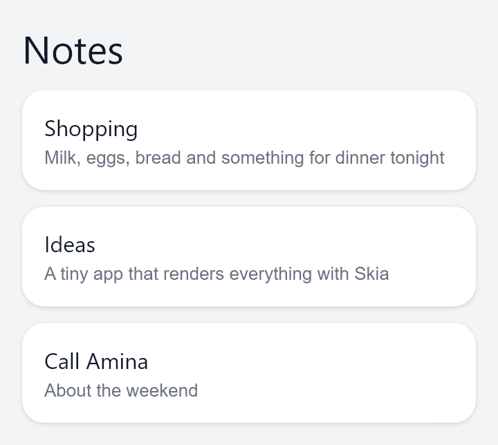
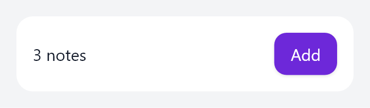
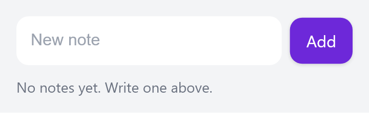
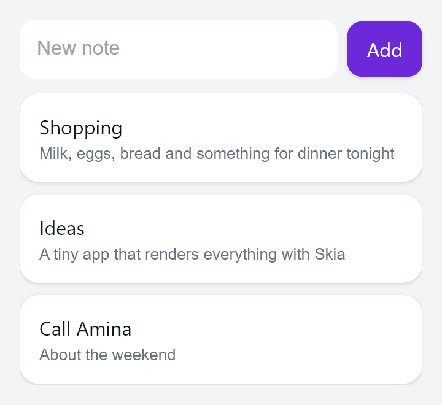

# Tutoriel : votre première application XenoUI

[Documentation](index.md) · [Pourquoi XenoUI ?](why-xenoui.md) · [Installation](installation.md) · [Glossaire](glossary.md) · [FAQ](faq.md)

En 30 minutes environ, vous allez construire une petite application **Notes** : un écran, une carte réutilisable,
de l’état, un champ de texte, une liste et une deuxième page. Chaque étape montre le code et son rendu. Tous les
extraits de cette page sont compilés contre les vraies sources de XenoUI (voir
[`tools/DocSnippets`](https://github.com/Eel2000/XenoUI.Docs/tree/main/tools/DocSnippets)), et les captures sont
produites par le même aperçu léger que celui de votre IDE.

**Il vous faut :** le SDK .NET 11, le workload Android et un émulateur ou un téléphone
([Installation](installation.md)). Vous n’avez jamais écrit d’interface déclarative ? Lisez
[Penser en XenoUI](thinking-in-xenoui.md) *après*, pas avant : ce tutoriel se fait en premier.

## Sommaire

1. [Créer le projet](#étape-0--créer-le-projet)
2. [Étape 1 : un premier écran](#étape-1--un-premier-écran)
3. [Étape 2 : mise en page et composant](#étape-2--mise-en-page-et-composant)
4. [Étape 3 : l’état](#étape-3--létat)
5. [Étape 4 : un champ de texte et une liste](#étape-4--un-champ-de-texte-et-une-liste)
6. [Étape 5 : une deuxième page](#étape-5--une-deuxième-page)
7. [Étape 6 : lancer, prévisualiser, tester](#étape-6--lancer-prévisualiser-tester)
8. [La suite](#la-suite)

---

## Étape 0 : créer le projet

```powershell
dotnet new install XenoUI.Templates
dotnet new xenoui -n NotesApp
cd NotesApp
dotnet build -f net11.0-android
```

Le template fournit `App.cs`, `Pages/HomePage.cs` et `Components/Counter.cs`. Vous allez remplacer le `Body()` de la
page ; le reste est déjà câblé. Si une commande échoue, voir [Installation](installation.md) et
[Dépannage](troubleshooting.md).

## Étape 1 : un premier écran

Une page est une classe qui hérite de `XenoPage` et retourne son interface depuis `Body()`. L’interface se
**construit en appelant des fonctions** : `Column`, `Text`… Chacune retourne un `XenoComponent`, et des
*modificateurs* comme `.Padding(24)` l’affinent.

```csharp
public sealed class HomePage : XenoPage
{
    public override XenoComponent Body() =>
        Column(
            Text("Notes", 28).TextColor(0xFF111827),
            Text("My first XenoUI screen", 14).TextColor(0xFF6B7280)
        ).Gap(6).Padding(24);
}
```


Ce que vous venez d’utiliser :

- `Column(a, b)` empile ses enfants verticalement ; `Row` le fait horizontalement.
- `Text("…", 28)` dessine du texte de 28 dp. Les tailles sont des **unités logiques** (dp), les couleurs `0xAARRGGBB`.
- `.Gap(6)` est l’espace entre enfants, `.Padding(24)` la marge intérieure. Les modificateurs s’enchaînent.

> **Astuce :** ajoutez `[Preview]` sur la page pour voir cet écran dans Visual Studio ou VS Code **sans appareil**
> ([Visual Studio](visual-studio.md), [VS Code](vscode.md)).

## Étape 2 : mise en page et composant

Un **composant** est simplement une fonction qui retourne un `XenoComponent`. Extrayez la carte de note :

```csharp
public static class NoteCard
{
    public static XenoComponent View(string title, string body) =>
        Column(
            Text(title, 16).TextColor(0xFF111827),
            Text(body, 13).TextColor(0xFF6B7280).MaxLines(2, ellipsis: true)
        ).Gap(4).Padding(16)
         .Background(0xFFFFFFFF).CornerRadius(16).Elevation(2);
}
```

Utilisez-la trois fois :

```csharp
public override XenoComponent Body() =>
    Column(
        Text("Notes", 28).TextColor(0xFF111827),
        NoteCard.View("Shopping", "Milk, eggs, bread and something for dinner tonight"),
        NoteCard.View("Ideas", "A tiny app that renders everything with Skia"),
        NoteCard.View("Call Amina", "About the weekend")
    ).Gap(12).Padding(16).CrossAxis(CrossAxisAlignment.Stretch).Background(0xFFF3F4F6);
```



Nouveautés :

- `.Background`, `.CornerRadius` et `.Elevation` stylent un élément ; `.MaxLines(2, ellipsis: true)` tronque un texte long.
- `CrossAxis(Stretch)` donne aux cartes la largeur de l’écran. L’*axe transversal* d’une `Column` est horizontal.
- Un composant est **réutilisable et testable** : modifiez `NoteCard` une fois, toutes les cartes changent. Plus de détails
  dans [Créer un composant](components.md).

## Étape 3 : l’état

Un écran statique ne sert pas à grand-chose. L’**état** est une valeur dont dépend l’interface et qui peut changer.
L’objet d’état de XenoUI est `State<T>`.

```csharp
public sealed class CounterPage : XenoPage
{
    private readonly State<int> _count = UseState(3);          // un champ, jamais dans Body()

    public override XenoComponent Body() =>
        Column(Counter(_count, () => _count.Value++))
            .Padding(16).Background(0xFFF3F4F6).CrossAxis(CrossAxisAlignment.Stretch);
}

public static XenoComponent Counter(State<int> count, Action add) =>
    Row(
        Text($"{count} notes", 16).TextColor(0xFF111827).FlexGrow(1),
        Button("Add", add).Background(0xFF6D28D9).CornerRadius(12).Padding(16, 10)
    ).Gap(12).CrossAxis(CrossAxisAlignment.Center)
     .Padding(16).Background(0xFFFFFFFF).CornerRadius(16);
```



Touchez **Add** : le nombre change **sans reconstruire la page**, car `Text($"{count} notes")` est *lié* à l’état.

Trois règles à retenir (ce sont les erreurs de débutant les plus fréquentes) :

1. **Créez l’état dans un champ**, jamais dans `Body()`. `UseState` retourne un objet neuf à chaque appel : dans
   `Body()`, votre état repartirait de zéro à chaque reconstruction.
2. **L’état descend, les événements remontent.** `Counter` reçoit l’état et une `Action` ; il ne possède ni l’un ni l’autre.
3. **La liaison est explicite.** `Text(count)` ou `$"{count}"` dans `Text(...)` suit les changements ; lire `count.Value`
   dans `Body()` ne les suit pas.

Pour approfondir : [État et reconstruction](state.md).

## Étape 4 : un champ de texte et une liste

Laissons maintenant l’utilisateur écrire des notes. La saisie utilise un **contrôleur** (`UseTextEdit`) qui, comme l’état,
vit dans un champ.

```csharp
public sealed class NotesPage : XenoPage
{
    private readonly TextEditController _input = UseTextEdit();
    private readonly List<Note> _notes = new();
    private readonly LazyListState _list = UseLazyList();
    private int _nextId;

    public override XenoComponent Body() =>
        Column(
            Row(
                TextField(_input, "New note").Height(48).FlexGrow(1),
                Button("Add", Add).Background(0xFF6D28D9).CornerRadius(12).Padding(16, 12)
            ).Gap(8).CrossAxis(CrossAxisAlignment.Center),
            _notes.Count == 0
                ? Text("No notes yet. Write one above.", 14).TextColor(0xFF6B7280)
                : LazyColumn(_notes, NoteRow, key: note => note.Id, state: _list)
                    .FlexGrow(1).CrossAxis(CrossAxisAlignment.Stretch)
        ).Gap(12).Padding(16).Background(0xFFF3F4F6).CrossAxis(CrossAxisAlignment.Stretch);

    private XenoComponent NoteRow(Note note) =>
        NoteCard.View(note.Title, note.Body).Margin(Spacing.Only(bottom: 10));

    private void Add()
    {
        string text = _input.Value.Text.Trim();
        if (text.Length == 0) return;
        _notes.Insert(0, new Note(_nextId++, text, "Tap to read"));
        _input.SetText("");
        Rebuild();                                              // la liste a changé de forme
    }
}

public sealed record Note(int Id, string Title, string Body);
```

L’état vide, puis l’écran avec des notes :





Nouveautés :

- `TextField(controller, placeholder)` est un champ dessiné par XenoUI ; le **clavier natif** sert à la saisie.
- `LazyColumn(items, fonction, key: …)` est une **liste virtualisée** : elle ne construit que ce qui est visible. La `key`
  identifie chaque élément : donnez-en toujours une (un identifiant, jamais l’index).
- `Rebuild()` rappelle `Body()`. Ici la **forme** de l’écran a changé (un nouvel élément), donc une reconstruction est
  juste. Quand seule une *valeur* change, liez plutôt un `State` (étape 3).
- Les notes vivent dans un **champ** (`_notes`), donc elles survivent à la reconstruction.

> **Règle pratique :** un `State` d’abord, `Rebuild()` seulement quand la structure change.

## Étape 5 : une deuxième page

Les pages sont enregistrées une fois dans `App.OnStart`, et l’on passe de l’une à l’autre avec `Navigate`. Une page peut
recevoir un argument typé.

```csharp
public sealed record NoteArgs(Note Note);

public sealed class NoteDetailPage : XenoPage<NoteArgs>, ITopBarPage
{
    private Note? _note;

    public override void OnNavigatedTo(NoteArgs arguments) { _note = arguments.Note; Rebuild(); }

    public string TopBarTitle => "Note";
    public TopBarOptions? TopBarOptions => new()
    {
        OnNavigation = GoBack,
        Background = 0xFFFFFFFF,
        Foreground = 0xFF111827,
        Elevation = 0
    };

    public override XenoComponent Body() =>
        Column(
            Text(_note?.Title ?? "", 24).TextColor(0xFF111827),
            Text(_note?.Body ?? "", 16).TextColor(0xFF374151),
            Button("Back", GoBack).Background(0xFF6D28D9).CornerRadius(12).Padding(16, 12)
        ).Gap(12).Padding(24).Background(0xFFF3F4F6).CrossAxis(CrossAxisAlignment.Start);
}

public sealed class NotesApp : XenoApp
{
    public override void OnStart()
    {
        Page<NotesPage>();
        Page<NoteDetailPage>();
        Navigate<NotesPage>();
    }
}
```

Pour ouvrir le détail depuis une note, appelez (dans `NotesPage`) :

```csharp
Navigate<NoteDetailPage, NoteArgs>(new NoteArgs(note), NavTransitions.SlideHorizontal());
```

- `Page<T>()` crée chaque page **une seule fois** ; ses champs gardent leur valeur quand on s’en va puis revient.
- `GoBack()` dépile la page ; le bouton Retour du système fait la même chose.
- `ITopBarPage` donne à la page une barre du haut fixe. `NavTransitions.SlideHorizontal()` anime le changement.

Plus de détails : [Cycle de vie](lifecycle.md), [Navigation](navigation-scaffold.md).

## Étape 6 : lancer, prévisualiser, tester

**Lancer sur appareil ou émulateur**

```powershell
xeno devices
xeno run --project NotesApp.csproj --device <id> --framework net11.0-android
```

**Prévisualiser sans appareil.** Ajoutez `[Preview]` à une méthode statique sans paramètre qui retourne un composant :

```csharp
[Preview("Note card")]
private static XenoComponent CardPreview() => NoteCard.View("Shopping", "Milk, eggs and bread");
```

**Tester le rendu en headless.** Le même aperçu fonctionne dans un test unitaire ([Tester](testing.md)) :

```csharp
var image = PreviewRenderer.Render(() => NoteCard.View("Shopping", "Milk"), scale: 1f);
Assert.True(image.Succeeded);
```

Si quelque chose ne va pas : [Déboguer l’interface](debugging.md) et [FAQ](faq.md).

## La suite

Vous connaissez maintenant toute la boucle : **des fonctions construisent l’interface, l’état la pilote, `Rebuild()`
gère la structure, les pages et `Navigate` font circuler.** Ensuite :

| Je veux… | Lire |
|---|---|
| Comprendre le modèle derrière | [Penser en XenoUI](thinking-in-xenoui.md) |
| Charger des données depuis le réseau | [Effets de bord et travail asynchrone](side-effects.md), [Architecture d’une application](app-architecture.md) |
| Styler et animer | [Personnaliser](customization.md), [Animations](animations.md) |
| Voir tous les composants fournis | [Catalogue des composants](component-catalog.md) |
| Chercher un type ou une méthode | [Référence d’API](reference/index.md) |
| Voir une application complète | [Apprendre par le SampleApp](sample-app.md) |
| La publier | [Publier votre application](publishing.md) |
| Je viens de Jetpack Compose | [De Jetpack Compose à XenoUI](compose-comparison.md) |
