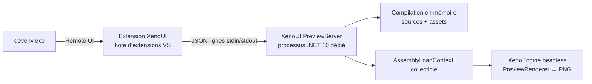

# Visual Studio — templates et XenoUI Preview

[Documentation](index.md) · [Guide développeur](developer-guide.md) · [Xeno.SDK](xeno-sdk.md) · [Architecture du tooling](architecture/tooling-and-platforms.md)

XenoUI fournit deux éléments pour Visual Studio :

- **des templates** `dotnet new`, visibles dans *Créer un projet* et *Ajouter › Nouvel élément* : « XenoUI App », « XenoUI Page » et « XenoUI Component » ;
- **l’extension XenoUI Preview** : une fenêtre d’outil qui affiche, pendant la frappe, les composants et pages marqués `[Preview]`, comme les aperçus Compose d’Android Studio. Elle ne compile pas le projet par MSBuild et ne lance ni l’application, ni un émulateur.

> **Statut : preview locale `0.1.0-preview.5`.** Rien n’est publié sur nuget.org ni sur le Marketplace. Prérequis : Visual Studio 2022 17.14 ou Visual Studio 2026, et le runtime .NET 10 (installé avec le SDK .NET 10) pour le serveur de rendu. Templates, compilation en mémoire et rendu sont couverts par des tests ; l’affichage de la fenêtre dans l’IDE reste à valider avant publication.

## Installer

En bref, depuis la racine du dépôt :

```powershell
./tools/Pack-XenoSdk.ps1 -IncludeMedia -IncludeVisualStudio
dotnet new install ./artifacts/packages/XenoUI.Templates.0.1.0-preview.5.nupkg
```

Puis, Visual Studio fermé, double-cliquez `artifacts/visualstudio/XenoUI.VisualStudio.0.1.0-preview.5.vsix`. Les templates apparaissent dans Visual Studio au prochain démarrage.

Prérequis, installation depuis nuget.org, `VSIXInstaller` en ligne de commande, mise à jour, désinstallation et dépannage : [guide d’installation](installation.md#7-installer-le-previewer-extension-visual-studio).

## Créer un projet

Dans Visual Studio : *Créer un projet* › filtre « XenoUI » › **XenoUI App**. En ligne de commande :

```powershell
dotnet new xenoui -n MyApp --feed D:/chemin/XenoUI/artifacts/packages
```

| Option | Effet |
|---|---|
| `--feed <dossier>` | Génère un `NuGet.config` qui ajoute le feed local ; indispensable tant que le SDK n’est pas publié |
| `--ios` | Ajoute `net10.0-ios` (workload iOS requis ; le build de l’app exige macOS et Xcode) |
| `--appId com.example.myapp` | Identifiant Android/iOS ; par défaut `com.companyname.<nom>` |
| `--sdkVersion <version>` | Version de `Xeno.SDK` épinglée dans `global.json` ; par défaut celle du pack de templates |

Le projet contient `App.cs`, `Pages/HomePage.cs` et `Components/Counter.cs`, chacun avec des `[Preview]`.

Ajouter un élément : *clic droit sur un dossier › Ajouter › Nouvel élément* › **XenoUI Page** ou **XenoUI Component**, ou :

```powershell
dotnet new xenoui-page -n ProfilePage -o Pages
dotnet new xenoui-component -n Avatar -o Components
```

Le namespace suit le `RootNamespace` du projet restauré ; une page doit encore être enregistrée dans `App.OnStart` avec `Page<ProfilePage>()`.

## Écrire des aperçus

`[Preview]` (namespace `XenoUI.Core.Preview`) s’applique à :

- une méthode **statique, sans paramètre**, qui retourne `XenoComponent` — aperçu de composant, aussi large que l’appareil et aussi haut que son contenu ;
- une **`XenoPage`** avec un constructeur public sans paramètre — aperçu plein écran.

```csharp
using XenoUI.Core.Preview;

public static class ProfileCard
{
    public static XenoComponent View(string name, string role) =>
        Column(Text(name, 18), Text(role, 13).TextColor(0xFF6B7280))
            .Gap(4).Padding(16).Background(0xFFF3F4F6).CornerRadius(16);

    [Preview("Carte")]
    [Preview("Carte (Pixel, RTL)", Device = "pixel", RightToLeft = true)]
    private static XenoComponent Preview() => View("Amina", "Designer");
}
```

| Propriété | Défaut | Rôle |
|---|---|---|
| `Name` | nom du membre | Titre affiché |
| `Device` | composant : largeur `android` ; page : `android` | `android`, `pixel`, `iphone`, `iphone-se`, `foldable`, `tablet` ; force aussi la hauteur de l’appareil |
| `Width`, `Height` | appareil | Taille logique en dp ; `Height = 0` sur un composant = hauteur du contenu |
| `RightToLeft` | `false` | Mise en page de droite à gauche |
| `Background` | `0xFFFFFFFF` | Couleur ARGB derrière l’aperçu |
| `Group` | — | Libellé de regroupement affiché sous le titre |
| `App` | l’unique `XenoApp` de l’assembly | Classe d’application d’une page, quand l’assembly en déclare plusieurs |

L’attribut n’a aucun effet à l’exécution. Les assets (`Assets/**`) et les polices sont chargés comme dans l’application.

### Pages et application en aperçu

**Aucune application n’est lancée.** Pour une page, l’aperçu construit seulement l’objet de votre classe `App` (constructeur et champs), puis y attache la page : `Application` et les casts `((App)Application).…` fonctionnent. Ensuite :

| Exécuté | Jamais exécuté |
|---|---|
| constructeur de l’`App`, puis `OnPreview()` | `OnStart`, `OnForeground`, `OnBackground` |
| constructeur de la page, `OnCreate()`, `Body()`, puis `OnDestroy()` | `OnActivated`, `OnNavigatedTo` (aperçu statique) |
| actions postées au dispatcher UI pendant `OnCreate`/`Body` (avant l’image) | navigation : `Navigate`, `GoBack` et le tiroir sont sans effet |

`Native` fournit des remplaçants d’aperçu : dispatcher UI, dimensions de l’appareil (`IWindowMetricsCapability`), sens de lecture, préférence de mouvement réduit, presse-papiers en mémoire. **Média, vidéo et clavier sont absents** : `Native.Get<T>()` renvoie `null` (gérez ce cas comme sur un hôte qui ne les fournit pas), `Native.Require<T>()` lève une erreur.

Ce que vos pages lisent et qu’`OnStart` prépare (modèles, services) se prépare pour l’aperçu dans `OnPreview()`, sans réseau ni navigation :

```csharp
public sealed class App : XenoApp
{
    internal ArticleDetailsModel ArticleDetails { get; private set; } = null!;

    public override void OnStart() { ArticleDetails = CreateDetails(); /* pages, navigation… */ }

    protected override void OnPreview() => ArticleDetails = CreateDetails();
}
```

`Application.IsPreview` vaut `true` en aperçu : testez-le pour éviter un appel réseau ou un effet de bord dans du code partagé. Quand une page échoue pour une de ces raisons (état préparé dans `OnStart`, cast vers une autre app, capacité absente), la fenêtre affiche sous l’erreur un indice indiquant la correction.

## Utiliser la fenêtre XenoUI Preview

*Affichage › Autres fenêtres › XenoUI Preview* (ou *Extensions › XenoUI Preview*, raccourci **Ctrl+Alt+P**). La fenêtre s’ancre à droite de l’éditeur et suit le fichier C# actif :

- elle affiche les `[Preview]` **déclarés dans ce fichier** ; le texte non sauvegardé est pris en compte ;
- chaque modification relance le rendu après 350 ms d’inactivité ;
- en cas d’erreur de compilation, les erreurs sont listées en haut et le dernier rendu valide reste affiché ;
- une exception dans un aperçu s’affiche à sa place, sans affecter les autres ;
- `−` / `+` règlent le zoom (100 % = taille du téléphone en dp), `⟳` force un nouveau rendu.

Rien n’est calculé tant que la fenêtre est masquée.

## Fonctionnement et isolation



- **L’extension** est *out-of-process* (VisualStudio.Extensibility) : elle ne s’exécute jamais dans `devenv.exe`.
- **Le serveur de rendu** est un processus distinct possédé par l’extension. Il lit le `.csproj` sans évaluer MSBuild, compile en mémoire avec Roslyn les sources partagées du projet (hors `bin`, `obj`, `Platforms/`) avec les usings implicites de `Xeno.SDK` et les générateurs de source du framework, embarque les assets, charge l’assembly dans un contexte collectible, rend chaque aperçu avec `PreviewRenderer`, puis décharge tout.
- **Runtime du projet** : les aperçus sont compilés et rendus avec la même version de XenoUI que le projet, jamais avec une copie figée dans l’extension :
  1. projet situé dans un clone XenoUI (le SampleApp, un contributeur) : `XenoUI.Core`, `StandardLibrary` et `Media` sont compilés en mémoire depuis les sources du clone, puis gardés en cache tant qu’aucun fichier ne change ; une nouvelle API du framework est donc visible sans build ;
  2. sinon, les packages de la version `Xeno.SDK` du projet (`Sdk="Xeno.SDK/x"` ou `global.json`), lus dans le cache NuGet ;
  3. à défaut (projet jamais restauré), le runtime embarqué dans l’extension, avec un avertissement dans la fenêtre : lancez un build ou `dotnet restore`.

  Le runtime utilisé est affiché dans la ligne d’état. Comme le build, la compilation utilise C# 14 et les assemblies de référence des dépendances (SkiaSharp, RichTextKit).
- **Léger** : priorité basse, GC workstation non concurrent, `ConserveMemory`, plafond de tas de 768 Mo, compilation Roslyn mono-cœur, aucune activité au repos (lecture bloquante de stdin). Une requête identique à la précédente répond en quelques dizaines de millisecondes sans recompiler. Le serveur s’arrête seul après 15 minutes d’inactivité ou à la fin de l’hôte d’extensions, et redémarre à la demande.
- **Robuste** : un aperçu qui dépasse 10 s (boucle infinie) arrête le serveur ; un plantage ou une réponse absente au bout de 45 s est signalé dans la fenêtre et le serveur est relancé à la modification suivante. L’IDE n’est jamais touché.

Ordres de grandeur mesurés sur le SampleApp (poste de développement, Release) : premier rendu ~13 s quand le runtime est compilé depuis les sources du clone, ~5 s depuis les packages ; puis ~1,6 s de compilation et ~0,7 s de rendu par modification ; ~150 Mo de mémoire de travail.

Diagnostic sans Visual Studio :

```powershell
dotnet tools/visualstudio/XenoUI.PreviewServer/bin/Release/net10.0/XenoUI.PreviewServer.dll --render samples/SampleApp/Design/Ui.cs --out ./preview-out
```

La commande imprime la réponse JSON et conserve les PNG dans `--out`.

## Limites

- Seuls les fichiers du dossier du projet sont compilés : les `ProjectReference`, `PackageReference` additionnels et `<Compile Include>` externes ne sont pas encore résolus.
- En mode packages, SkiaSharp est celui de l’extension : un projet qui imposerait une version de SkiaSharp plus récente que celle du runtime peut échouer en aperçu.
- Les directives `#if ANDROID` / `#if IOS` sont évaluées comme fausses ; `XENO_PREVIEW` est défini.
- Les aperçus sont statiques : pas encore de mode interactif (clic, scroll, saisie) ni d’animation.
- Le code des constructeurs (`App`, pages), d’`OnPreview`, `OnCreate` et `Body` s’exécute réellement dans le serveur de rendu : un appel réseau y partirait aussi. Protégez-le avec `Application.IsPreview`. Si du code d’aperçu garde des ressources vivantes (timers, requêtes), le serveur se recycle de lui-même après une vingtaine de rendus.
- Le contenu chargé dans `OnActivated` ou `OnNavigatedTo` n’apparaît pas : l’aperçu montre l’état initial de la page.
- Seuls les `[Preview]` du fichier actif sont affichés ; le changement d’onglet est détecté à la première interaction dans l’éditeur (ou avec `⟳`).
- Le serveur est lancé avec la commande `dotnet` du `PATH` ; sans runtime .NET 10, la fenêtre affiche l’erreur de démarrage.
