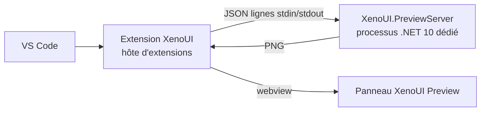

# Visual Studio Code — XenoUI Preview, projets, pages et composants

[Documentation](index.md) · [Installation](installation.md) · [Visual Studio](visual-studio.md) · [Guide développeur](developer-guide.md)

L’extension **XenoUI** pour Visual Studio Code apporte sur macOS, Linux et Windows ce que l’extension Visual Studio apporte sous Windows :

- **XenoUI Preview** : un panneau qui affiche pendant la frappe les composants et pages marqués `[Preview]`, avec le même serveur de rendu que Visual Studio ;
- **la création de projets, pages et composants** à partir des templates `XenoUI.Templates` ;
- la sélection d’un appareil Android et le lancement de l’application (outil `xeno`).

> **Statut : pré-version `{{ vscode_extension_version }}` publiée sur le [Marketplace VS Code](https://marketplace.visualstudio.com/items?itemName=EliezerBwana.xenoui).** L’extension a son propre numéro de version ; elle crée des projets avec `Xeno.SDK` `{{ xeno_version }}`.
>
> Prérequis : VS Code 1.95+ et le SDK .NET 10 (l’aperçu compile avec ses assemblies de référence ; la création de projets utilise `dotnet new`). Le serveur, le client du protocole, les templates et la création d’éléments sont testés sur macOS, et le paquet Windows sous Windows ; le panneau sous Linux reste à valider.

## Installer

Dans VS Code : vue *Extensions* (**Cmd/Ctrl+Shift+X**), recherchez **XenoUI** (éditeur *EliezerBwana*), puis **Installer**. Seule une pré-version existe pour l’instant ; si VS Code propose les deux, choisissez *Installer la pré-version*. En ligne de commande :

```bash
code --install-extension EliezerBwana.xenoui --pre-release
```

VS Code installe automatiquement le paquet de votre plateforme (`win32-x64`, `win32-arm64`, `darwin-x64`, `darwin-arm64`, `linux-x64`, `linux-arm64`, `alpine-x64`). Les mises à jour arrivent par le Marketplace. Désinstallation : `code --uninstall-extension EliezerBwana.xenoui`.

## Créer un projet, une page, un composant

| Commande (palette **Cmd/Ctrl+Shift+P**) | Effet |
|---|---|
| **XenoUI: New Project…** | Nom, dossier parent, plateformes (Android, iOS), source du package `Xeno.SDK`, puis `dotnet new xenoui` ; propose d’ouvrir le projet ou de l’ajouter à l’espace de travail |
| **XenoUI: New Page…** | `dotnet new xenoui-page` dans le dossier choisi, puis ouvre le fichier ; rappelle d’enregistrer la page avec `Page<T>()` dans `App.OnStart` |
| **XenoUI: New Component…** | `dotnet new xenoui-component` dans le dossier choisi, puis ouvre le fichier |
| **XenoUI: Install Templates** | Réinstalle les templates fournis avec l’extension |

Les commandes de page et de composant sont aussi dans l’explorateur : *clic droit sur un dossier › XenoUI*. Le dossier doit se trouver dans un projet XenoUI. Le namespace suit celui du projet (`RootNamespace`, sinon le nom du `.csproj`) suivi des sous-dossiers, comme dans Visual Studio : une page créée dans `Features/Cart` du projet `Shop` est dans `Shop.Features.Cart`.

Les templates sont installés automatiquement au premier usage s’ils manquent, depuis le package inclus dans l’extension. La version de `Xeno.SDK` inscrite dans `global.json` est celle de l’extension. À l’étape « source du package `Xeno.SDK` », choisissez **nuget.org only** : le SDK y est publié et aucun `NuGet.config` n’est nécessaire.

## Utiliser XenoUI Preview

Ouvrez un fichier C# d’un projet `Xeno.SDK`, puis **XenoUI: Open Preview** (**Cmd+Alt+P** / **Ctrl+Alt+P**, ou l’icône d’aperçu en haut de l’éditeur). Le panneau s’ouvre à côté de l’éditeur et suit le fichier C# actif :

- il affiche les `[Preview]` **déclarés dans ce fichier**, texte non sauvegardé compris ;
- chaque modification relance le rendu après 350 ms d’inactivité ;
- en cas d’erreur de compilation, les erreurs sont listées (un clic ouvre la ligne) et le dernier rendu valide reste affiché ;
- une exception dans un aperçu s’affiche à sa place, avec un indice de correction quand l’échec est typique ;
- `−` / `+` règlent le zoom (100 % = taille du téléphone en dp), **Refresh** force un nouveau rendu.

Rien n’est calculé tant que le panneau est masqué. L’attribut `[Preview]`, les pages en aperçu et `OnPreview()` sont décrits dans [Visual Studio › Écrire des aperçus](visual-studio.md#écrire-des-aperçus) : le comportement est identique.

| Réglage | Défaut | Rôle |
|---|---|---|
| `xenoui.previewScale` | `2` | Pixels par dp des images |
| `xenoui.previewServerPath` | vide | Chemin d’un `XenoUI.PreviewServer.dll` à utiliser à la place du serveur inclus |
| `xenoui.cliPath` | `xeno` | Outil `xeno` utilisé pour la liste des appareils et le lancement |

## Fonctionnement



L’extension parle au **même serveur de rendu** que Visual Studio, avec le même protocole : compilation en mémoire, runtime XenoUI du projet (packages du cache NuGet, sinon runtime embarqué avec un avertissement), contexte collectible, isolation et redémarrage automatique. Voir [Visual Studio › Fonctionnement et isolation](visual-studio.md#fonctionnement-et-isolation).

Spécificités de VS Code :

- chaque `.vsix` est propre à une plateforme (`darwin-arm64`, `darwin-x64`, `linux-x64`, `linux-arm64`, `alpine-x64`, `win32-x64`, `win32-arm64`) et ne contient que les bibliothèques natives SkiaSharp de celle-ci ;
- les images sont écrites dans un dossier temporaire propre à la fenêtre (`XenoUI.Preview/vscode-<pid>`), seul dossier lisible par le panneau ;
- le serveur s’arrête avec la fenêtre VS Code (surveillance du processus parent) ou après 15 minutes d’inactivité.

Mesuré sur une application d’exemple (macOS, Intel) : premier rendu d’environ 10 s, puis ~0,9 s de compilation et ~0,2 s de rendu par modification.

## Limites

- Celles du serveur de rendu : voir [Visual Studio › Limites](visual-studio.md#limites).
- Le serveur est lancé avec la commande `dotnet` du `PATH` ; sans runtime .NET 10, le panneau l’indique.
- Les commandes de création utilisent `dotnet new` : un projet Android se construit ensuite avec le workload Android, un projet iOS exige macOS et Xcode.
- Le lancement sur appareil (barre d’état, **XenoUI: Run on Selected Device**) ne concerne que les projets Android.
